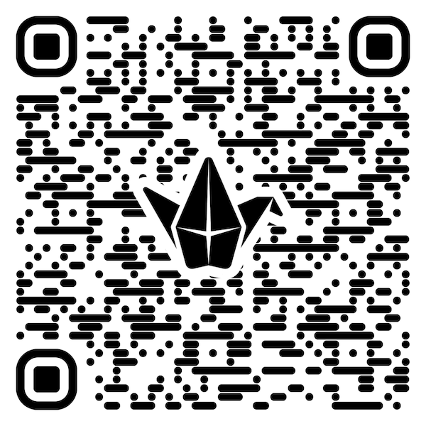

<!-- footer: <a href="https://images.unsplash.com/photo-1601698462586-4831feb10177?q=80&w=1288&auto=format&fit=crop&ixlib=rb-4.1.0&ixid=NHwxMjA3fDA%3D" target="_blank">Photo</a> by Jayson Hinrichsen on Unsplash. -->

# Digital Humanities / Data Management / Informatica per i Beni Culturali (2026/2027)

## 00. Il corso

➡️ Mail: [laurent.fintoni2@unibo.it](mailto:laurent.fintoni2@unibo.it)
➡️ ORCID: [0000-0002-8656-4602](https://orcid.org/0000-0002-8656-4602)
➡️ Sito: [laurenf.fintoni2](https://www.unibo.it/sitoweb/laurent.fintoni2)

---
<!-- footer: "" -->

### Hello, hi 👋🏻

Sono... 

➡️ francese, italiano, statunitense.
➡️ _incarico di ricerca_ presso il FICLIT.
➡️ mi occupo di patrimonio culturale digitale, archivi, web semantico e organizzazione della conoscenza.

In un altra vita... 

➡️ Giornalista specializzato in musica e cultura (scritto un libro e altre cose) tra varie 'professione'. 
➡️ Vissuto in Los Angeles, New York City, London, Tokyo, Milano, e Bruxelles. 

---
<!-- footer: "" -->

### Chi siete? 

Inquadrate il codice QR (o cliccate sul link sottostante) e facciamo breve introduzione di tutti.

➡️ Link: https://shorturl.at/42XCJ 

---

### Organizzazione del corso: _cos'è_

#### Obiettivi

Avviare alla vostra conoscenza delle Digital Humanities, fornendo competenze in materia di progettazione di risorse di patrimonio culturale digitale. Quindi: trovare, descrivere, gestire e pubblicare dati. 

#### Temi

Digital Humanities, Data Management, Open Science, Preservation, Generative AI  

#### Risultati

Progetti _vostri_ che testimoniano le competenze acquisite.

---

<!-- footer: Spesso in una slide troverete un riquadro di questo tipo, contenente la fonte bibliografica e/o il credit per le immagine. <a href="https://unsplash.com/photos/a-drawing-of-a-woman-reading-a-book-_lM_cGcM3F8" target="_blank">Image source</a>.-->

### Organizzazione del corso: _cos'è_

I testi e fonte bibliografiche sono un accompagnamento alle slide delle lezioni. Non imparanoiatevi con il fatto di dover studiare tutto e saperlo "a memoria". Sono qua per permettervi di approfondire nel vostro tempo.

Dove possibile i materiali sono gratuiti e pubblicati online.  

La presenza non è obbligatoria ma consigliata. Anche consigliato (vivamente) di portare un computer o un tablet per le parte pratiche del corso. 

---
<!-- footer: <a href="https://unsplash.com/photos/an-angel-with-wings-sits-on-a-rock-mZpRhcGixKE" target="_blank">Image source</a>.-->

### Organizzazione del corso: _cos'è_

Il corso è pensato per stimolare il pensiero critico, non l’apprendimento meccanico. Ho bisogno che collaboriate con me, che vi impegniate e che mi comunichiate eventuali difficoltà, ma anche idee o suggerimenti. 

Non sono qui per farvi fallire. Sono qui per condividere competenze e conoscenze (che spero siano) interessanti e utili. 

---
<!-- footer: <a href="https://unsplash.com/photos/a-tall-clock-tower-overlooks-a-busy-harbor-with-sailboats-DqtFZ2SGQXQ" target="_blank">Image source</a>.-->

### Organizzazione del corso: _quando_ e _dove_

| Giorno | Orario | Luogo |
| ------ | ------- | ----- |
| Lunedì | 16:00 - 18:00 | AULA II, Palazzo Verdi |
| Giovedì | 09:00 - 11:00 | Online o AULA V, Palazzo Verdi (TBC) |
| Venerdì | 16:00 - 18:00  | LAB. INFORMATICO, Palazzo Corradini |

---
<!-- footer: <a href="https://unsplash.com/photos/a-man-flying-through-the-air-on-top-of-a-boat-bidoZaK4ZIE" target="_blank">Image source</a>.-->

### Organizzazione del corso: _come_

* 15 lezioni;
* 4/5 di queste saranno online, giovedì (TBC);
* Dal 09 novembre al 14 dicembre, 3 volte a settimana;
* 2 ore per lezione;
* Parte teorica e parte pratica per ogni lezione: puntiamo a circa meta teoria e meta pratica (TBC);
* Venerdì è immaginato più come workshop, da capire insieme; 
* 1 pausa di 15 minuti (giovedì sarà a inizio lezione).

---
<!-- footer: ""-->

### Organizzazione del corso, Part 1: _Trovare_

**_N.B.: Qualcosa potrebbe cambiare!_**

| Lezione | Titolo | Teoria | Pratica | Data |
| ------- | ------ | ------ | ------- | ---- |
| 01 | Introduction | Course, Digital Humanities | Ice breakers | 09/11 |
| 02 | DH Projects | Project as basic unit | Reverse engineer, Diaries | 12/11 |
| 03 | Workshop | Values, Labour, Credit | Groups, GitHub, Markdown | 13/11 |
| 04 | Finding Things | Research & Data Literacy, AI Literacy, Collections as Data | Data sources, GenAI outputs, IIIF manifests | 16/11 |

---
<!-- footer: ""-->
### Organizzazione del corso, Part 2: _Descrivere_

| Lezione | Titolo | Teoria | Pratica | Data |
| ------- | ------ | ------ | ------- | ---- |
| 05 | Describing Things | Data & Metadata, Schemas | Describe objects, Tag set | 19/11 |
| 06 | Workshop | Planning, rights, ethics | Project demos, DMP | 20/11 |
| 07 | Interpreting Things | Data modelling, databases | Spreadsheet databases | 23/11 |
| 08 | Linked Open Data | LOD, RDF, Authority Files | Wikidata, SPARQL | 26/11 |
| 09 | Workshop | Data Cleaning | OpenRefine | 27/11 |

---
<!-- footer: ""-->
### Organizzazione del corso, Part 3: _Gestire, Presentare_

| Lezione | Titolo | Teoria | Pratica | Data |
| ------- | ------ | ------ | ------- | ---- |
| 10 | Working w/ Text | Analysis, Encoding, Transcription | Text tools | 30/11 |
| 11 | Maps & Space | GIS, Geocoding | Mapping tools | 03/12 |
| 12 | Collections & Prototyping | Interface, Data Mgmt | Collection tools | 04/12 |
| 13 | Visualization | IIIF, 3D, Data Viz | IIIF, RAWGraphs | 10/12 |

---
<!-- footer: ""-->
### Organizzazione del corso, Part 4: _Condividere_

| Lezione | Titolo | Teoria | Pratica | Data |
| ------- | ------ | ------ | ------- | ---- |
| 14 | Open Science | FAIR, CARE, PIDs, Sustainability | README, Zenodo | 11/12 |
| 15 | Workshop | Evaluation, Sharing | Project feedback | 14/12 |

---
<!-- footer: <a href="https://unsplash.com/photos/man-in-historical-attire-writing-at-a-desk-pxKyrrPkz74" target="_blank">Image source</a>.-->

### Esame finale

#### Cos'è? 

➡️ Realizarre un **prototipo funzionante** di un oggetto digitale che illustri la gestione dei dati relativi al patrimonio culturale, scegliendo uno dei tre ambiti seguenti: mappe (visualizzazione), collezioni (documentazione) o testi (analisi).

➡️ Inteso per **gruppi** (di massimo 3 persone), ma anche possibile **individualmente**. 

➡️ Potete confrontarvi tra di voi e chiedere chiarimenti al sottoscritto. 

---
<!-- footer: <a href="https://unsplash.com/photos/woman-sitting-on-chair-reading-book-sketch-TWavMkqC_cc" target="_blank">Image source</a>.-->

### Esame finale  

#### Preparazione

Non spaventatevi: avremo modo di esercitarci e capire assieme i vari passaggi da seguire per realizzare un buon progetto (e portare a casa un 30 e lode).

➡️ Nelle sessioni pratiche, lavoreremo assieme su i vari elementi che sono requisiti e farremo anche sperimenti con strumenti e metodi da usare collegati alla parte teorica.

---
<!-- footer: <a href="https://unsplash.com/photos/a-painting-of-a-group-of-people-sitting-around-a-table-_Za_OwL1eys" target="_blank">Image source</a>.-->

### Esame finale  

#### Preparazione

In questa prima parte del corso esamineremo insieme i vari requisiti dell'esame. 

Ciò che questo corso richiede è che cerchiate di lavorare al progetto man mano che procediamo, anche se si tratta solo di idee che potreste modificare prima dell'esame. Vi fornirò inoltre spunti e dati su cui potrete lavorare durante pratica, ma se iniziate già a pensare a cosa vi interessa e usarlo, è meglio. 

---
<!-- footer: <a href="https://unsplash.com/photos/an-old-man-teaches-children-at-a-desk-uQaFne9pg78" target="_blank">Image source</a>.-->

### Esame finale  

#### Valutazione

Verrano valutati sia il contributo del gruppo nel suo complesso sia il contributo individuale di ciascun membro del gruppo e la loro comprensione del lavoro durante un colloquio orale. 

Valutazioni e punteggio sono quelli che trovate sulla pagina del corso, e ne parleremo più nel dettaglio nella seconda lezione.

---
<!-- footer: <a href="https://unsplash.com/photos/man-in-suit-writing-in-a-notebook-821h6vwv4J4" target="_blank">Image source</a>.-->

### Valutazione del corso

⚠️ Ad un certo punto, anche voi dovrete valutare me!

⚠️ Il questionario viene fatto all'inizio di una lezione (una delle ultime, probabilmente), solo da chi è presente.

⚠️ Vi prego di fare valutazioni quanto più corrette (umanamente e professionalmente) possibili, in modo da farmi capire cosa è andato bene e cosa, invece, no.

---
<!-- footer: <a href="https://unsplash.com/photos/women-looking-at-their-reflections-in-water-MFHOgLjEMN0" target="_blank">Image source</a>.-->

### Riflessioni utili

➡️ Affrontare cose nuove è sempre difficile, quindi non preoccupatevi se il corso può sembrare complesso. 

➡️ È pensato per farvi crescere, non fallire, per introdure e confrontare tematiche forse nuove.

➡️ Se fatte in buona fede, **non esistono domande stupide**, quindi **fatele**. 

➡️ A seconda della domanda, potrei aver bisogno di tempo per darvi una risposta sensata, quindi - nel caso - abbiate un po’ di pazienza.

---
<!-- footer: ""-->

### Uso di GenAI/LLM

L’uso dell’IA generativa (GenAI) e dei modelli di linguaggio (LLM) – con cui si intendono agenti, chatbot e altre interfacce in cui è possibile utilizzare prompt testuali per produrre un output – durante il corso a scopo di supporto didattico è consentito in base alla policy esistente di Unibo (ad esempio, supporto alla ricerca, sintesi di informazioni, ecc.). 

L’uso della GenAI/LLM per l'esame è consentito, ma sarà soggetto a linee guida specifiche. È importante sottolineare che viene incoraggiato anche il non utilizzo. La scelta è vostra. 

Durante la prima parte del corso tratteremo i dettagli relativi a questo - perché e come - e le guidelines. 

#### Registrazioni, Materiali

Tutte le lezione verano registrate e condivise tramite Virtuale, insieme a i materiali. Per chi vuole registrare separatamente, vi chiedo solo di informami all'inizio della lezione.

---
<!-- footer: <a href="https://unsplash.com/photos/stylized-portrait-of-a-woman-in-a-floral-shawl-VHpRTFlHPtg" target="_blank">Image source</a>.-->

### Sondaggio introduttivo + break 

➡️ https://forms.cloud.microsoft/e/zUvqbTBF7q 

➡️ Dovete fare login con credenziali Unibo. 

➡️ Le vostre risposte mi aiutano a capire meglio chi siete e come proporre e gestire le parte pratiche del corso.

➡️ Una volta fatto, facciamo break per 15 minuti. 

---

# Digital Humanities / Data Management / Informatica per i Beni Culturali (2026/2027)

## 00. Il corso ✅

### Thank you 🙏🏻 
