<!-- _paginate: false -->
<!-- _footer: Image: Unsplash. <a href="https://unsplash.com/photos/books-in-shelves-in-room-X_j3b4rqnlk" target="_blank">Source</a>. -->

# Digital Humanities / Data Management / Informatica per i Beni Culturali (2026/2027)

## 01. Introduction to DH

➡️ Mail: [laurent.fintoni2@unibo.it](mailto:laurent.fintoni2@unibo.it)
➡️ ORCID: [0000-0002-8656-4602](https://orcid.org/0000-0002-8656-4602)
➡️ Sito: [laurent.fintoni2](https://www.unibo.it/sitoweb/laurent.fintoni2)

---

<!-- _class: impact -->

###### Part 1
# **what are** the DH
## (or when humanists met computers)

---

<!-- _class: steps -->
<!-- _paginate: false -->
<!-- _footer: 1/ Kirschenbaum, M. (2010). What Is Digital Humanities and What’s It Doing in English Departments? In M. K. Gold (Ed.), *Debates in the Digital Humanities*. University of Minnesota Press. https://doi.org/10.5749/9781452963754 2/ Burdick, A., Drucker, J., Lunenfeld, P., Presner, T., & Schnapp, J. (2012). *Digital_Humanities*. The MIT Press. https://doi.org/10.7551/mitpress/9248.001.0001 -->

* > "At its core digital humanities is more akin to **a common methodological outlook** than an investment in any one specific set of texts or even technologies. [...] Yet it is also **a social undertaking**." — Kirschenbaum (2010)

* > "Digital Humanities is born of the **encounter between traditional humanities and computational methods**." — Burdick et al. (2012)  

---

<!-- _class: steps -->
<!-- _paginate: false -->
<!-- _footer: 1/ Tomasi, F. (2022). *Organizzare la conoscenza: Digital Humanities e Web semantico: Un percorso tra archivi, biblioteche e musei*. Editrice Bibliografica. <a href="https://cris.unibo.it/retrieve/3f6a3ea4-ece7-4a5d-b1d0-da2c9d6d19ad/tomasi_STAMPA.pdf" target="_blank">PDF</a>. 2/ Betik, B., & Cors, A. (2023). 5 Reasons Why All Graduate Education Should Include the Digital Humanities. Edinburgh University Press. https://euppublishingblog.com/2023/10/20/graduate-education-digital-humanities/ -->

* > "Definire il concetto di DH non è impresa facile. Lo statuto di questo ambito, o anche settore o ancora area di ricerca, **varia al variare del punto di vista dell’osservatore**." — Tomasi (2022)

* > "Digital humanities leverages technology to enhance research, analysis, communication, and the sharing of knowledge in the humanities, ultimately leading to **a deeper understanding of human culture and society**." — Betik & Cors (2023)

---

<!-- _footer: Image: Roberto Busa, with the Index Thomisticus in the background. Source: Antonio G. Colombo / Wikipedia. -->

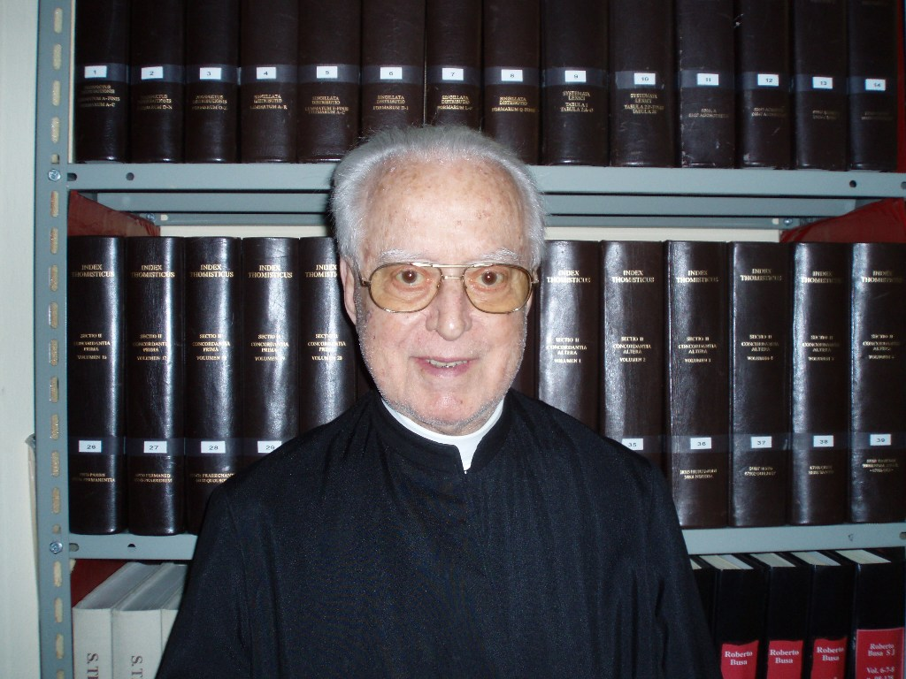

### C'era una volta...

Un sacerdote gesuita interessato a realizzare una concordanza di tutte le parole di Tommaso d’Aquino.

Dal 1946 al 1980, Roberto Busa e il suo team (con il sostegno di IBM) hanno realizzato l'_Index Thomisticus_, utilizzando schede perforate per l’inserimento dei dati.

Questo progetto ha contribuito alla crescita del settore dell’**informatica applicata alle discipline umanistiche**, che si è poi evoluto nelle DH. 

---
<!-- _paginate: false -->
<!-- _footer: Deitrich, C., & McPherson, T. (2016). *Designing Digital Scholarship: Art, Feminism + the Digital Humanities* [Video]. Vimeo. https://vimeo.com/166430492 Image: E.A.T. <a href="https://www.experimentsinartandtechnology.org/trisha-brown" target="_blank">Source</a>. -->

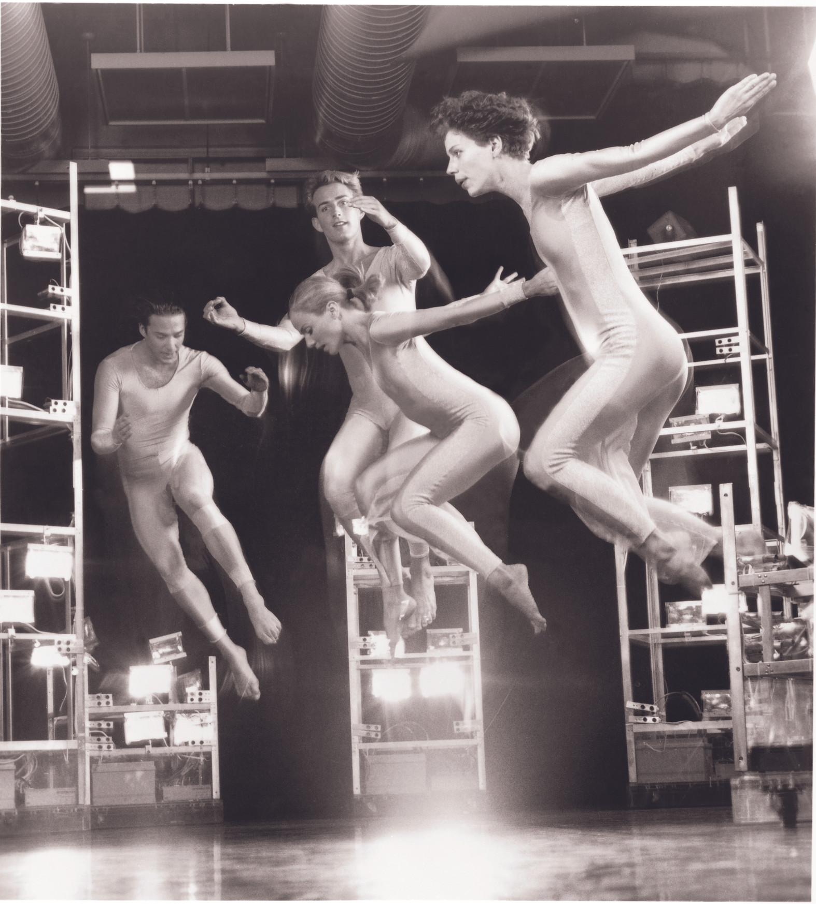

### C'era una volta...

Un’altra storia su come sono nate le DH.

Una storia in cui l’arte, la cultura dei primi schermi elettronici e le idee femministe offrono una fonte di ispirazione diversa per questo campo.

Questa è, in un certo senso, una delle origini del lato creativo delle DH, ovvero il modo in cui esse **combinano il digitale e il fisico per esplorare cosa significhi essere umani**.

---

<!-- _footer: Image: Melba Roy, National Archives. -->

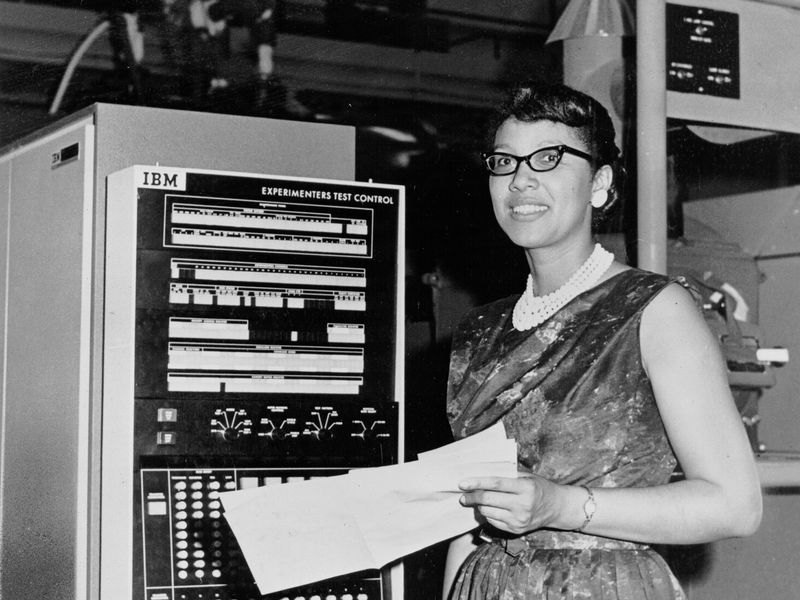

### Perché DH?

Perché agli accademici piace discutere e definire le cose. **Il termine fa la sua comparsa nei primi anni 2000**, in parte grazie all’antologia _A Companion to Digital Humanities_ (2004).

### Quindi le DH sono?

Una serie di pratiche convergenti che esplora, sviluppa e applica metodi e strumenti digitali senza perdere di vista l'esperienza umana. 

⚠️ Usare strumenti digitali nella ricerca non vuol dire essere DH! 

---

### Le DH oggi...

Una convergenza tra analogico e digitale, tradizione e innovazione, attraverso la quale analizziamo e mettiamo in discussione i paradigmi esistenti e cerchiamo modi per (ri)utilizzare e (ri)creare i dati in un'ottica umanistica.

Digitalizzazione. Studi testuali. Archivi. Collezioni. Studi multimediali. Epistemologia. Web semantico. Studi sui dati. Studi critici. Storia dell’arte. Archeologia. Apprendimento automatico. Ingegneria della conoscenza. Sistemi di ricerca. Interfacce. Studi sui social media. E molto altro ancora! Fonti diverse. Metodologie diverse. Ambiti diversi. 

L'oggetto di studio è l'intera storia dell'umanità.

**L’incontro tra discipline umanistiche e informatica rimane, idealmente, un filo conduttore comune**:
- L’informatica dovrebbe supportare l’umanista;
- L’umanista dovrebbe interrogare/contestualizzare l’informatica.

---

<!-- _paginate: false -->
<!-- _footer: Image: DH.arc logo, DH.arc. Images (next slides): 1/ Infographic, Bailey Betik. <a href="https://euppublishingblog.com/2023/10/20/graduate-education-digital-humanities/" target="_blank">Source</a>. 2/ Research data, Noppe, N., Vanvelk, J., & Callens, N., adaptation by me. <a href="https://doi.org/10.5281/zenodo.8010618" target="_blank">Source</a>. -->

### Le DH oggi...

➡️ Organizations: AIUCD (Italia), EADH (Europa), ADHO (Globale). 

➡️ Centri di ricerca: DH.arc (Bologna), VeDPH (Venezia), DISH (Torino), DH Lab (Firenze) ecc.

➡️ Corsi, progetti, risorse. 

➡️ Una prospettiva critica attraverso cui guardare il mondo.

---

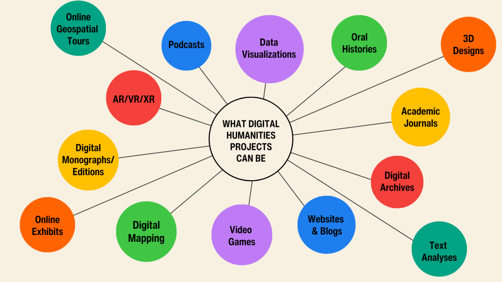

---

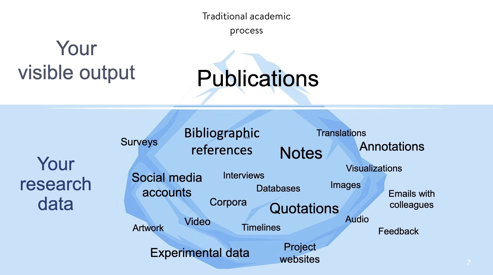

---

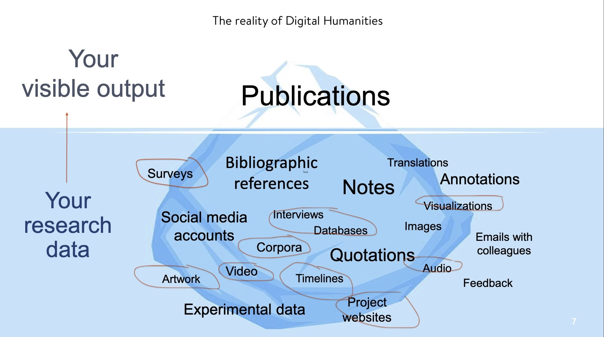

---

<!-- _class: impact -->

###### Part 2
# DH **values**
## (or not just how but also why)

---

<!-- _footer: Spiro, L. (2012). This Is Why We Fight: Defining the Values of the Digital Humanities. In M. K. Gold (Ed.), *Debates in the Digital Humanities*. University of Minnesota Press. https://doi.org/10.5749/9781452963754 Image: Unsplash. <a href="https://unsplash.com/photos/woman-stands-on-piano-addressing-a-large-crowd-dFLCExX5Xvw" target="_blank">Source</a>. -->

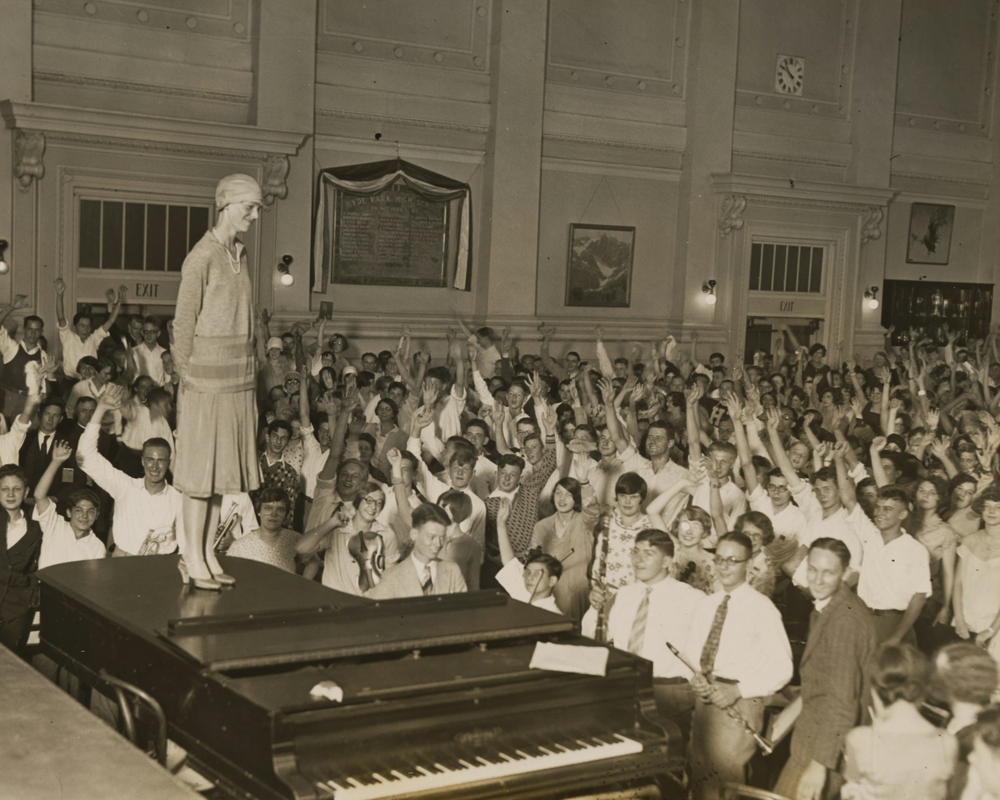

### Lavoro e comunità

Quindi, le DH sono diversi a seconda delle persone. Si tratta di una vasta comunità di professionisti che riflettono, ricercano, analizzano e producono.

Un modo per superare queste differenze è aggrapparsi a un **insieme condiviso di valori**: non per limitare la nostra identità, ma per ispirarci e ricordarci ciò che conta.

I valori ci ricordano ciò in cui crediamo e cosa c’è in gioco nel nostro lavoro.

---

<!-- _paginate: false -->
<!-- _footer: Spiro, L. (2012). This Is Why We Fight: Defining the Values of the Digital Humanities. In M. K. Gold (Ed.), *Debates in the Digital Humanities*. University of Minnesota Press. https://doi.org/10.5749/9781452963754 Image: CLIR. -->

### This is why we fight

Nel 2012, Lisa Spiro ha proposto la seguente serie di valori DH per il campo:

1️⃣ Openness
2️⃣ Collaboration
3️⃣ Collegiality and Connectedness
4️⃣ Diversity 
5️⃣ Experimentation 

L'intenzione era quella di fornire uno spunto, **una guida per riflettere sul “perché”, non solo sul “come”**.

---

<!-- _footer: Dombrowski, Q., & Spiro, L. (2026). This Is How We Fight: Revising Digital Humanities Values. ADHO 2026. https://doi.org/10.5281/zenodo.22656106 Image: ADHO. -->

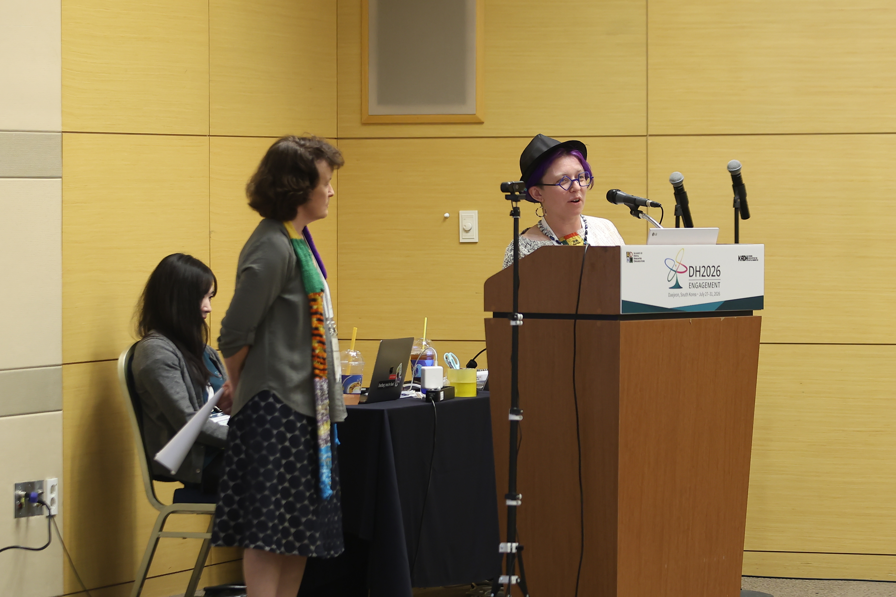

### This is how we fight

Quest'anno, Lisa e Quinn Daedal hanno presentato un aggiornamento dei valori.

1️⃣ Openness
2️⃣ Collaboration, Collegiality & Connectedness
3️⃣ Diversity
4️⃣ Experimentation & Play
5️⃣ Social Engagement & Responsibility 

Essi sostengono che il dibattito sui valori delle DH rimane essenziale, soprattutto per **affrontare le nuove sfide**.

---

<!-- _paginate: false -->
<!-- _footer: Reed, A. (2016). Craft and Care: The Making Movement, Catherine Black, and the Digital Humanities. *Essays in Romanticism*, *23*. Image: Christine Darden at NASA (1975), Wikipedia. -->

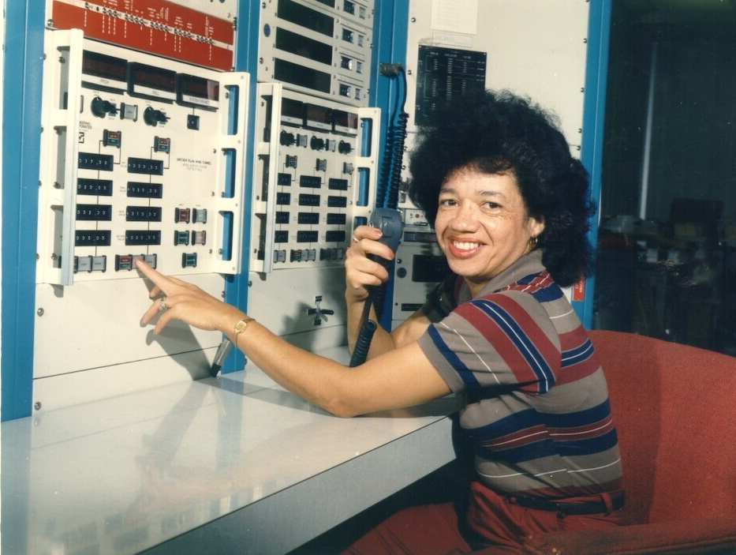

### Work ≠ Credit?

Un’ultima riflessione su cui torneremo nel corso della settimana: quale lavoro, che non si vede, rende possibile ciò che usi?

> "To create a truly critical digital humanities we should acknowledge and foreground the interdependencies between different kinds of labor." — Reed (2016)

---

<!-- _footer: Smith, A., & Whearty, B. (2023). All the Work You Do Not See: Labor, Digitizers, and the Foundations of Digital Humanities. In M. K. Gold & L. F. Klein (Eds.), *Debates in the Digital Humanities*. University of Minnesota Press. https://doi.org/10.5749/9781452969565 Image: Punch card operators, CIRCSE. -->

### Work = Credit ✅

I DH si basano in gran parte sui dati, ma questi dati non nascono dal nulla. **Dietro alla digitalizzazione ci sono persone il cui lavoro l'ha reso possibile**.

Padre Busa non avrebbe potuto “creare” l’_Index Thomisticus_ senza le donne che perforavanno le schede. Eppure sono rimaste invisibili fino agli anni 2010.

Questo tipo di lavoro non è di minore importanza, anzi, spesso _è il più importante_.

---

<!-- _class: impact -->

###### Part 3
# what is **data**
## (and why do we need it)

---

<!-- _footer: Image: John Snow cholera map, Wikipedia. -->

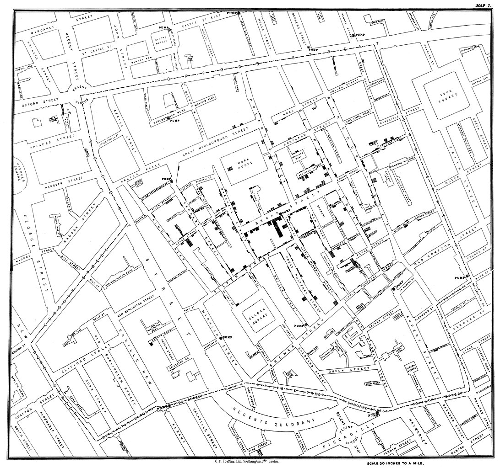

### C'era una volta...

1854, quartiere di Soho, Londra.

Un’epidemia di colera causa decine di morti in pochi giorni. 

John Snow, un medico, decide di mappare i casi, identificando ogni evento di contagio e segnalandolo su una mappa del quartiere.

I **dati raccolti da Snow e la loro visualizzazione** permettono di rintracciare la fonte dell'epidemia fino a una pompa dell'acqua. 

---

<!-- _footer: Gualandi, B., Pareschi, L., & Peroni, S. (2023). What do we mean by “data”? A proposed classification of data types in the arts and humanities. *Journal of Documentation*, *79*(7), 51–71. https://doi.org/10.1108/JD-07-2022-0146 Image: Unsplash. <a href="https://unsplash.com/photos/a-drawing-of-a-map-of-a-city-9ukqHb3KrEw" target="_blank">Source</a>. -->

### Cosa intendiamo con _dati_?

Nell’immaginario comune i dati sono legati al digitale, ma hanno radici ben più profonde: si tratta di un **dato** (_datum_, participio passato di _dare_), _qualcosa che viene dato_ dalla natura all'osservatore. 

Da sempre sono stati usati per "provare", "misurare", "fattualizzare" qualcosa (spesso un argomento). 

Possibile tipi: numeri; statistiche; fonti; fatti; eventi storici; interpretazioni; media; posizione; abbitudini; e ?

---

<!-- _paginate: false -->
<!-- _footer: Klein, L. F. (2013). The Image of Absence: Archival Silence, Data Visualization, and James Hemings. *American Literature*, *85*(4). https://doi.org/10.1215/00029831-2367310 <a href="https://spring2020-networks.designforthe.net/content/6-library/3-image-of-absence/lauren-klein-image-of-absence.pdf" target="_blank">PDF</a>. Image: Lauren F. Klein. -->

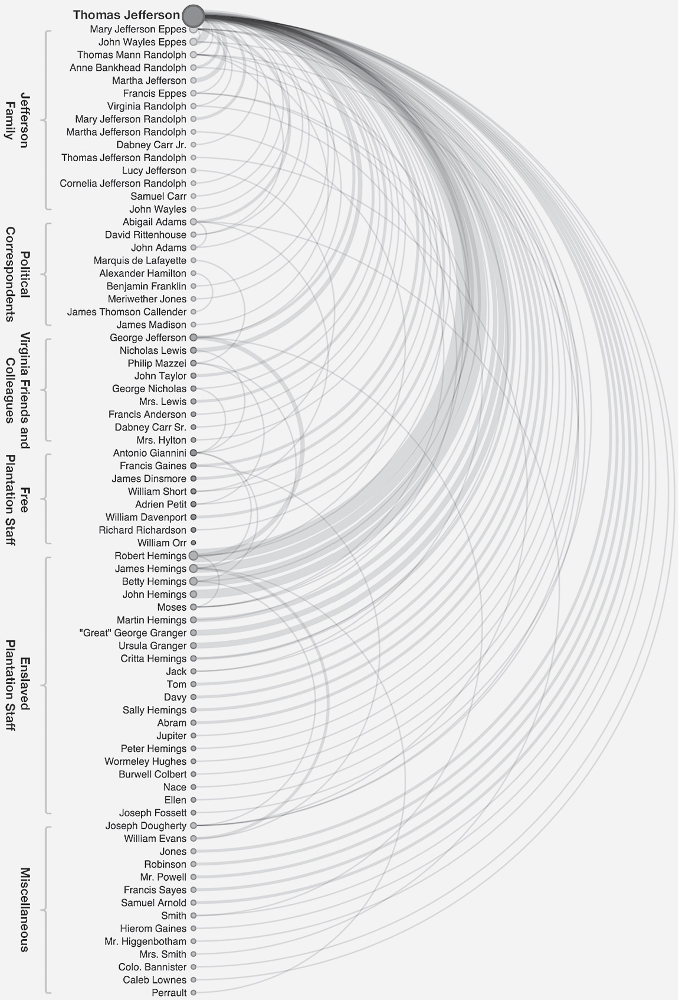

### Non è così semplice...

Spesso si dice che i dati siano indipendenti dall'osservatore, ovvero che siano neutri. 

⚠️ I **dati non sono neutri**, oggettivi, ed estranei a processi di intervento umano.

⚠️ Un dato non esiste di per sé, ma _viene generato_ e quindi _interpretato_.

💡 Ciò che è considerabile dato **dipende da chi lo usa, da come lo usa, e per quale scopo**.

---

<!-- _footer: Ciston, S., Ananny, M., & Crawford, K. (2023). *A critical field guide for working with machine learning datasets*. Knowing Machines project. https://knowingmachines.org/critical-field-guide Image: DELAUNAY dataset sample. <a href="https://doi.org/10.48550/arXiv.2201.12123" target="_blank">Source</a>. -->

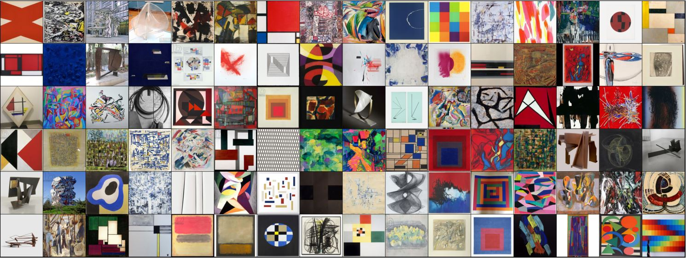

### I dati sono raccolti in _dataset_

➡️ Un **dataset** può essere costituito da qualsiasi tipo di dati raccolti, organizzati e correlati tra loro.

⚠️ **Riflette le circostanze che hanno portato alla sua creazione e gestione** (strumenti, limiti, bias, responsabilità).

💡 Oggi i dataset **hanno un impatto diretto sulla nostra vita**: accesso al lavoro, ai diritti, alla libertà di movimento, nonché sul modo in cui i sistemi ti percepiscono (monitoraggio). 

---

<!-- _footer: Image: ESRC cassette collection. Source: Laurent Fintoni. -->

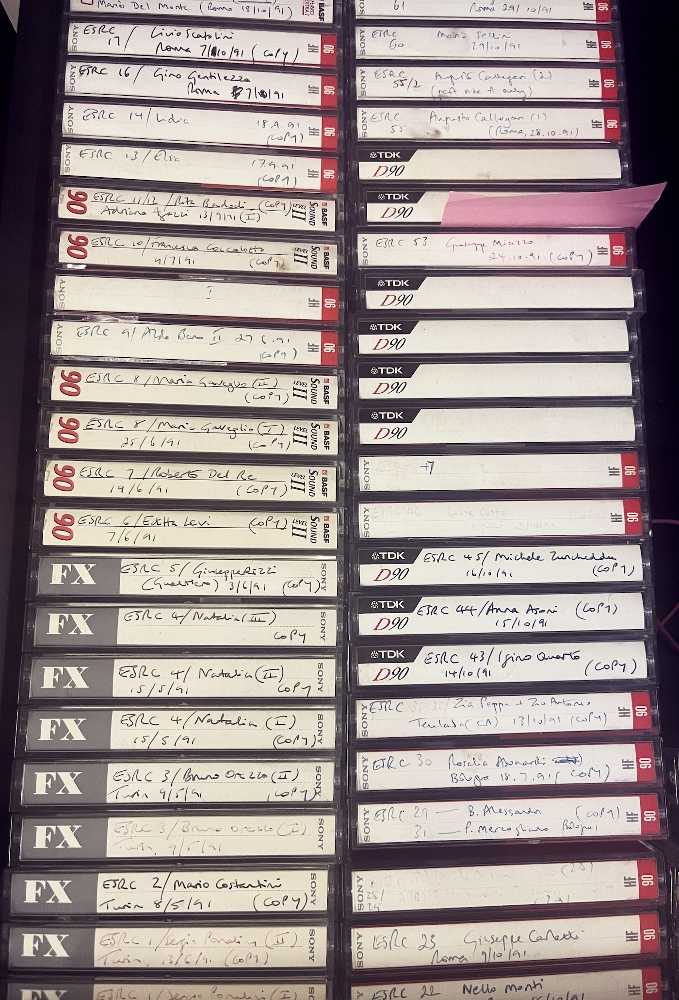

### Dati umanistici

Nell'ambito umanistico i dati rivestono oggi **un ruolo centrale** nel modo in cui concepiamo, creiamo e interagiamo con oggetti e progetti. 

💡 Dati servono per organizzare una collezione bibliografica, realizzare una mostra, analizzare l'opera di un artista, ecc. 
 
💡 Nel lungo periodo, i dati possono essere conservati da musei, archivi e gallerie nazionali, diventando parte del patrimonio storico.

---

<!-- _footer: Tóth-Czifra, E. (2019). *DARIAH Pathfinder to Data Management Best Practices in the Humanities* (Version 1.0.0). DARIAH-Campus. https://campus.dariah.eu/id/yR8mHfs3eW-ibu58LerCt Image: Torsten Roeder, 2019. -->

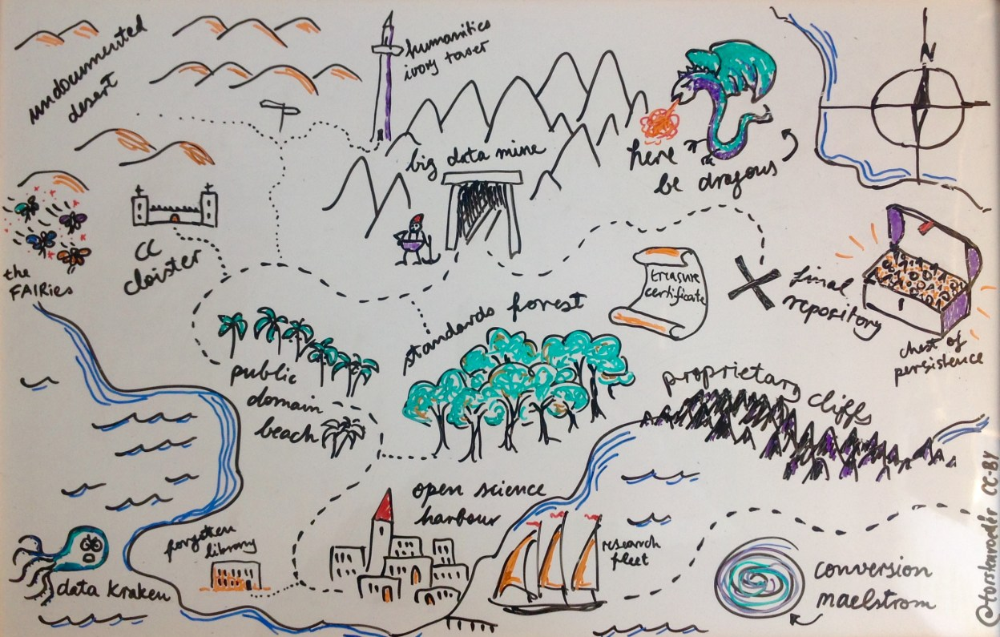

### Dati umanistici

⚠️ Il modo in cui il linguaggio viene usato nelle discipline umanistiche tende ad essere ermetico, individualista, ambiguo.

⚠️ I dati umanistici sono spesso non accessibili a causa di licenze troppo stringenti.

⚠️ I dati umanistici sono complessi e raramente documentati nell'ottica di una loro gestione adeguata.

---

<!-- _footer: Andersson, L., Huvila, I., & Sköld, O. (2024). An Introduction to Paradata. In *Perspectives on Paradata: Research and Practice of Documenting Process Knowledge* (pp. 1–14). Springer International Publishing. https://doi.org/10.1007/978-3-031-53946-6_1 -->

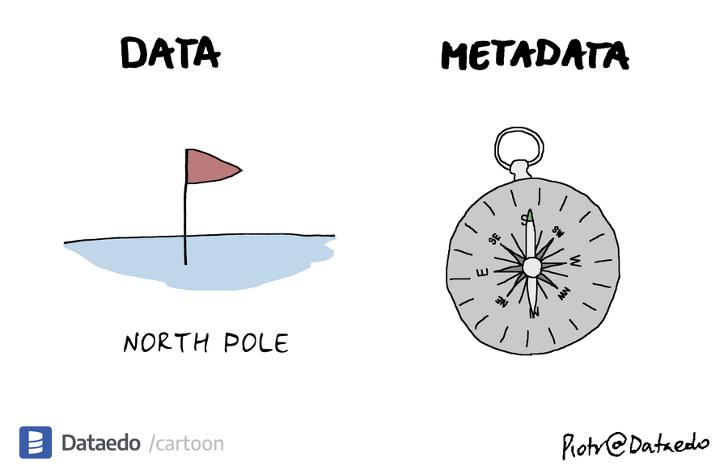

### Il contesto è importante

Nelle discipline umanistiche tendiamo ad avere _dati descrittivi e interpretativi di altri dati_: per descrivere opere culturali, eventi, collezioni bibliografiche lavoriamo più che altro sulle relazioni e i contesti (sociali, geografici, storici, umani).

💡 In questa prospettiva, un ruolo fondamentale è svolto dai **metadati** che documentano _in maniera strutturata_ i _chi_, i _cosa_, i _come_, i _quando_, i _dove_, i _perché_ dei dati.

---

<!-- _footer: Image: Dataedo.com. -->

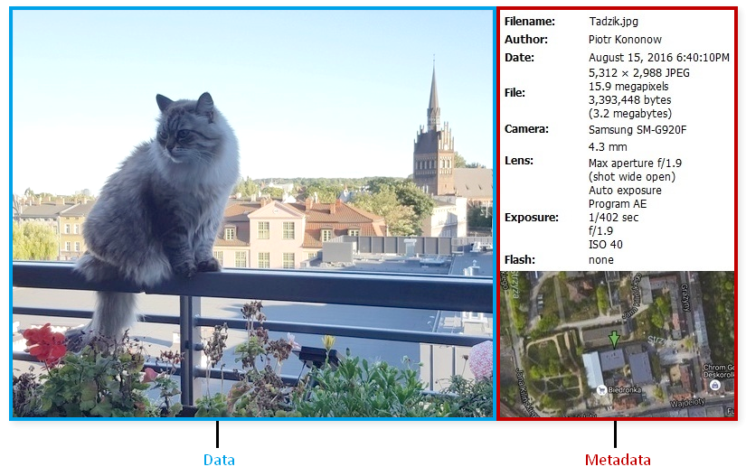

### I metadati di un oggetto

Ogni volta che viene scattata una foto con un dispositivo digitale, dei _metadati_ vengono creati automaticamente, come:
* Data di creazione;
* Nome del file;
* Impostazioni del dispositivo;
* Geolocalizzazione.

---

<!-- _footer: Image: Dataedo.com. -->

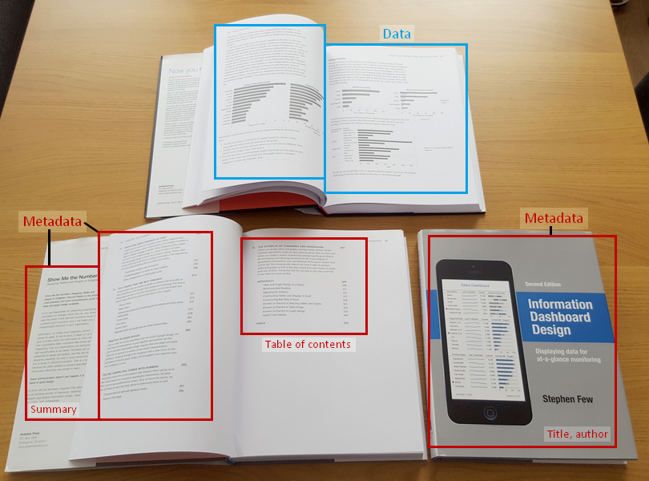

### I metadati di un oggetto

Anche un libro è ricco di metadati visibili sulla copertina e nel frontespizio, come:
* Titolo;
* Autore;
* Editore.

O anche nell'indice! 

---

<!-- _footer: Baca, M. (Ed.). (2016). *Introduction to metadata*. Getty Publications. https://www.getty.edu/publications/intrometadata/ -->

### Dati su dati

➡️ I **metadati** sono _dati che descrivono un oggetto informativo e ne documentano alcune caratteristiche_.

Esempi di metadati includono l'autore di un libro, il contenuto testuale, la data di pubblicazione, e così via.

💡 I metadati possono essere visti come _l'insieme di tutto ciò che si può dire su un dato (oggetto informativo) in un determinato momento, a qualsiasi livello di aggregazione_.

👉 Ritorneremo su tutto questo per approfondire all'inizio della seconda parte del corso (lezione 5). 

---

<!-- _class: impact -->

###### Part 4
# practice
## in class or at home

---

<!-- _footer: Image: Unsplash. <a href="https://unsplash.com/photos/two-children-studying-at-a-table-under-a-lamp-qfQLbxKgqYU" target="_blank">Source</a>. -->

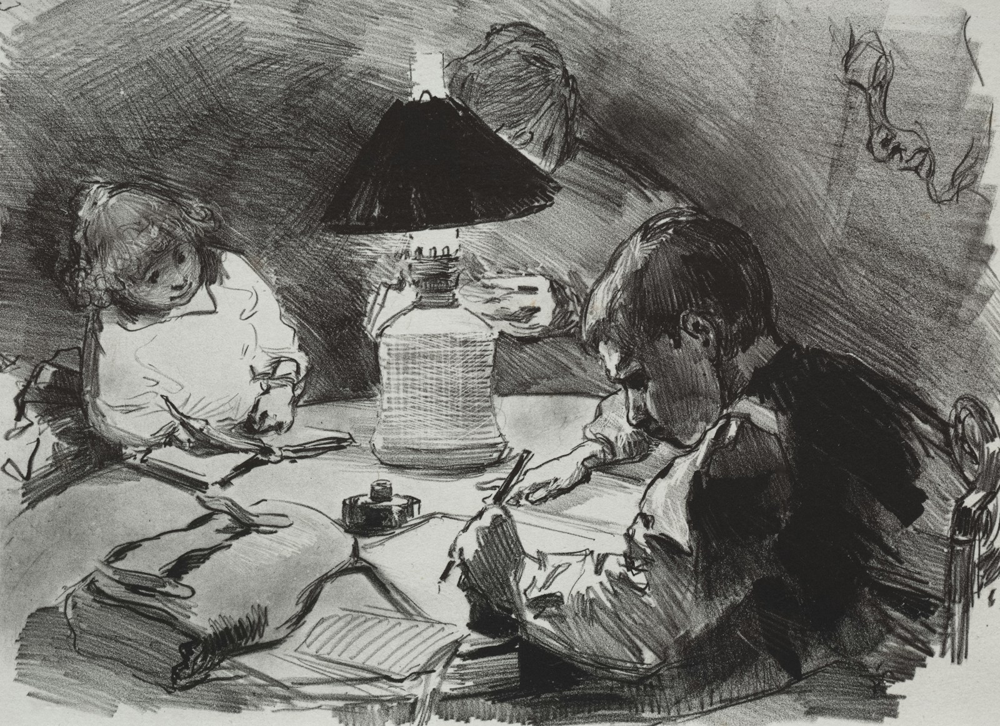

### Practical exercises

⚠️ Lo scopo di questi esercizi è quello di farvi riflettere su ciò di cui stiamo parlando. **Non si tratta di un test**.

1️⃣ Conosci già un progetto DH? Se sì, potresti descriverlo in una frase?
2️⃣ Quali valori ritieni importanti per il lavoro che svolgi o che vorresti svolgere?
3️⃣ Che tipo di dati crei e utilizzi ogni giorno? Quali set di dati hai creato nel corso della tua vita?
4️⃣ Di quali metadati hai bisogno per i tuoi studi?

---

### Practical exercises

Vorrei suggerirvi la seguente attività da svolgere durante questo corso. È del tutto facoltativa, ma ve la consiglio come strumento per aiutarvi a riflettere su tutto ciò che tratteremo e impareremo.

**Tenete un diario di idee e riflessioni** che potrete utilizzare per il progetto (e magari anche per altri corsi). Può trattarsi semplicemente di un documento sul vostro computer, su un servizio cloud o anche solo di una nota sul vostro telefono o tablet.

Può includere: ciò che avete imparato; idee con cui siete d’accordo o in disaccordo; attività svolte e difficoltà o successi riscontrati durante il lavoro pratico che faremo.

Se non siete sicuri di come procedere, sarò lieto di discuterne, in classe o privatamente via e-mail.

---

<!-- _paginate: false -->

# Digital Humanities / Data Management / Informatica per i Beni Culturali (2026/2027)

## 01. Introduction to DH ✅

### Thank you 🙏🏻
