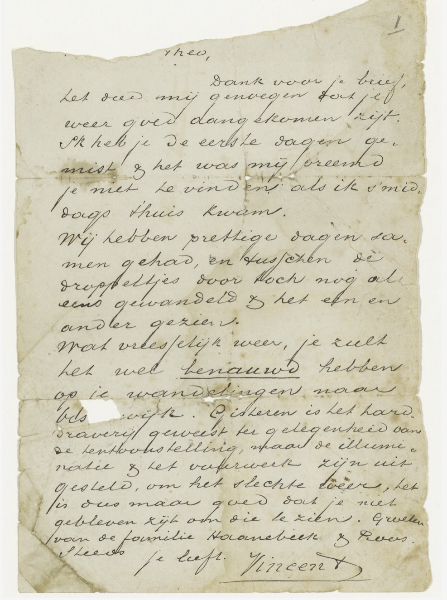
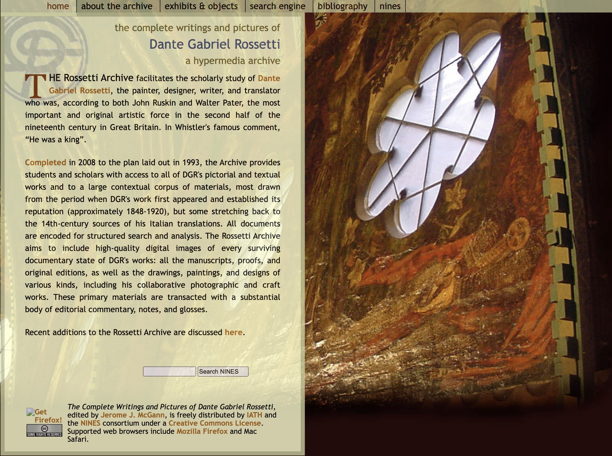
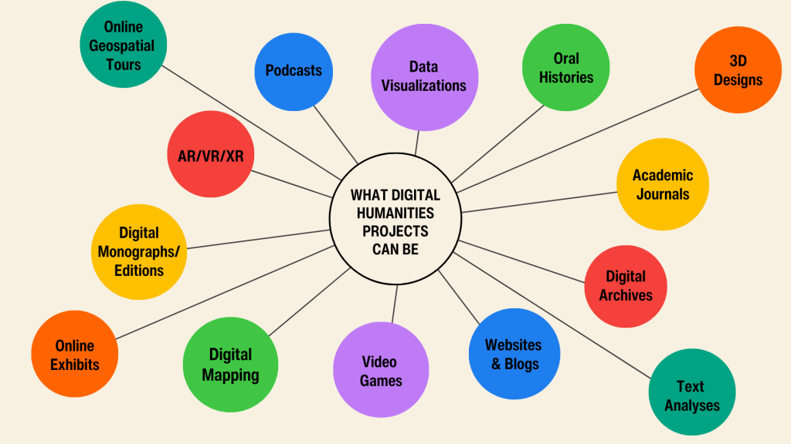
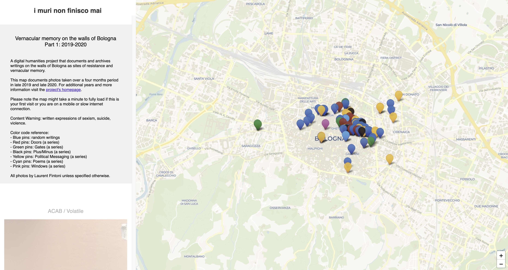
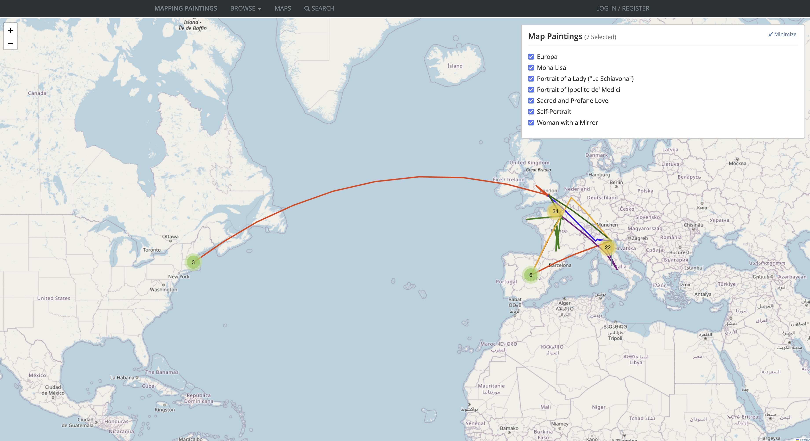
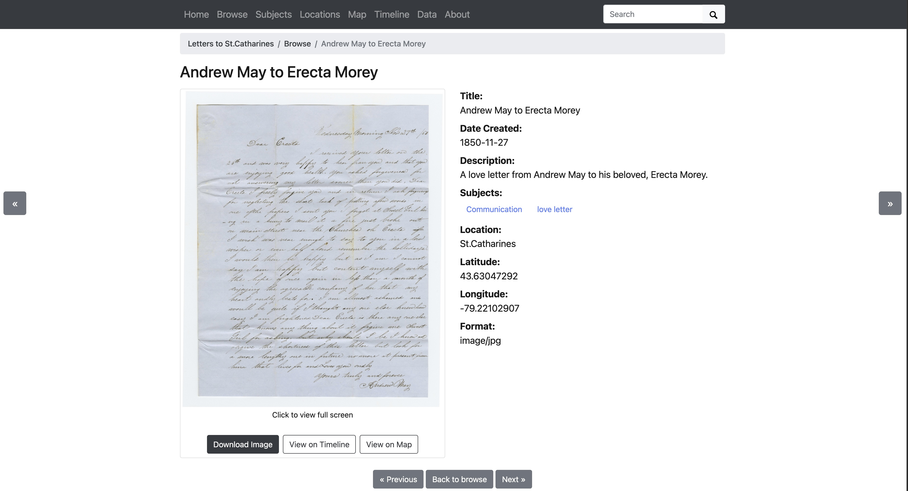
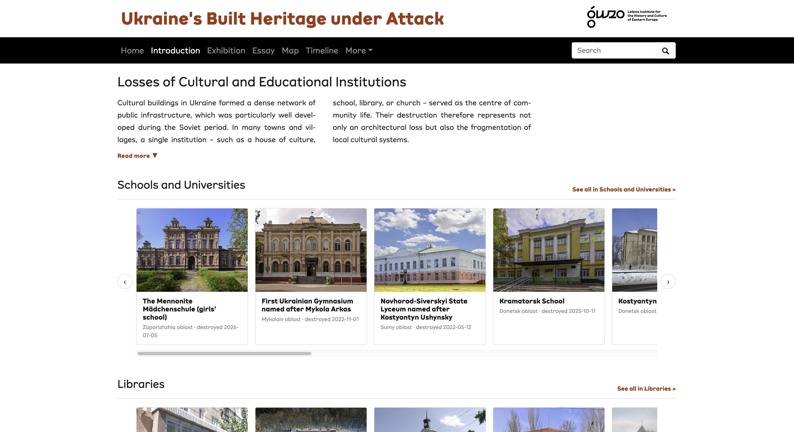

<!-- _paginate: false -->
<!-- _footer: Image: Unsplash. <a href="https://unsplash.com/photos/woman-in-black-framed-eyeglasses-UBxsyJ4xq1A" target="_blank">Source</a>. -->

# Digital Humanities / Data Management / Informatica per i Beni Culturali (2026/2027)

## 02. DH Projects

➡️ Mail: [laurent.fintoni2@unibo.it](mailto:laurent.fintoni2@unibo.it)
➡️ ORCID: [0000-0002-8656-4602](https://orcid.org/0000-0002-8656-4602)
➡️ Sito: [laurent.fintoni2](https://www.unibo.it/sitoweb/laurent.fintoni2)

---

<!-- _footer: Image: Van Gogh self portrait, Europeana. <a href="https://unsplash.com/photos/self-portrait-of-vincent-van-gogh-with-hat-w5sZ5pohapM" target="_blank">Source</a>. -->

### C'era una volta... 

Centinaia di lettere scritte da e indirizzate al pittore Vincent Van Gogh.

Queste lettere erano state raccolte in pubblicazioni cartacee nel corso del XX secolo e, nel 1990, il Museo Van Gogh decise di aggiornare e modernizzare la corrispondenza e i relativi apparati critici.

Il lavoro su quello che sarebbe diventato <a href="https://vangoghletters.org/" target="_blank">Vincent Van Gogh: The Letters</a> è iniziato nel novembre 1994 e si è concluso nell’ottobre 2009.

---

<!-- _footer: Image: Letter to Theo, 1872. <a href="https://vangoghletters.org/detail/urn:mace:huc.knaw.nl:vangogh:let001?query=fullText%3D" target="_blank">Source</a>. -->

### C'era una volta... 

Dall’idea alla realizzazione, il progetto ha richiesto:
- 15 anni di ricerca e lavoro;
- Collaborazione tra diverse istituzioni;
- Redattori, traduttori, responsabili di progetto, tecnici, e altri;
- Una manutenzione continua, con aggiornamenti fino ad oggi.

Il tutto per offrire nuovi spunti di riflessione sull’archivio di un artista. 

---

<!-- _class: impact -->

###### Part 1
# the project as **basic unit**
## (or theory in action)

---

<!-- _footer: Burdick et al. (2012). *Digital_Humanities*. MIT Press. <a href="https://web.archive.org/web/20161026210950/https://mitpress.mit.edu/sites/default/files/9780262018470_Open_Access_Edition.pdf" target="_blank">Open Access</a>. Image: Breslau und Umgebung, Europeana. <a href="https://unsplash.com/photos/a-historical-city-plan-with-colored-land-use-zones-80_YUVWteBY" target="_blank">Source</a>. -->

### Why projects? 

Un **tipo diverso di ricerca**: progettazione, gestione, negoziazione, collaborazione.

La domanda di ricerca è un punto di partenza per **possibili percorsi di risposta**.

I progetti sono iterativi e proiettivi, guardano a ciò che ancora non è, a ciò che potrebbe essere.

**Teoria in pratica** attraverso l’azione. Ogni fase del processo (idealmente) alimenta la riflessione sul perché e sul come.

---

<!-- _paginate: false -->
<!-- _footer: Burdick et al. (2012). *Digital_Humanities*. MIT Press. <a href="https://web.archive.org/web/20161026210950/https://mitpress.mit.edu/sites/default/files/9780262018470_Open_Access_Edition.pdf" target="_blank">Open Access</a>. Image: ADLab, Unibo. -->

### Who is involved?  

Un team, che può variare da un piccolo gruppo di persone a più gruppi distinti con competenze diverse e complementari.

La complessità del progetto spesso determina le dimensioni del team (così come le risorse disponibili).

In ambito accademico, un progetto si avvale di partnership per il finanziamento o per l’approvvigionamento di materiale.

Tipi di ruoli: responsabile di progetto, ricercatore, progettista, programmatore, redattore, traduttore, ecc.

---

<!-- _footer: Burdick et al. (2012). *Digital_Humanities*. MIT Press. <a href="https://web.archive.org/web/20161026210950/https://mitpress.mit.edu/sites/default/files/9780262018470_Open_Access_Edition.pdf" target="_blank">Open Access</a>. Image: UCLA Newsroom. -->

### How is it organized? 

Molto spesso un progetto nasce da un’esigenza (come questo corso!), da un tema di ricerca o da un’esigenza istituzionale o della comunità.

### Size doesn't matter

I progetti possono essere di ogni dimensione: da quelli su larga scala (Van Gogh Letters) a quelli su scala più ridotta (progetti individuali, prototipi).

Le dimensioni non contano. Ciò che conta è il contributo che il progetto apporta. 

---

<!-- _paginate: false -->
<!-- _footer: Burdick et al. (2012). *Digital_Humanities*. MIT Press. <a href="https://web.archive.org/web/20161026210950/https://mitpress.mit.edu/sites/default/files/9780262018470_Open_Access_Edition.pdf" target="_blank">Open Access</a>. Image: <a href="https://rossettiarchive.iath.virginia.edu/" target="_blank">Rossetti Archive</a>, University of Virginia. -->

### Similarities & Differences  

I progetti DH fanno parte della tradizione umanistica. Promuovono l’analisi, la critica e l’interpretazione come un saggio.

Ma mentre la ricerca umanistica tradizionale ha sempre privilegiato il lavoro intellettuale come attività solitaria, progetti ci ricordano che l’azione ha lo stesso valore della riflessione.

Riconoscono le **potenzialità del digitale** pur rispettando l’importanza del fisico. Offrono un modo per **estendere gli oggetti culturali** a nuove dimensioni.

---

<!-- _footer: Burdick et al. (2012). *Digital_Humanities*. MIT Press. <a href="https://web.archive.org/web/20161026210950/https://mitpress.mit.edu/sites/default/files/9780262018470_Open_Access_Edition.pdf" target="_blank">Open Access</a>. Image: Unsplash. <a href="https://unsplash.com/photos/sign-with-numbers-404-in-a-field-WCS8Ew14QqA" target="_blank">Source</a>. -->

### Credits & Afterlife   

I progetti favoriscono un lavoro che non è frutto di un unico autore, ma di **molteplici contributi e prospettive**. Anche se si realizza il progetto “da soli”, si utilizza comunque o si parte dal lavoro altrui.

Ma i progetti presentano anche l’inconveniente di richiedere **un’attenzione costante**. Ciò che si realizza con gli strumenti disponibili oggi potrebbe non funzionare più domani. 

È utile riflettere su questo, se non altro per capire cosa può accadere e perché.

---

<!-- _class: impact -->

###### Part 2
# project **types**
## (or the tyranny of choice)

---

<!-- _paginate: false -->
<!-- _footer: Posner, M. (2013). "How did they make that?". <a href="https://miriamposner.com/blog/how-did-they-make-that/" target="_blank">miriamposner.com </a>. Infographic, Bailey Betik. <a href="https://euppublishingblog.com/2023/10/20/graduate-education-digital-humanities/" target="_blank">Source</a>. -->

### Different Types, Different Needs 

Come abbiamo visto nella prima lezione, le possibilità per i progetti di DH sono molteplici.

Nel 2013, Miriam Posner ha fornito agli studenti il seguente elenco iniziale e alcuni esempi: <a href="https://1989.rrchnm.org/" target="_blank">un archivio di fonti</a>; <a href="https://cather.unl.edu/" target="_blank">edizione scientifica digitale</a>; <a href="https://digital.library.sc.edu/collections/the-negro-travelers-green-book-1956/" target="_blank">mappatura</a>; <a href="https://kieranhealy.org/blog/archives/2013/06/18/a-co-citation-network-for-philosophy/" target="_blank">visualizzazione di rete</a>; <a href="https://cblevins.github.io/posts/topic-modeling-martha-ballards-diary/" target="_blank">analisi testuale</a>; <a href="https://guzdenvarinlioglu.wordpress.com/archaeology/digital-anatolia/" target="_blank">modelli 3D</a>; <a href="http://nicestkids.com/nehvectors/nicest-kids/index" target="_blank">narrazione multimediale</a>.

A distanza di 13 anni, la sua argomentazione rimane valida: è difficile stilare un elenco davvero rappresentativo.

---

<!-- _footer: Andreose, E., Crosilla, G., Grillo, R., & Spinaci, G. (2026). Italian Digital Humanities Projects [Dataset]. Zenodo. https://doi.org/10.5281/zenodo.23434566. -->

### Different Types, Different Needs 

Nel 2026, nel contesto italiano, lo stesso elenco potrebbe presentarsi così:

<a href="http://aldomorodigitale.unibo.it/" target="_blank">Edizione digitale</a>; <a href="https://koseodiah.org/mapofkingdom.php" target="_blank">banca dati di immagini</a>; <a href="https://raguproject.github.io/" target="_blank">archivio di ricette</a>; <a href="https://atlas.paths-erc.eu/" target="_blank">atlante archeologico</a>; <a href="https://alpilink.it/" target="_blank">corpus linguistico e mappatura</a>; <a href="https://alim.unisi.it/" target="_blank">biblioteca digitale</a>; <a href="https://3dhop.net//" target="_blank">software</a>.

🤔 Sulla base di queste tipologie, quali pensate fossero le esigenze del progetto? 

### Not just what, but how

Il “come” è importante tanto quanto il “cosa”. I requisiti tecnici di un progetto e le competenze tecniche delle persone hanno un impatto diretto su ciò che un progetto può essere e sarà.

Qui torniamo al tema della collaborazione: a volte può essere necessario ricorrere a qualcuno che possieda competenze o conoscenze specifiche.

---

<!-- _footer: Image: Laurent Fintoni. -->

### I tre ambiti dell'esame: mapping 

Diamo un'occhiata a tre esempi dei tipi di progetti che potete scegliere per l'esame.

Il primo è la mappatura, ovvero la localizzazione di oggetti (dati) su una mappa con informazioni aggiuntive (metadati).

L'idea è quella di consentire all'utente di esplorare la domanda di ricerca dal punto di vista spaziale. Attraverso la mappatura possiamo rivelare visivamente le informazioni contenute nei dati.

---

<!-- _paginate: false -->
<!-- _footer: Fintoni, L. (2022). "i muri non finisco mai: Vernacular Memory on the Walls of Bologna". https://studies.laurentfintoni.com/walls-bologna/. Cranston, J. (2017). "Mapping Paintings". Boston University. https://www.mappingpaintings.org/. -->

### I tre ambiti dell'esame: mapping 

_i muri non finisco mai_ è un progetto che ho realizzato nel 2022.  Traccia una mappa delle scritte sui muri di Bologna in 3 anni attraverso la lente della memoria popolare.

_Mapping Paintings_ è un progetto di Jodi Cranston che traccia la provenienza delle opere d’arte attraverso lo spazio e il tempo. Permette di creare le proprie mappe.

Main tool: Leaflet JS; HTML; Catalogue software. 

---

<!-- _footer: Image: Letters to St. Catharines. -->

### I tre ambiti dell'esame: collection 

La seconda opzione è la “collezione”, ovvero la creazione di una piccola raccolta di oggetti organizzati secondo una logica specifica (domanda di ricerca) e accessibili in diversi modi.

L’idea è quella di consentire all’utente di esplorare i dati in modo più serendipico, fornendogli un quadro di riferimento con diverse modalità di accesso agli oggetti e di navigazione al loro interno (tra cui la mappatura, ma anche tag, infografiche, linee temporali ecc.)

---

<!-- _paginate: false -->
<!-- _footer: Richard, J. (2021). "Letters to St. Catharines". CollectionBuilder. https://jessierichard.github.io/Letters-to-St.Catharines/. Sandkühler, J. (2026). "Ukraine's Built Heritage under Attack", CollectionBuilder. https://ukraines-heritage-attacked.leibniz-gwzo.de/. -->

### I tre ambiti dell'esame: collection 

_Letters to St. Catharines_ è un progetto studentesco che raccoglie lettere inviate da e a St. Catharines, che raccontano la storia della città alla fine del XIX secolo.

_Ukraine's Built Heritage under Attack_ è una mostra digitale realizzata dall’istituto GWZO, che documenta le distruzioni causate dalla guerra nella speranza di contribuire alla futura ricostruzione.

Main tool: CollectionBuilder; Spreadsheet databases. 

---

<!-- _footer: Image: Voyant Tools homepage. Source: Programming Historian. -->

### I tre ambiti dell'esame: text 

The last option is text, intended as the creation of a small corpus of textual  data that can be analyzed to reveal new information. 

Here the idea is to use text analysis and visualizations to show patterns in text, such as concordances, relationships, frequency, etc. In the same that maps offer spatial access to data, text analysis offers a statistical approach that can be useful and interesting.  

---

<!-- _paginate: false -->
<!-- _footer: Appel, K. (202)). "The Viral Virus". ArcGIS StoryMaps. https://storymaps.arcgis.com/stories/816472ff4486409da34a5c28ab87524d. Image: Voyant Tools. Source: Wikipedia. -->

### I tre ambiti dell'esame: text 

Unlike maps and collections, text analysis projects tend to be more focused around essays / written formats than digital objects. As we'll see the requirements for the exam reflect this. 

_The Viral Virus_ is an exception, analyzing the conversation around COVID-19 on Twitter by combining text analysis with visual storytelling. 

Main tool: Voyant Tools.

---
<!-- _class: steps -->
<!-- _footer: Albrezzi, F & Drucker, J. (2025). *The Digital Humanities Coursebook*. Routledge. -->

* > "When designing a digital project, ask whether using computational processes or Web‑based tools allows you to raise new questions, ask existing questions differently, or just add special effects. Are you able to generate new results and insights, or are you using digital platforms to show outcomes? Are you willing to invest in learning computational methods well enough to think with them?" — Drucker & Albrezzi (2025)

* Whatever approach you decide to take for the final exam is up to you. We will cover each in the third part of the course, with examples of the tools I mentioned. I will also share some tutorials you can use on your own time to experiment with each approach. 

---

<!-- _class: impact -->

###### Part 3
# **anatomy** of a DH project
## (or how did they make that?)

---

<!-- _footer: Rider, J. (2014). “How Did They Make That? Reverse-Engineering Digital Projects” with Miriam Posner. <a href="https://studentwork.prattsi.org/dh/2014/04/02/how-did-they-make-that-reverse-engineering-digital-projects/" target="_blank">DH@Pratt</a>. Image: Unsplash. <a href="https://unsplash.com/illustrations/a-blue-and-white-icon-of-two-gears-Nyy01QsYvL4" target="_blank">Source</a>. -->

### Reverse engineering 

One of the best ways to engage with and learn from existing DH projects is to follow a reverse engineering approach.

In her 2014 lecture 'How Did They Make That?', Miriam Posner offers three simple steps to reverse engineer a DH project: 
- Identify the _sources_. 
- Determine the _processes_. 
- Assess how the results are _presented_. 

---

### Sources 

What information/data is the projet based/built on? 

### Process 

What processes were used on the data? Digitization, encoding, transformation, etc.

### Presentation

How are the results presented to you, the user? Map, text, images, collection, search, interactivity, etc. 

### Longevity (bonus) 

Who maintains the project? Can you build it so it is resilient, requiring less 'care'? 

---

<!-- _footer: Image: Unsplash. <a href="https://unsplash.com/photos/vintage-map-of-the-arctic-region-and-surrounding-continents-8tz9nCt_v9o" target="_blank">Source</a>. -->

### What it means for you

This idea of reverse engineering applies to the structure of the course: Find; describe; analyse; present/share. 

When looking at projects you should think about how they are made, and why. 

Look for documentation (not always there!). Look for credits. Look things up. Be curious. 

---
<!-- _class: impact -->

###### Part 4
# Final exam **criteria**
## (or what do you need to do?)

---

<!-- _footer: Image: Unsplash. <a href="https://unsplash.com/photos/intricate-brown-and-white-batik-fabric-with-bird-motif-7rkDCrENdbU" target="_blank">Source</a>. -->

### Final Exam Guidelines 

At the end of the class today I will share with you the exam guidelines, via Virtuale. 

These should (hopefully) cover everything you need to know and think about. 

I recommend you read them at least once before the next lesson, in case you have questions but also because all the theory and practice we will cover is connected to it in some way. 

---

<!-- _footer: Image: Unsplash. <a href="https://unsplash.com/photos/traditional-batik-pattern-with-stylized-human-figures-and-birds-ItlRH9hiACw" target="_blank">Source</a>. -->

### Prototype Requirements  

While you can choose one of three tracks for the prototype you will create, every prototype must include the following:
- A research question 
- Some data and a basic data model 
- Metadata
- Link to at least one authority source 
- Licence, rights, and mini DMP
- README, documentation, GenAI record
- Zenodo DOI 

Each of these will be introduced throughout the course (see guidelines). 

---

<!-- _footer: Image: Unsplash. <a href="https://unsplash.com/photos/a-collection-of-diverse-animals-on-a-patterned-background-fkmJhg6KxSQ" target="_blank">Source</a>. -->

### Research Question

The research question is simply: what does my project set out to answer? It should be clear and feasible. 

You may want to start with the question and let that influence how you choose to answer. Or you may want to start with data, like a collection or topic, and let that influence the question you want to ask. 

Think about what interests you, what you are studying, which approaches interest you! 

---

<!-- _paginate: false -->

# Digital Humanities / Data Management / Informatica per i Beni Culturali (2026/2027)

## 02. DH Projects ✅

### Thank you 🙏🏻
