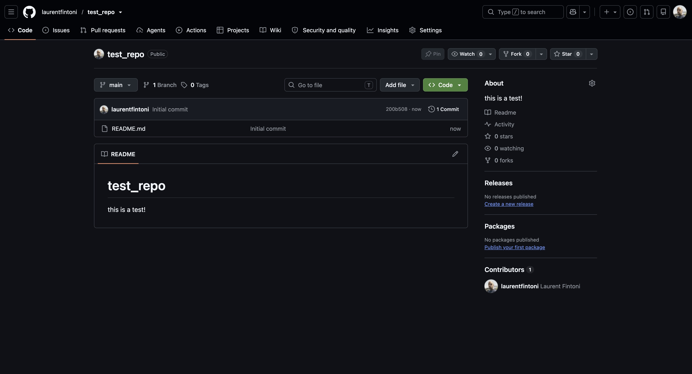
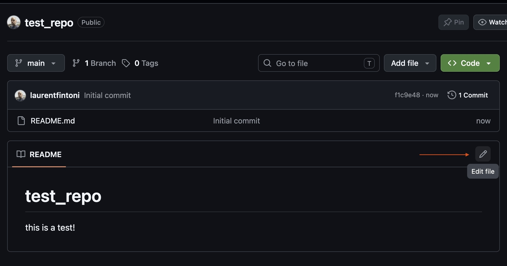
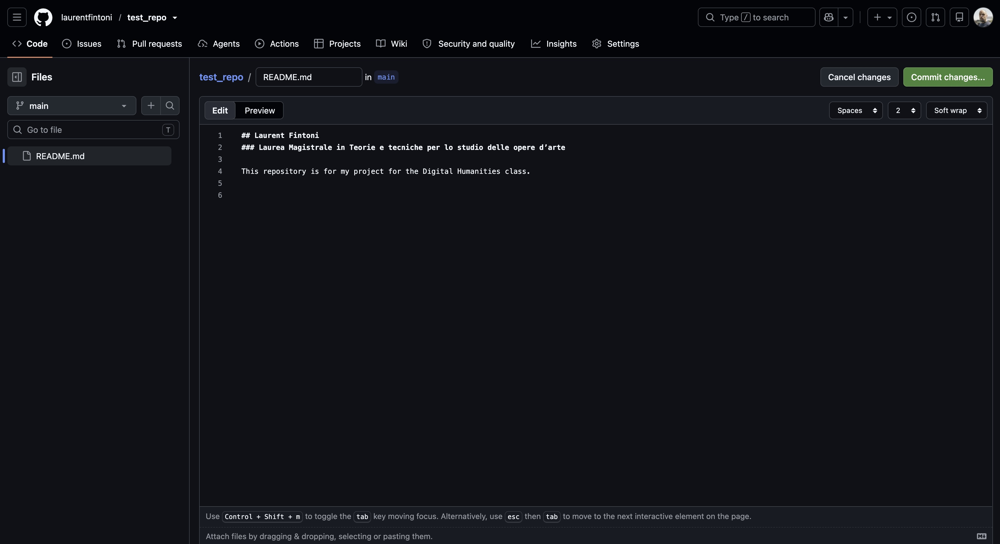
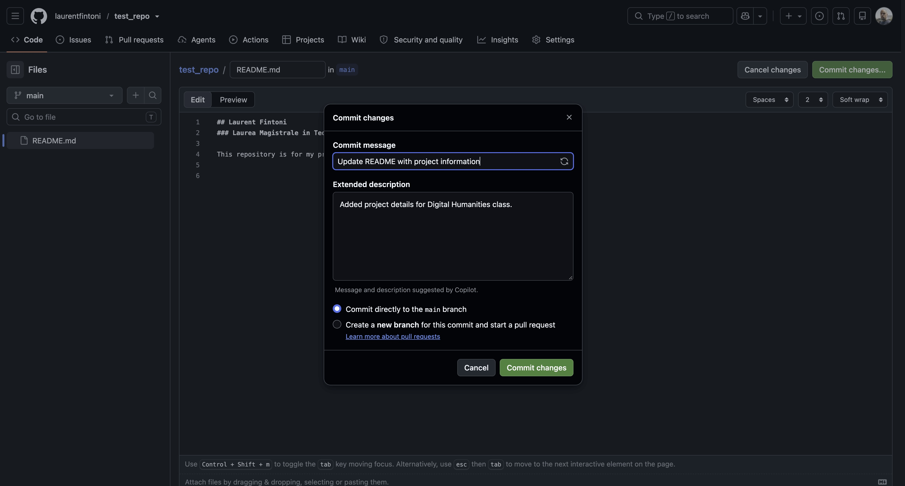
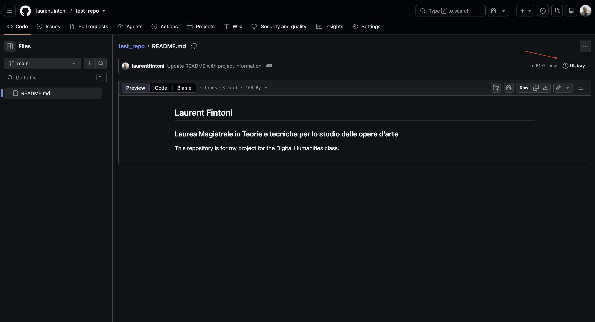
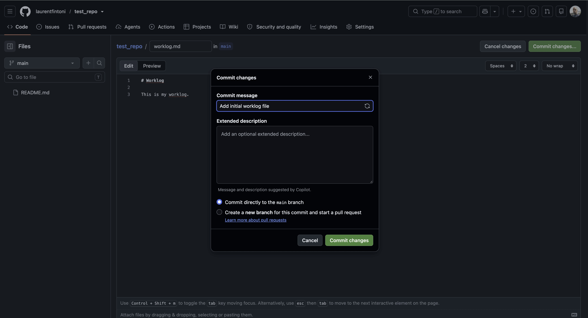

<!-- _paginate: false -->
<!-- _footer: Image: Unsplash. <a href="https://unsplash.com/photos/abstract-painting-with-colorful-geometric-shapes-and-figures-AoPQuHn-F_A" target="_blank">Source</a>. -->


# Digital Humanities / Data Management / Informatica per i Beni Culturali (2026/2027)

## 03. Workshop 01 - GitHub, Markdown

➡️ Mail: [laurent.fintoni2@unibo.it](mailto:laurent.fintoni2@unibo.it)

---

<!-- _class: impact -->

###### Foreword
# Versioning & GIT
## keeping track, sharing work

---

<!-- _footer: Perez-Riverol, Y., Gatto, L., Wang, R., Sachsenberg, T., Uszkoreit, J., Leprevost, F. D. V., ... & Vizcaíno, J. A. (2016). Ten simple rules for taking advantage of Git and GitHub. PLoS computational biology, 12(7), e1004947. https://doi.org/10.1371/journal.pcbi.1004947 -->

### What is versioning?

Il versionamento è la gestione delle modifiche nei file. La maggior parte delle persone utilizza una qualche forma di versionamento per gestire i propri file.

```
tesi brutta.docx
tesi brutta2.docx
tesi vera finale.docx
```
Aggiungere informazioni di contesto facilmente ordinabili (come le date) rende leggermente più facile seguire lo storico delle modifiche.

```
tesi_2024-03-20.docx
tesi_2024-05-06.docx
tesi_2024-05-10.docx
```

---

<!-- _footer: Ram, K. (2013). Git can facilitate greater reproducibility and increased transparency in science. Source code for biology and medicine, 8, 1-8. https://doi.org/10.1186/1751-0473-8-7 -->


### Git

Git è il nome di un Version Control System, un sistema di versionamento descrittivo, permissivo, e collaborativo.

Permette di tenere traccia delle modifiche apportate ai file in un progetto.

In pratica, consente di salvare diverse versioni di un file o di un intero progetto nel tempo, così possiamo vedere cosa è cambiato, da chi, e quando.

In genere usato tramite linea di comando, ma anche tramite app e altri servizi.

---

<!-- _footer: Blischak, J. D., Davenport, E. R., & Wilson, G. (2016). A quick introduction to version control with Git and GitHub. PLoS computational biology, 12(1), e1004668. https://doi.org/10.1371/journal.pcbi.1004668 -->


### GitHub

[GitHub](https://github.com/) è una piattaforma online per repository Git.

Permette di caricare, condividere e collaborare su progetti con altre persone.

Servizio fondamentale per sviluppatori.

Sempre più importante anche per gestire i flussi di lavoro della pubblicazione online, i libri di testo aperti, e progetti di Digital Humanities.

---


### Come interagiremo con GitHub

Oggi:

- Creazione di un account;
- Creazione di una nuova _repo_ (in pratica, la cartella del progetto);
- Creazione di un file README;
- Creazione di un worklog.

Con Git/GitHub è possibile fare moltissime cose in più, ma ora limitiamoci allo stretto necessario per questo corso.

Nelle prossime lezioni vedremo come aggiungere su GitHub gli elementi necessari per il progetto.

---

<!-- _class: impact -->

###### STEP 1
# create a repository
## (fancy name for your project folder)

---

### The repository

Un repository è l'elemento fondamentale di GitHub. È uno spazio in cui è possibile archiviare il proprio codice, i propri file e la cronologia delle revisioni di ciascun file. I repository possono avere più collaboratori ed essere pubblici o privati.

Per questo corso, useremo un repository come cartella pubblica per il vostro progetto e, a seconda del percorso che sceglierete, il repository vi consentirà anche di pubblicarne i contenuti come sito web (ad esempio utilizzando CollectionBuilder).

Andate su github.com -> accedi/login -> repository (nel menu) -> cliccate su “Nuovo”.

---

<!-- _paginate: false -->


---

<!-- _paginate: false -->



---

<!-- _class: impact -->

###### Interlude
# markdown
## (an easy way to document and write for humans and computers)

---

### What is it
Markdown è un linguaggio che consente di scrivere testi formattati utilizzando una sintassi semplice e facilmente leggibile.

Viene utilizzato in vari contesti, come la scrittura tecnica su piattaforme come GitHub, e anche per creare documenti in sistemi di gestione dei contenuti.

La sua sintassi intuitiva lo rende ideale per scrivere in modo rapido e strutturato, ed è facilmente convertibile in HTML o altri formati (se sapete scrivere in HTML, potete anche combinarlo con elementi HTML di base).

Utilizzate https://markdownlivepreview.com/ per sperimentare e vedere cosa succede.

---

<!-- _paginate: false -->


---

### Markdown syntax

La sintassi fondamentale che vi serve oggi è:

1. Il cancelletto `#` viene usato per intestazione, da 1 (largest) a 6 (smallest).
2. Due asterischi `**` o trattini bassi `__` prima e dopo per rendere la parola grassa `**grassa**` = **grassa** o singolo per corsivo `_corsivo_` = _corsivo_.
3. **Link**: racchiudiamo il testo del link tra parentesi quadre `[ ]` e subito dopo racchiudiamo l’URL tra parentesi tonde `( )`. Quindi: `Link al mio [sito](https://laurentfintoni.com).` = Link al mio [sito](https://laurentfintoni.com).
4. **Liste puntate**: precediamo ogni elemento della lista con un asterisco `*` o un trattino `-`, seguito da uno spazio.
5. **Liste ordinate**: precediamo ogni elemento della lista con un numero puntato.

Questa <a href="https://github.com/adam-p/markdown-here/wiki/markdown-cheatsheet" target="_blank">scheda riassuntiva</a> (cheat sheet) è un utile strumento di riferimento.

---

<!-- _class: impact -->

###### STEP 2
# EDIT README
## (the document that explains the repository)

---

### README file

Quando abbiamo creato il repository, abbiamo aggiunto un file README, che viene creato come file Markdown denominato README.md all’interno del vostro repository.

Questo file viene generalmente utilizzato come documento che spiega cos’è un repository. Pottete vedere che il suo contenuto viene visualizzato direttamente sotto la struttura del repository.

È possibile modificare questo file (e altri) direttamente su GitHub utilizzando il browser. Modificare i file direttamente nel browser non è il modo in cui la maggior parte delle persone utilizza GitHub, ma è il modo più semplice per imparare!

Per farlo, basta cliccare sull'icona a forma di penna.

---

<!-- _paginate: false -->



---

<!-- _paginate: false -->


---

### README file

Vorrei che aggiungete le seguenti informazioni di base al vostro README:
- Il vostro nome;
- Il vostro corso di studi;
- Una descrizione di una riga su cosa sia questo repository (e.g. Questo repository è per il mio progetto del corso di Digital Humanities).

Potete usare qualsiasi sintassi desideriate. Potete anche utilizzare il pulsante “Modifica/Anteprima” per vedere come appare la vostra sintassi.

Quando avete finito, cliccate sul pulsante “Commit changes...”. Eseguire un commit in Git significa essenzialmente salvare le modifiche apportate a un file. In questo modo verrà creata una voce nella cronologia delle versioni del vostro repository.

---

<!-- _paginate: false -->



---

<!-- _paginate: false -->



---

<!-- _paginate: false -->



---

<!-- _class: impact -->

###### STEP 3
# add a worklog
## (the record of your work)

---

### Add a new file

Per aggiungere un file al vostro repository, potete utilizzare il menu “Aggiungi file”, che vi offrirà la possibilità di caricare un file o di crearne uno direttamente nel browser.

Scegliete l’opzione per creare il file, quindi inserite un nome e selezionate il tipo di file! Ad esempio: `worklog.md`.

Una volta fatto ciò, potete ripetere la stessa procedura vista per il file README: modificate il file direttamente nel browser, e salvate le modifiche con un commit.

---


---


---



---

### Learn more

Questo corso dispone anche di un repository GitHub dove potete trovare tutte le lezioni e i materiali di supporto.

https://github.com/laurentfintoni/dh-ravenna-26-27

È possibile utilizzare le funzioni “Watch” o “Star” su GitHub per ricevere notifiche in caso di modifiche o per ritrovarlo facilmente in seguito.

GitHub offre agli studenti un pacchetto speciale che consente di imparare a utilizzarlo e dà accesso a strumenti premium per tutta la durata degli studi.

https://education.github.com/pack

---

<!-- _paginate: false -->


# Digital Humanities / Data Management / Informatica per i Beni Culturali (2026/2027)

## 03. Workshop 01 ✅

### Thank you 🙏🏻
