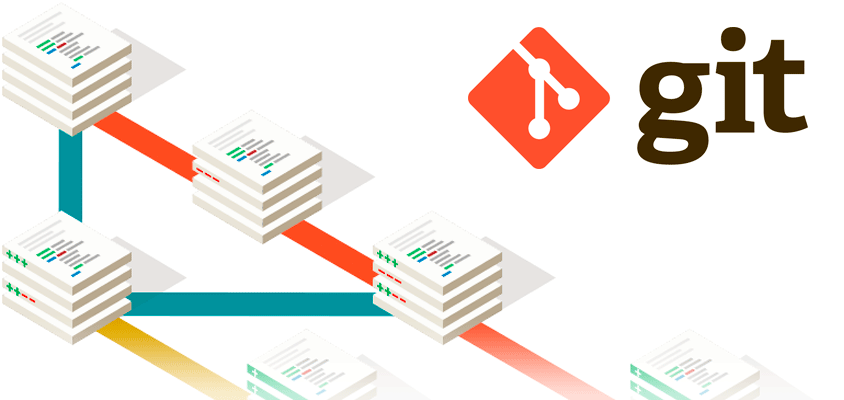
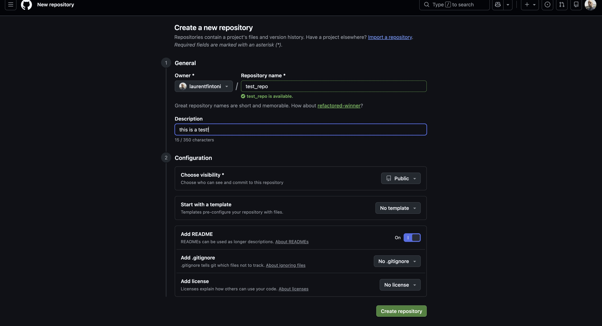
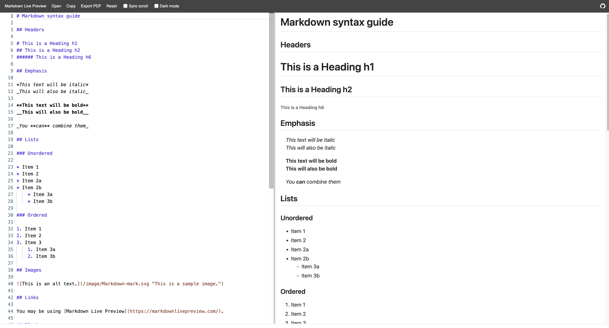
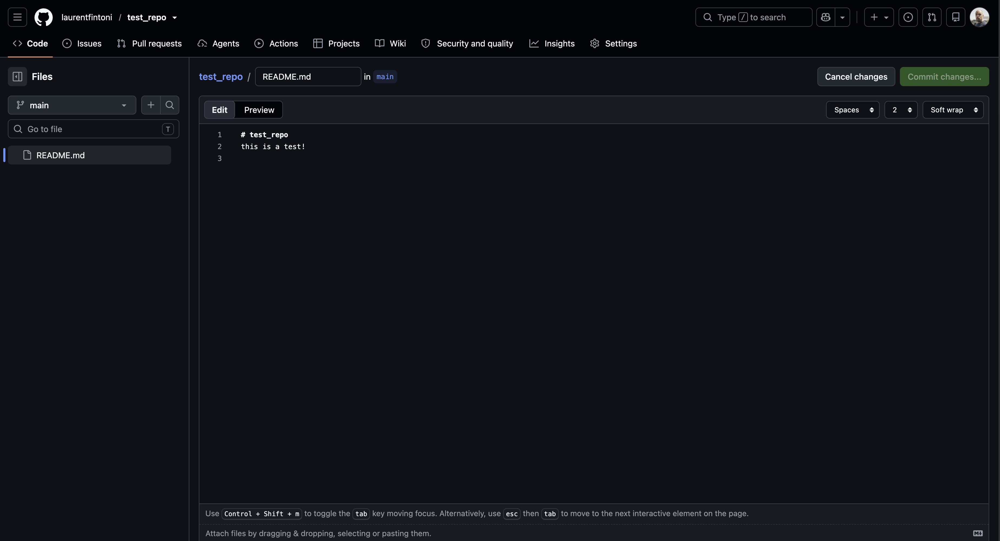
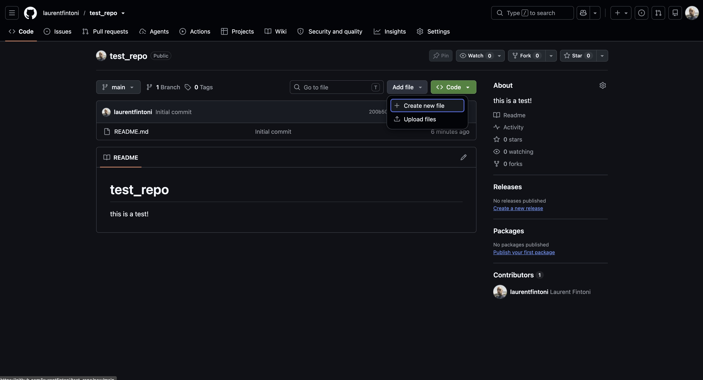
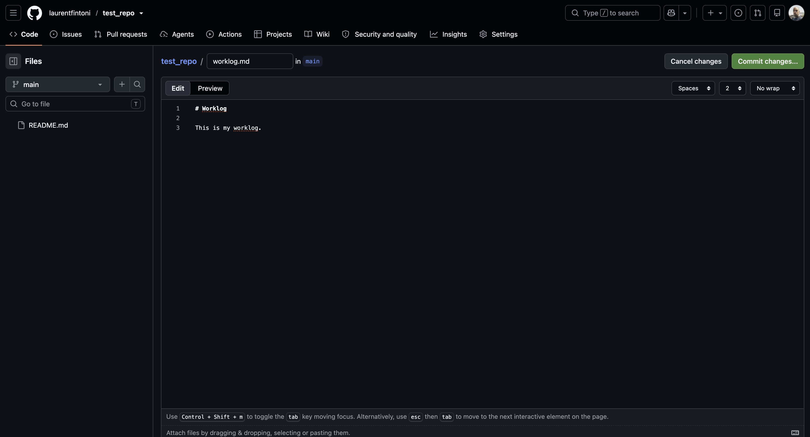

<!-- _paginate: false -->
<!-- _footer: Image: Unsplash. <a href="https://unsplash.com/photos/abstract-painting-with-colorful-geometric-shapes-and-figures-AoPQuHn-F_A" target="_blank">Source</a>. -->


# Digital Humanities / Data Management / Informatica per i Beni Culturali (2026/2027)

## 03. Workshop 01 - GitHub, Markdown

➡️ Mail: [laurent.fintoni2@unibo.it](mailto:laurent.fintoni2@unibo.it)

---
<!-- _class: impact -->

###### Foreword
# Versioning & GIT
## keeping track, sharing work

---

<!-- _footer: Perez-Riverol, Y., Gatto, L., Wang, R., Sachsenberg, T., Uszkoreit, J., Leprevost, F. D. V., ... & Vizcaíno, J. A. (2016). Ten simple rules for taking advantage of Git and GitHub. PLoS computational biology, 12(7), e1004947. https://doi.org/10.1371/journal.pcbi.1004947 -->

### What is versioning? 

Il versionamento è la gestione delle modifiche nei file. La maggior parte delle persone utilizza una qualche forma di versionamento per gestire i propri file.

```
 tesi brutta.docx
tesi brutta2.docx
tesi vera finale.docx
```
Aggiungere informazioni di contesto facilmente ordinabili (come le date) rende leggermente più facile seguire lo storico delle modifiche.

```
tesi_2024-03-20.docx
tesi_2024-05-06.docx
tesi_2024-05-10.docx
```

---
<!-- _footer: Ram, K. (2013). Git can facilitate greater reproducibility and increased transparency in science. Source code for biology and medicine, 8, 1-8. https://doi.org/10.1186/1751-0473-8-7 -->



### Git 

Git è il nome di un Version Control System, un sistema di versionamento descrittivo, permissivo, e collaborativo.

Permette di tenere traccia delle modifiche apportate ai file in un progetto.

In pratica, consente di salvare diverse versioni di un file o di un intero progetto nel tempo, così possiamo vedere cosa è cambiato, da chi, e quando.

In genere usato tramite linea di comando, ma anche tramite app e altri servizi.

---
<!-- _footer: Blischak, J. D., Davenport, E. R., & Wilson, G. (2016). A quick introduction to version control with Git and GitHub. PLoS computational biology, 12(1), e1004668. https://doi.org/10.1371/journal.pcbi.1004668 -->


### GitHub

[GitHub](https://github.com/) è una piattaforma online per repository Git. 

Permette di caricare, condividere e collaborare su progetti con altre persone.

Servizio fondamentale per sviluppatori.

Sempre più importante anche per gestire i flussi di lavoro della pubblicazione online, i libri di testo aperti, e progetti di Digital Humanities.

---


### Come interagiremo con GitHub

Oggi:

- Creazione di un account;
- Creazione di una nuova _repo_ pubblica (in pratica, la cartella del progetto);
- Creazione di un file README.

Con Git e GitHub è possibile fare moltissime cose in più, ma ora limitiamoci allo stretto necessario per questo corso. 

Nelle prossime lezioni vedremo come aggiungere su GitHub gli elementi necessari per il progetto.

---

<!-- _class: impact -->

###### STEP 1 
# create a repository
## (fancy name for your project folder)

---
<!-- _footer: Image: Unsplash. <a href="https://unsplash.com/photos/abstract-seascape-with-orange-sky-and-gray-water-phTXTaVyXPc" target="_blank">Source</a>. -->

### The repository 

A repository is the most basic element of GitHub. It's a place where you can store your code, your files, and each file's revision history. Repositories can have multiple collaborators and can be either public or private.

For this course, we will use a repository as a public folder for your project and depending on the track you choose, the repository will also allow you to publish its contents as a website (for example using CollectionBuilder). 

Go to github.com -> login -> repositories -> click new. 

---



---


---
<!-- _class: impact -->

###### Interlude
# markdown
## (an easy way to document and write for humans and computers)

---

### What is it
Markdown è un linguaggio che consente di scrivere testi formattati utilizzando una sintassi semplice e facilmente leggibile.

Viene utilizzato in vari contesti, come la scrittura tecnica su piattaforme come GitHub, e anche per creare contenuti in sistemi di gestione dei contenuti.

La sua sintassi intuitiva lo rende ideale per scrivere in modo rapido e strutturato, ed è facilmente convertibile in HTML o altri formati.

### How does it work 

Markdown text is most often converted into HTML directly by your browser. It can also be combined with HTML. That's it! 

Use https://markdownlivepreview.com/ to experiment and see what happens. 

---



---

### Markdown syntax 

The key syntax you need for today is: 

1. Il cancelletto `#` viene usato per intestazione, da 1 (largest) a 6 (smallest).
2. Due asterischi `**` o trattini bassi `__` prima e dopo per rendere la parola grassa `**grassa**` = **grassa** o singolo per corsivo `_corsivo_` = _corsivo_.
3. **Link**: racchiudiamo il testo del link tra parentesi quadre `[ ]` e subito dopo racchiudiamo l’URL tra parentesi tonde `( )`. Quindi: `Link al mio [sito](https://laurentfintoni.com).` = Link al mio [sito](https://laurentfintoni.com). 
4. **Liste puntate**: precediamo ogni elemento della lista con un asterisco `*` o un trattino `-`, seguito da uno spazio.
5. **Liste ordinate**: precediamo ogni elemento della lista con un numero puntato.

This <a href="https://github.com/adam-p/markdown-here/wiki/markdown-cheatsheet" target="_blank">cheat sheet</a> is a useful reference. 

---
<!-- _class: impact -->

###### STEP 2
# EDIT README
## (the document that explains the repository)

---

### README file

When we created the repository we added a README file, which is created as a Markdown file named README.md in your repository. 

This file is generally used as a document that explains what a repository is. You can see its contents are displayed directly beneath your repository structure. 

You can edit this file (and others) directly in GitHub using your browser. Editing files directly in the browser is not the way most people use GitHub but it's the easiest way for beginners to learn! 

To do this simpy click the pen icon. 

---



---

### README file

I want you to add the following basic information to your README: 
- Your name
- Your programme 
- One research interest 
- A one line description of what this repository is

You can use whatever syntax you want. You can also use the edit/preview switch to view what your syntax looks like.

When you are done click the Commit changes... button. To commit a change in Git is essentially to save the changes to a file. Doing this will create a record in the version history of your repo. 

---
<!-- _class: impact -->

###### STEP 3
# add a worklog
## (the record of your work)

---

### Add a new file

You can add a file to your repository using the 'Add file' menu which will give you the option to upload or create something directly in the browser. 

Choose the option to create and then choose a name and the file type! So for example: `worklog.md`.

Once done you can repeat the same process as we saw for README, using the browser to edit the file, or add to it, and then using commit changes to save. 

---


---


---


---

### Learn more

This course also has a GitHub repository where you can find all the lessons and supporting materials. 

https://github.com/laurentfintoni/dh-ravenna-26-27

You can use the Watch or Star functions in GitHub to be alerted of changes or to easily find it again. 

GitHub offers students a special pack that lets you learn how to use it and gives you access to premium tools for the duration of your studies. 

https://education.github.com/pack

---

<!-- _paginate: false -->


# Digital Humanities / Data Management / Informatica per i Beni Culturali (2026/2027)

## 03. Workshop 01 ✅

### Thank you 🙏🏻
