<!-- _paginate: false -->
<!-- _footer: Image: Unsplash. <a href="https://unsplash.com/photos/abstract-figures-gathered-together-in-a-group--CtU6u4fEIk" target="_blank">Source</a>. -->

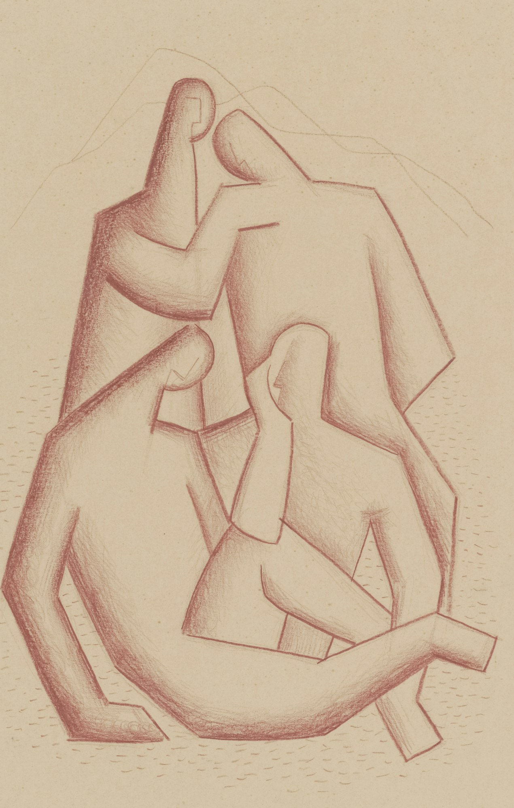

# DH & Data Management per i Beni Culturali (2026/2027)

## 03. Values, Credit, Documentation, GenAI

➡️ Mail: [laurent.fintoni2@unibo.it](mailto:laurent.fintoni2@unibo.it)
➡️ ORCID: [0000-0002-8656-4602](https://orcid.org/0000-0002-8656-4602)
➡️ Sito: [laurent.fintoni2](https://www.unibo.it/sitoweb/laurent.fintoni2)

---

<!-- _footer: Kwakkel, E. (2014). "The Last Page of the Medieval Book". https://medievalbooks.nl/tag/colophons/. Image: Scribal colophon. Source: Giulio Menna, Leiden University. -->

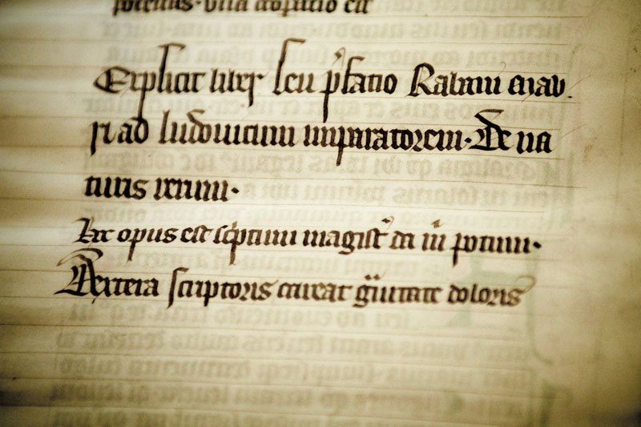

### C'era una volta...

Nel Medioevo, quando uno scriba terminava un manoscritto, talvolta ricorreva a quello che viene chiamato colofone – una nota riportata alla fine di un libro o di un manoscritto – per comunicare con il lettore.

Questi colofoni rappresentavano una delle prime forme di metadati, destinati a fornire informazioni su chi, dove e come fosse stato realizzato un manoscritto.

---

<!-- _footer: Porck, T. (2017). "Scribal Complaints." https://thijsporck.com/2017/06/12/scribal-complaints/. Image: Colophon drawings. <a href="https://medievalbooks.nl/tag/colophons/" target="_blank">Source</a>. -->

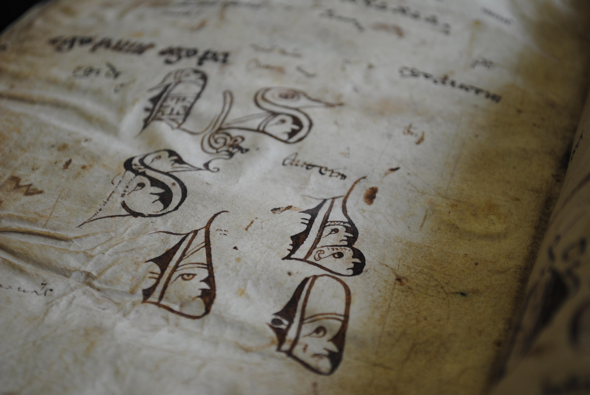

### C'era una volta...

Ma in alcuni casi, utilizzavano il colofone anche per rivelare la realtà del loro lavoro.

Una delle lamentele trovata nei colofoni tra l’VIII e il XII secolo era: "Tre dita scrivono, tutto il corpo fatica".

Altre chiedevano preghiere o sollievo fisico.

In questa tradizione possiamo vedere un legame diretto con il present e il lavoro invisibile che sta dietro alla creazione degli oggetti digitali.

---

<!-- _class: impact -->

###### Part 1
# Values in **Practice**
## (a reminder to think about why you do, not just how)

---

<!-- _footer: Dombrowski, Q., & Spiro, L. (2026). This Is How We Fight: Revising Digital Humanities Values. ADHO 2026. https://doi.org/10.5281/zenodo.22656106. Image: Unsplash. <a href="https://unsplash.com/photos/two-abstract-figures-resting-on-a-grassy-hillside-m8HsKz6hNu0" target="_blank">Source</a>. -->

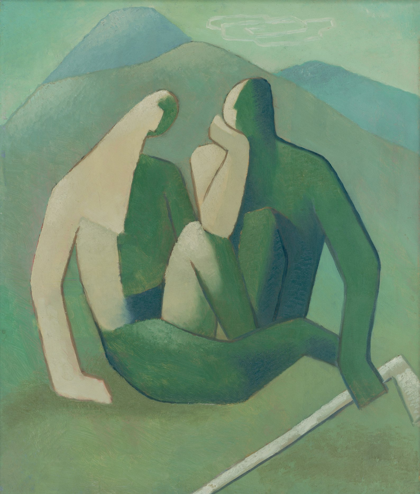

### DH Values

In primo luogo <a href="https://dhdebates.gc.cuny.edu/read/untitled-88c11800-9446-469b-a3be-3fdb36bfbd1e/section/9e014167 -c688-43ab-8b12-0f6746095335" target="_blank">proposto</a> da Lisa Spiro nel 2012, <a href="https://zenodo.org/records/22656106" target="_blank">rivisitato</a> con Quinn Daedal nel 2026.

1️⃣ Openness 2️⃣ Collaboration, Collegiality & Connectedness 3️⃣ Diversity 4️⃣ Experimentation & Play 5️⃣ Social Engagement & Responsibility

Non chi è un digital humanist o cosa sono le DH, ma **perché le DH**.

Diamo un'occhiata più dettagliata a tre di questi valori.

---

<!-- _footer: Image: Unsplash. <a href="https://unsplash.com/photos/four-abstract-figures-gathered-together-with-a-mountain-background-QX6hl34wsYQ" target="_blank">Source</a>. Image (next slide): Dependency, xkcd. <a href="https://xkcd.com/2347/" target="_blank">Source</a>. -->

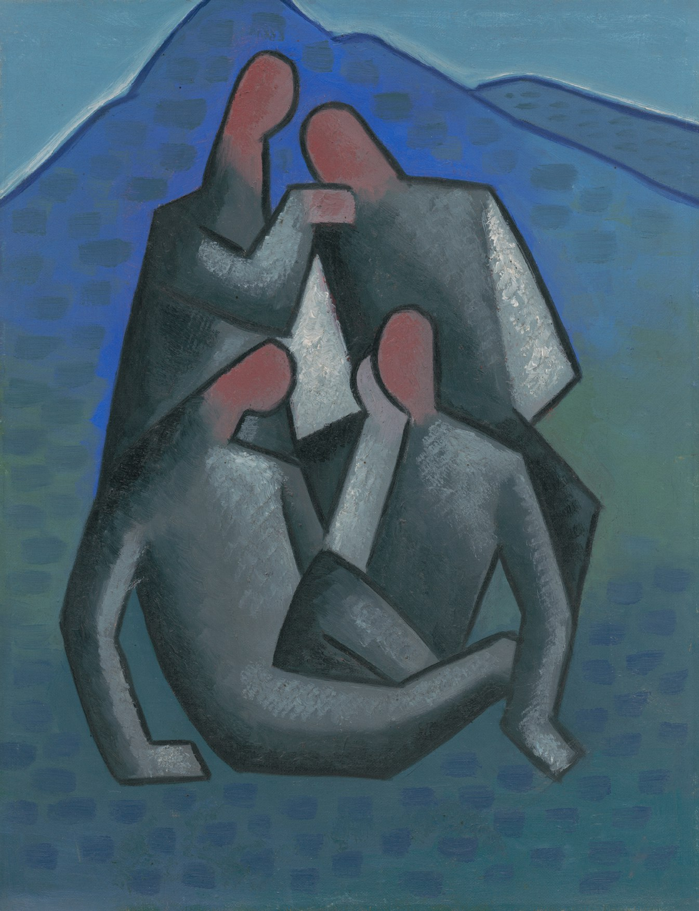

### Openness

**Open** = _scambio di idee, trasparenza e contenuti/software aperti_.

Se i dati non sono aperti, ciò comporta una minore interoperabilità, reperibilità, usabilità e riutilizzabilità.

I metadati dovrebbero sempre essere aperti, poiché rappresentano un’interpretazione o documentazione.

I dati sono più soggetti a normative. Ecco perché l’open source (risorse digitali legalmente accessibili a tutti) è importante.

---

<!-- _paginate: false -->

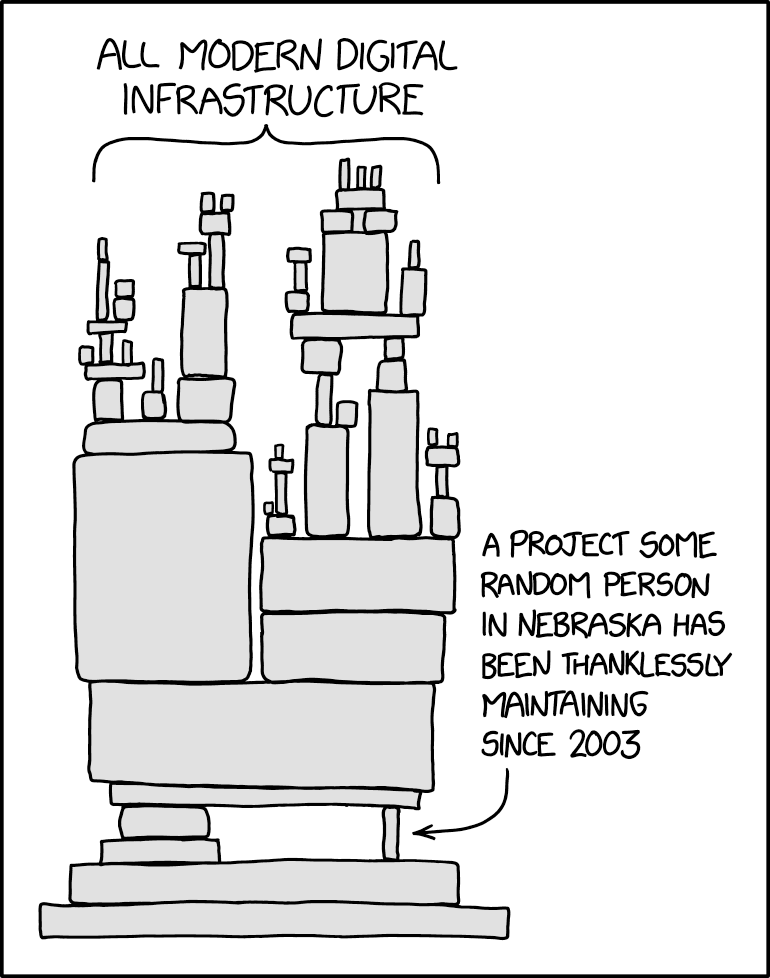

---

<!-- _footer: Image: Unsplash. <a href="https://unsplash.com/photos/an-abstract-painting-with-multiple-colors-and-shapes-33detyDUKgc" target="_blank">Source</a>. -->

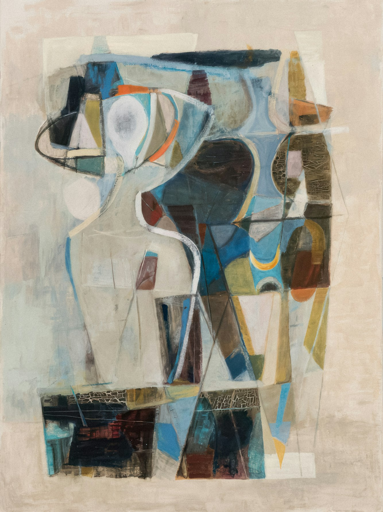

### Experimentation & Play

**Experimentation** = _assunzione di rischi, innovazione, provare_.

È un modo importante per imparare. Fa parte della vita quotidiana e anche del processo scientifico.

L’idea del gioco aggiunge una dimensione ulteriore che riflette un aspetto del fare e del creare, aspetti che tradizionalmente sono stati esclusi dalla “scienza”.

L’esame per questo corso è un invito a mettere in pratica tutto ciò.

---

<!-- _footer: Image: Unsplash. <a href="https://unsplash.com/photos/a-painting-of-a-womans-face-in-pastel-colors-4A9rAfOOmR8" target="_blank">Source</a>. -->

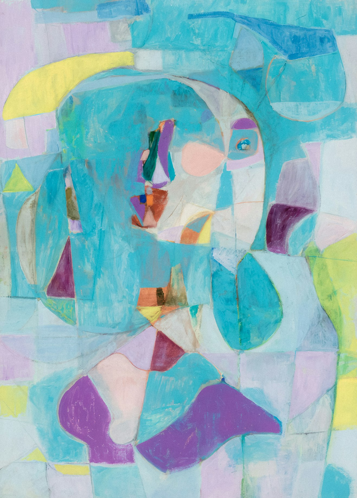

### Social Engagement & Responsibility

Le DH e il lavoro basato su progetti **non si limitano a rivolgersi al passato, ma anche al presente**.

L’impegno sociale può significare scegliere un tema di ricerca che sia rilevante oggi ma che prima non lo fosse: squilibrio di genere, ingiustizia sociale, patrimonio in pericolo.

La responsabilità può significare prestare attenzione all’etica, alla citazione, ai pregiudizi e al consumo energetico.

---

<!-- _class: impact -->

###### Part 2
# Labour & Credit in **practice**
## (or why knowledge work is situated)

---

<!-- _paginate: false -->
<!-- _footer: 1/ Haraway, D. (1988). Situated Knowledges: The Science Question in Feminism and the Privilege of Partial Perspective. Feminist Studies, 14 (3), 575–599. 2/ Gengnagel, T., & Lang, S. (2026). On the Digital Humanities and Ideologies of Knowledge Work [Conference slides]. DH2026 (ADHO), Daejeon. https://doi.org/10.5281/zenodo.22131598. Image: Unsplash. <a href="https://unsplash.com/photos/a-group-of-women-and-children-with-raised-hands-CcKJ1Kb7k5Q" target="_blank">Source</a>. -->

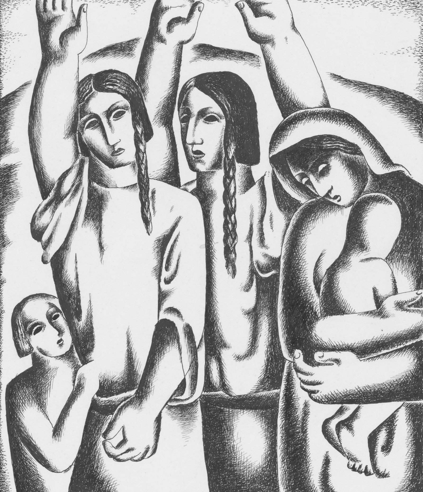

### Knowledge work is situated

Il lavoro intellettuale si riferisce all’elaborazione delle informazioni, in contrapposizione alla produzione fisica.

Nel 1988, Donna Haraway sosteneva che la conoscenza sia contestualizzata, nel senso che **non può essere separata dai propri contesti** (sociali, culturali, fisici) e richiede un approccio critico e una presa di responsabilità.

Quest'idea può essere estesa anche ai dati usati per il lavoro intellettuale.

---

<!-- _footer: Smith, A., & Whearty, B. (2023). All the Work You Do Not See: Labor, Digitizers, and the Foundations of Digital Humanities. In M. K. Gold & L. F. Klein (Eds.), *Debates in the Digital Humanities*. University of Minnesota Press. https://doi.org/10.5749/9781452969565. Image: Unsplash. <a href="https://unsplash.com/photos/abstract-rendering-of-a-seated-figure-with-dark-shadows-BVK761648Ds" target="_blank">Source</a>. Image (next slide): Digitization workflow diagram. <a href="https://dhdebates.gc.cuny.edu/read/f3f87448-138c-4d19-8ff8-b06acf40ddd1/section/f1946d2b-93ca-4ea0-ab8c-54fb835750ad" target="_blank">Source</a>. -->

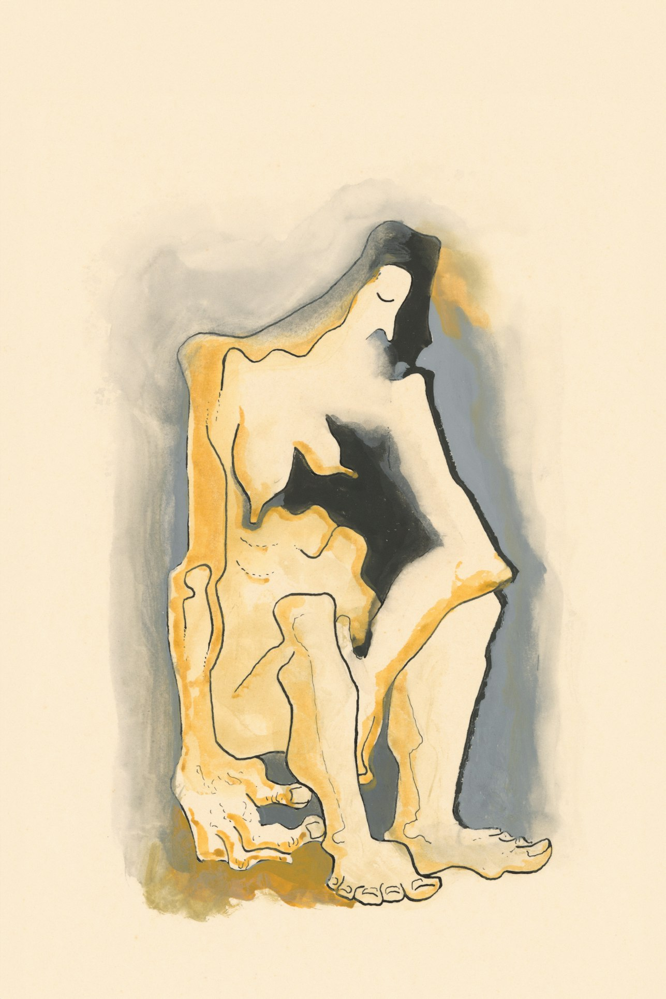

### Behind the object

Dietro ogni oggetto digitalizzato si cela spesso un lavoro non riconosciuto, storicamente nascosto.

Comprendere come gli oggetti passino dalla forma fisica a quella digitale significa anche contestualizzare il lavoro intellettuale che tale attività rende possibile.

🤔 Quali tipi di attività comportano la digitalizzazione dei beni del patrimonio culturale?

---

<!-- _footer: Smith, A., & Whearty, B. (2023). All the Work You Do Not See: Labor, Digitizers, and the Foundations of Digital Humanities. In M. K. Gold & L. F. Klein (Eds.), *Debates in the Digital Humanities*. University of Minnesota Press. https://doi.org/10.5749/9781452969565. Image: Unsplash. <a href="https://unsplash.com/photos/abstract-figures-in-warm-and-cool-colors-X6kPpLbpFRw" target="_blank">Source</a>. -->

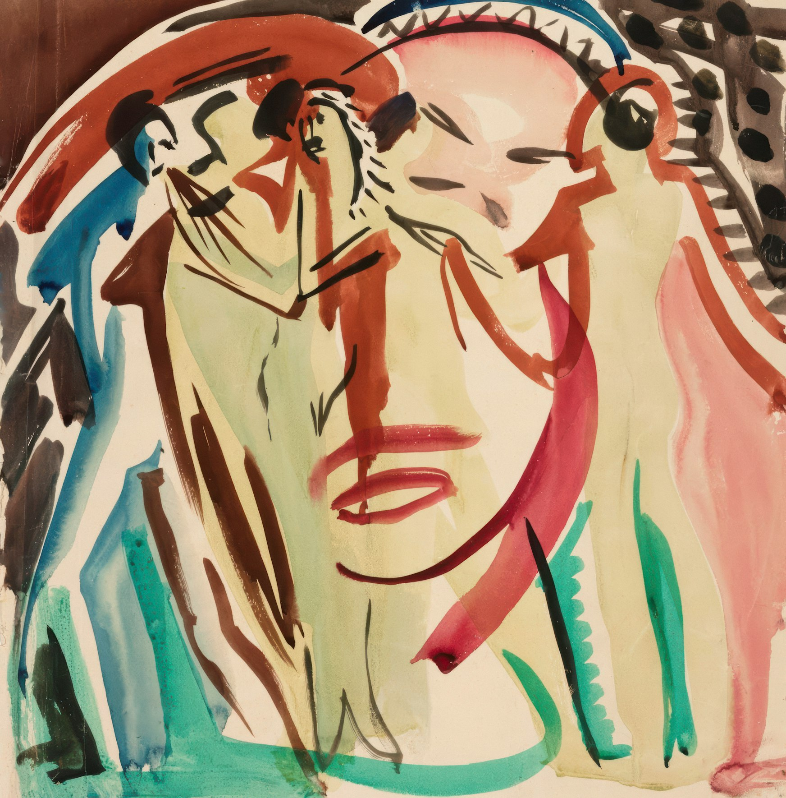

### Better practices

Come possiamo migliorare questa situazione?

- Non attribuirsi il merito del lavoro altrui.
- Riconoscere il merito del lavoro altrui, quando possibile e previo consenso.
- Utilizzare la documentazione o la visualizzazione per rendere visibili il lavoro e i processi.

---

<!-- _footer: Smith, A., & Whearty, B. (2023). All the Work You Do Not See: Labor, Digitizers, and the Foundations of Digital Humanities. In M. K. Gold & L. F. Klein (Eds.), *Debates in the Digital Humanities*. University of Minnesota Press. https://doi.org/10.5749/9781452969565. Image: Unsplash. <a href="https://unsplash.com/photos/man-in-blue-and-yellow-robe-sitting-on-brown-wooden-chair-painting-VDdP6Kilp-M" target="_blank">Source</a>. -->

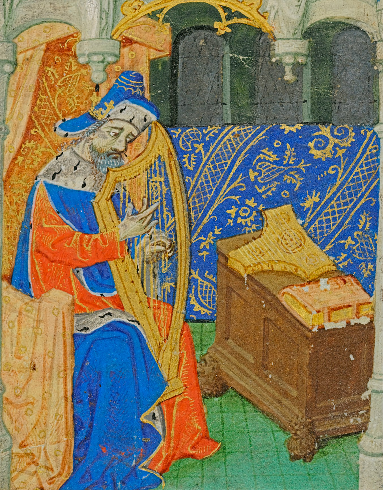

### Digital Scribal Colophons

Smith & Whearty propongono l'uso di colofoni digitali per consentire che le voci dei digitalizzatori siano incluse negli oggetti digitali da loro creati.

> "Accurately recording who does what for digital projects provides an essential record for understanding the past, present, and future of digital humanities."

---

<!-- _footer: Image: Unsplash. <a href="https://unsplash.com/photos/abstract-painting-of-three-faces-in-profile-faces-Z88llqyuhBQ" target="_blank">Source</a>. -->

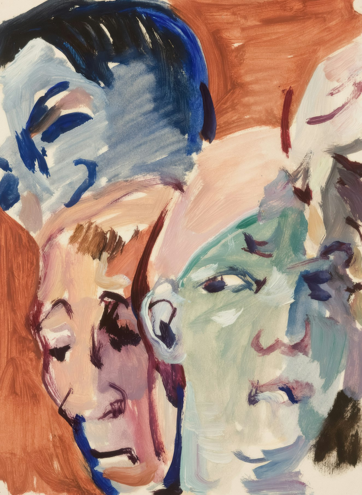

### What does it mean for you?

Sia che decidiate di sostenere l’esame in gruppo o individualmente, dovreste riflettere su come il lavoro venga riconosciuto e documentato, compreso quello a cui fate riferimento realizzato da altri: dai materiali digitalizzati ai software, fino alle metodologie.

L’esame finale rappresenta un’occasione per sperimentare con i concetti di valore e riconoscimento, al fine di comprendere come possano essere applicati, a voi stessi e agli altri, in altri contesti.

---

<!-- _footer: Image: Unsplash. <a href="https://unsplash.com/photos/three-figures-with-blurred-faces-in-abstract-style-GkY85WHhGl0" target="_blank">Source</a>. -->

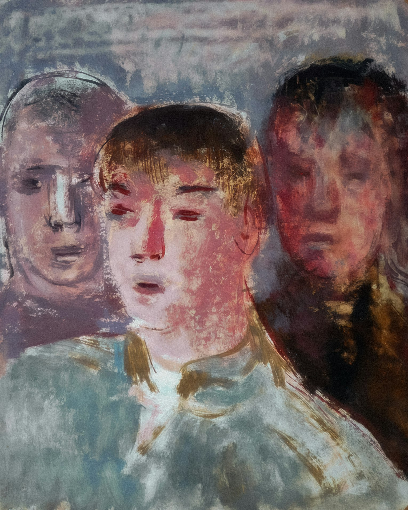

### Credit in practice

I metadati rappresentano un modo semplice per attribuire il merito. Sono già il luogo in cui ci si aspetta di trovarlo.

La <a href="https://credit.niso.org/" target="_blank">Tassonomia dei ruoli dei collaboratori (CRedIT)</a> è stata creata nel 2014 come sistema semplice per consentire l’attribuzione esplicita del merito per come viene prodotta la ricerca.

Si tratta di un esempio di come sia possibile utilizzare i metadati per andare oltre i concetti consolidati di autore, creatore o editore.

---

<!-- _class: impact -->

###### Part 3
# **GenAI** guidelines
## (for the course & exam)

---

<!-- _class: steps -->
<!-- _footer: Gengnagel, T., & Lang, S. (2026). On the Digital Humanities and Ideologies of Knowledge Work [Conference slides]. DH2026 (ADHO), Daejeon. https://doi.org/10.5281/zenodo.22131598. -->

### Labor & credit in the age of AI

* > "Especially now, in times of AI, **we can only survive if we value work well done**, or else, conditions will deteriorate for everyone." - Gengnagel & Lang (2026)

* Tutto ciò risulta ulteriormente complicato nel contesto attuale, in cui la GenAI viene presentata come uno strumento inevitabile. La GenAI, come le tecnologie di digitalizzazione che l’hanno preceduta, nasconde il merito e il lavoro offrendo un’unica soluzione che “sa” o “fa”. Gli strumenti di GenAI si basano sulle conoscenze altrui – i dati di addestramento – ma non ne riconoscono esplicitamente il merito.

* Ciò sottolinea l’importanza di riflettere sul perché e sul come si dovrebbero utilizzare questi strumenti nel lavoro intellettuale.

---

<!-- _footer: Image: Unsplash. <a href="https://unsplash.com/photos/abstract-blue-and-purple-geometric-shapes-on-white-background-tuglCX_unik" target="_blank">Source</a>. -->

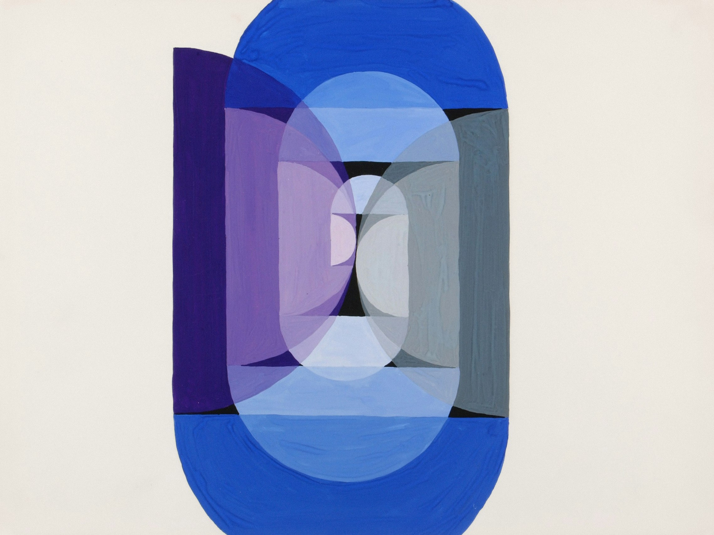

### Unibo policy

L'uso della GenAI come supporto all'apprendimento, in conformità con la <a href="https://www.unibo.it/it/ateneo/statuto-norme-strategie-bilanci/intelligenza-artificiale/intelligenza-artificiale" target="_blank"> norma Unibo sulla GenAI</a>, è consentito per questo corso e per l'esame finale.

Ciò comprende attività quali il supporto alla ricerca, la sintesi di documenti e la traduzione.

La norma opera una chiara distinzione tra **uso sostanziale** e **non sostanziale**, che potete consultare <a href="https://www.unibo.it/it/allegati/policy-per-un-uso-etico-e-responsabile-dell2019intelligenza-artificiale-generativa-nelle-attivita-di-didattica-e-ricerca/@@ download/file/Policy-Generative-AI.pdf" target="_blank">qui</a>.

---

<!-- _footer: Image: Unsplash. <a href="https://unsplash.com/photos/abstract-blue-geometric-shapes-on-a-white-background-9jrkkgKgi7w" target="_blank">Source</a>. -->

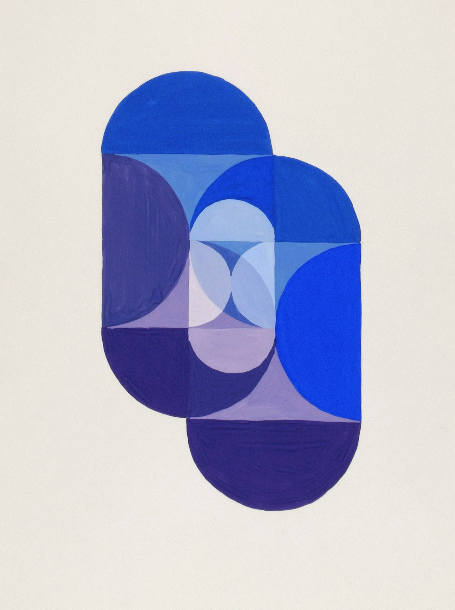

### GenAI for the exam

Le regole per l'esame seguono una logica simile, e la scelta spetta a voi.

Se decidete di utilizzare GenAI per generare un risultato (testo, immagine, documento, codice, analisi, ecc.), dovete documentarne l'uso secondo le <a href="https://github.com/laurentfintoni/dh-ravenna-26-27/blob/main/exam_guidelines.md" target="_blank">linee guida</a>. Si tratta di un concetto simile a quello che Unibo definisce “uso sostanziale”. Vi fornirò alcuni esempi di come deve presentarsi la documentazione.

Se decidete di non utilizzare GenAI, non chiederò alcuna prova. Si tratta di un sistema basato sulla fiducia.

---

<!-- _footer: Image: Unsplash. <a href="https://unsplash.com/photos/abstract-geometric-shapes-in-blue-orange-and-white-4tKPOf3Bcsg" target="_blank">Source</a>. -->

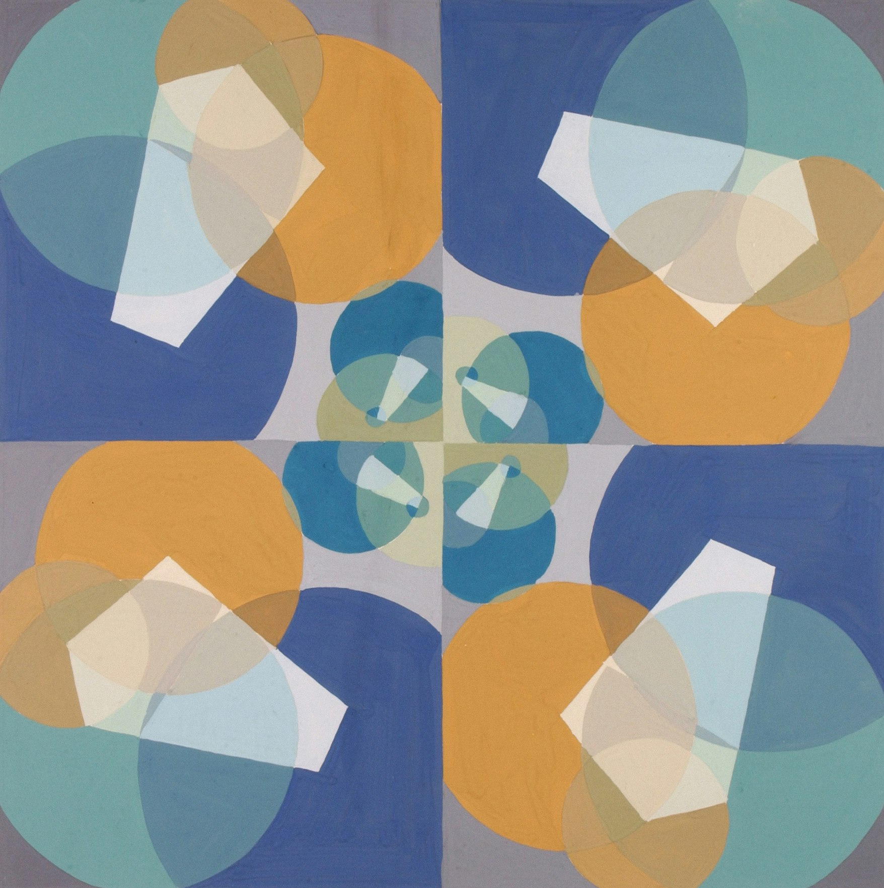

### GenAI for the exam

Se lavorate in gruppo, dovete decidere collettivamente se utilizzare o meno la GenAI.

L'utilizzo della GenAI può farvi guadagnare fino a 1 punto in più, mentre il non utilizzo fino a 2 punti in più. Questi punti sono facoltativi e saranno assegnati in base alla documentazione presentata e alla comprensione della scelta effettuata.

<a href="https://github.com/laurentfintoni/dh-ravenna-26-27/blob/main/exam_guidelines.md" target="_blank">Linee guida per l'esame</a>.

---

<!-- _class: impact -->

###### Part 4
# Documentation as **method**
## (remember as you go)

---

<!-- _footer: Albrezzi, F & Drucker, J. (2025). *The Digital Humanities Coursebook*. Routledge. Image: Unsplash. <a href="https://unsplash.com/photos/art-deco-wallpaper-with-gold-motifs--lNiAirIqp4" target="_blank">Source</a>. -->

### Documenting context

I metadati sono informazioni relative ai dati (oggetti, schede, ecc.). Vengono utilizzati per descrivere il contenuto o la struttura dei dati.

Ma cosa succede se vogliamo descrivere anche il contesto in cui questi dati sono stati creati?

Ricorriamo alla documentazione intesa come processo. Ma possiamo anche utilizzarla come metodo. Anziché documentare dopo aver agito, possiamo documentare mentre agiamo.

---

<!-- _footer: Andersson, L., Huvila, I., & Sköld, O. (2024). An Introduction to Paradata. In *Perspectives on Paradata: Research and Practice of Documenting Process Knowledge* (pp. 1–14). Springer International Publishing. https://doi.org/10.1007/978-3-031-53946-6_1. Image: Unsplash. <a href="https://unsplash.com/photos/XpZhzwbjoXQ" target="_blank">Source</a>. -->

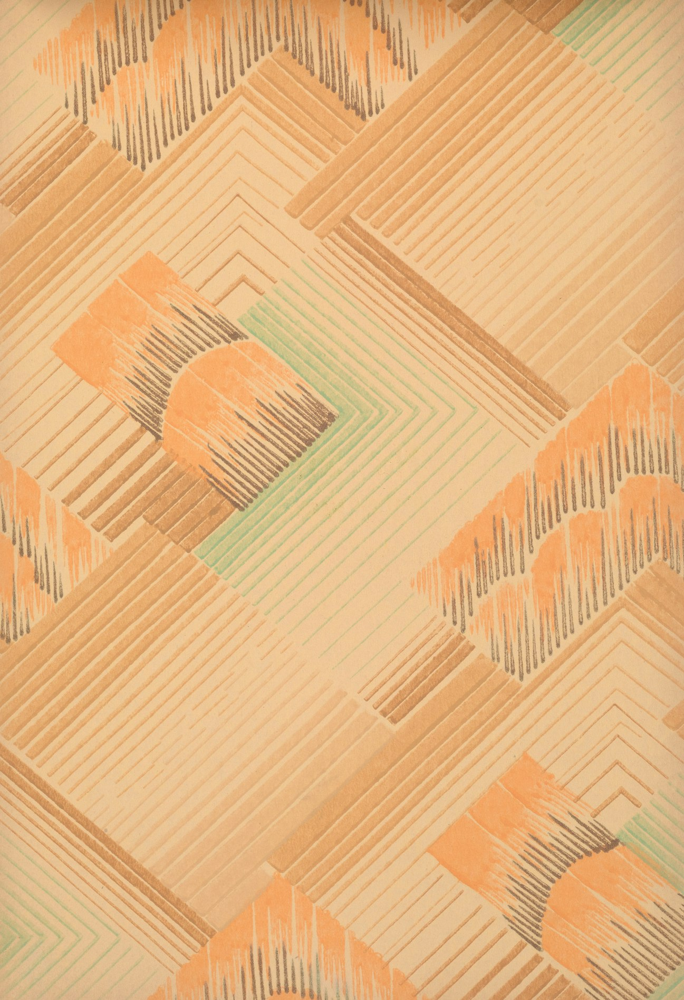

### Paradata

I _paradati_ sono un concetto recente che si propone come un **livello aggiuntivo ai metadati**, in grado di fornire un contesto per loro: processi, prassi, decisioni.

Possono essere utilizzati per registrare la provenienza, i flussi di lavoro e i metodi di creazione dei dati.

Il modo più semplice per raccogliere i paradati consiste nel **tenere una documentazione attiva** di cosa, perché e come si è agito.

---

<!-- _footer: Albrezzi, F & Drucker, J. (2025). *The Digital Humanities Coursebook*. Routledge. Image: Unsplash. <a href="https://unsplash.com/photos/a-pattern-of-circles-and-shapes-on-a-gray-background-dOu4946dglc" target="_blank">Source</a>. -->

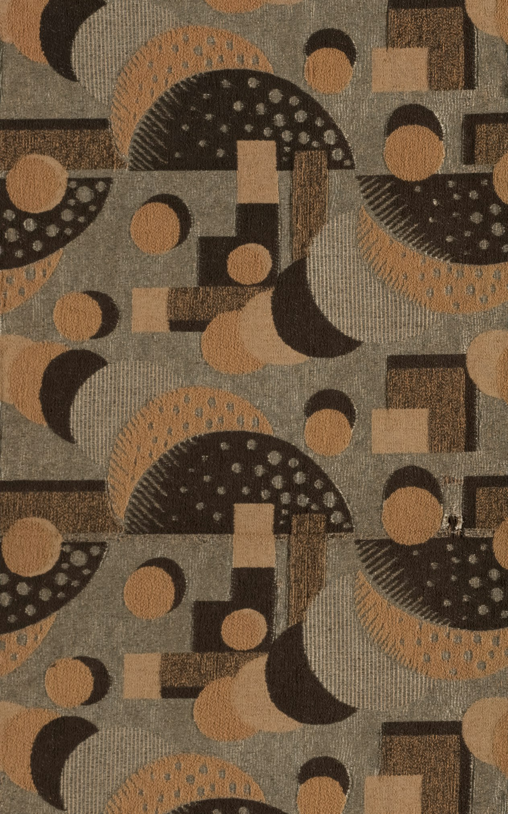

### Document as you go

Concordare i valori, registrare chi ha fatto cosa, documentare l’uso di GenAI sono tutti esempi di documentazione intesa come metodo, di paradati in relazione a un progetto.

I progetti digitali richiedono di **documentare man mano che si procede**.

Non è facile, ma spesso è essenziale. Senza una buona documentazione è difficile ripetere o condividere facilmente il lavoro svolto.

---

<!-- _footer: Image: Unsplash. <a href="https://unsplash.com/photos/stylized-geometric-pattern-with-repeating-fox-motifs-8Jygxkcgv3Y" target="_blank">Source</a>. -->

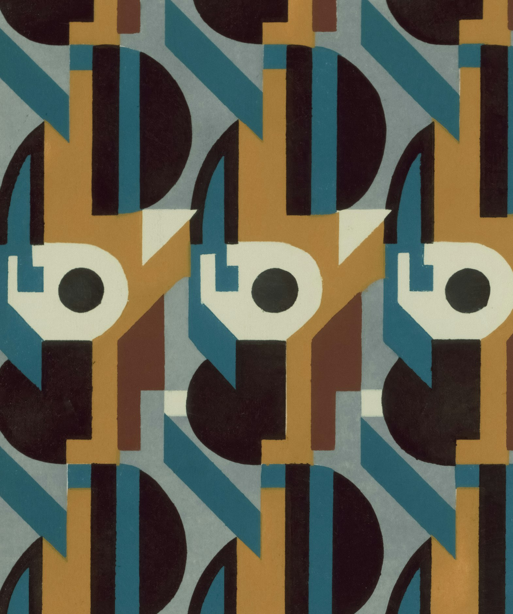

### Worklog for exam

La documentazione per l'esame finale dovrebbe assumere la forma di un diario di lavoro (worklog), ovvero un **semplice documento che riporti ciò che state facendo man mano che lo fatte**.

Dovrebbe includere le decisioni (e il motivo), quali le fonti dei dati, le scelte relative ai metadati o interfaccia, il modo in cui avette svolto il lavoro (compreso l'uso della GenAI) ecc...

(va bene anche se documentate in un secondo momento, il punto è imparare.)

---

<!-- _paginate: false -->

# Digital Humanities / Data Management / Informatica per i Beni Culturali (2026/2027)

## 03. Values, Credit, Documentation, GenAI ✅

### Thank you 🙏🏻
