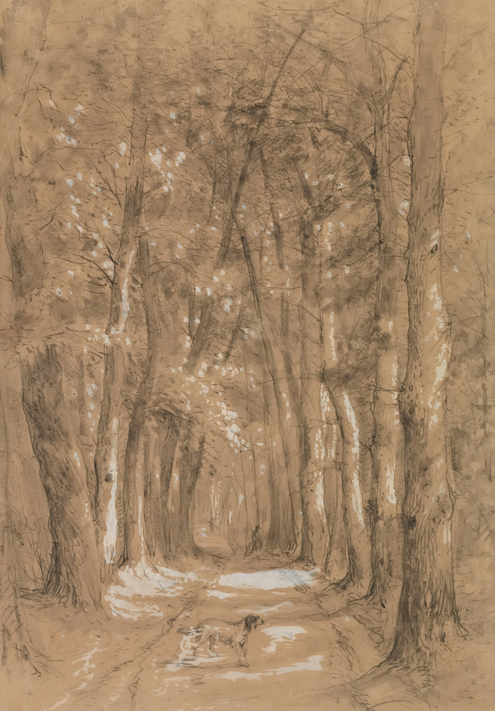
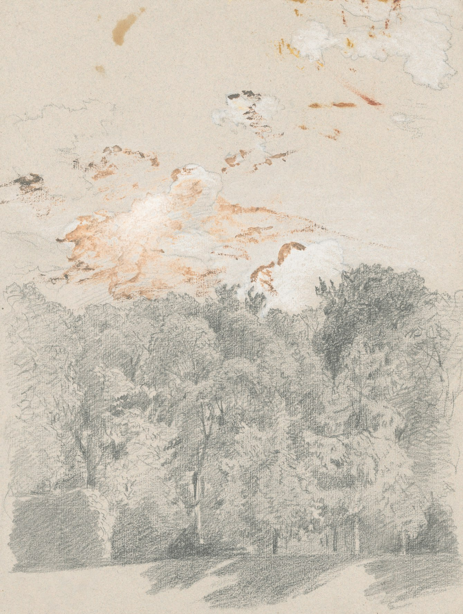
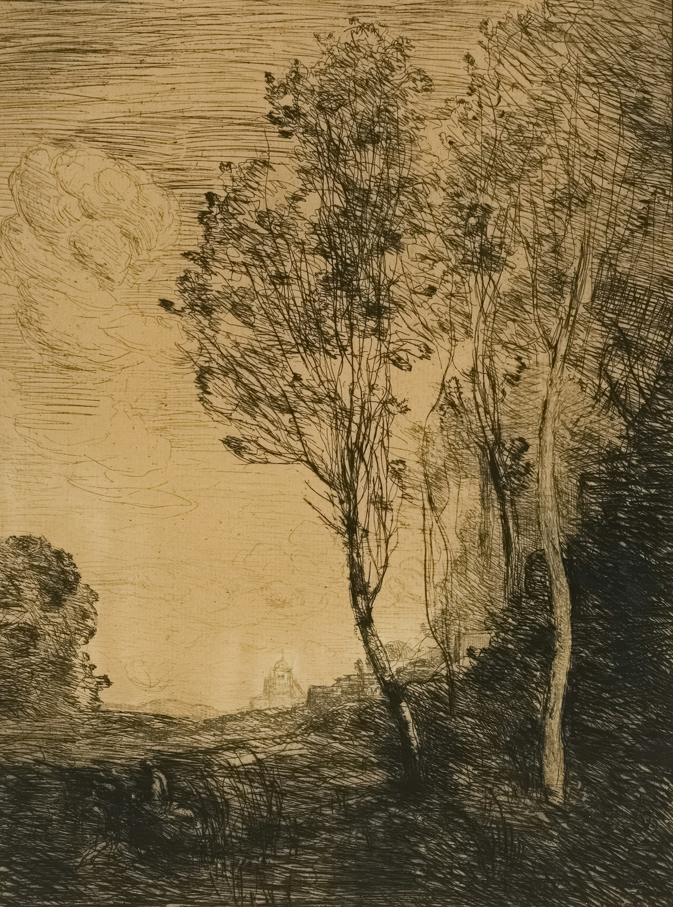
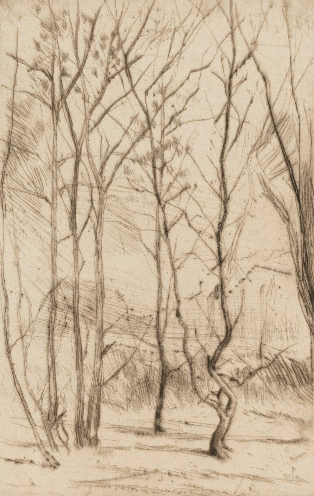

<!-- _paginate: false -->
<!-- _footer: Image: Unsplash. <a href="https://unsplash.com/photos/a-path-through-a-sun-dappled-forest-with-trees-orPmToerhrE" target="_blank">Source</a>. -->

# Digital Humanities / Data Management / Informatica per i Beni Culturali (2026/2027)

## 04. Literacies / PRATICA

➡️ Mail: [laurent.fintoni2@unibo.it](mailto:laurent.fintoni2@unibo.it)

---

<!-- _class: impact -->

###### Exercise 1
# **Object** first
## research as inquiry

---

<!-- _footer: Image: Unsplash. <a href="https://unsplash.com/photos/trees-and-clouds-rendered-in-pencil-sketch-GsdeXxg6JQU" target="_blank">Source</a>. -->

### Exercise

**Goal**: mettere in pratica il concetto di “ricerca come indagine”.

**What**: Partendo da un elemento, crea una serie di candidati e una possibile domanda di ricerca. 

**Time**: 15 mins. 

**Tools**: browser, notes/document. 

Farò una dimostrazione e poi vi dividerete in gruppi o lavorerete individualmente.

---

### Object first

1. Scegliete una fonte (dall’elenco che ho condiviso o una propria);
2. Sfogliate quella fonte, **senza effettuare ricerche**, scegliete un oggetto che susciti il proprio interesse;
3. Seguite i suoi metadati (autore, argomento, collezione ecc.) e vedete quanti oggetti simili o correlati riuscite a trovare. Ad esempio, dipinti dello stesso autore.
4. Documentate l’oggetto scelto, dove l’avete trovato, quanti altri ne avete trovati e a quale domanda potrebbero aiutarvi a rispondere.

#### Example

_Source_: <a href="https://www.europeana.eu/it" target="_blank">Europeana</a>. 
_Note_: Ho cliccato su “Collezioni” -> “Argomenti” -> “Strumenti musicali”. 
_Item_: <a href="https://www.europeana.eu/it/item/2048047/Clasate_35cf13ed40c046a29e999afb2b25db32" target="_blank">Radioreceptor AEG SUPER 68WK</a>. 
_Metadata_: type -> <a href="https://www.europeana.eu/it/collections/topic/3339-radio-receiver" target="_blank">radio</a>. 
_Similar items_: si, tanti! 
_Possible questions_: popolarità dei produttori, paesi in cui vengono adottati, design. 

---

<!-- _class: impact -->

###### Exercise 2
# **term** exploration
## searching as strategic exploration

---

<!-- _footer: Image: Unsplash. <a href="https://unsplash.com/photos/trees-and-landscape-with-distant-buildings-under-a-cloudy-sky-QTAcBYtcxUQ" target="_blank">Source</a>. -->

### Exercise

**Goal**: mettere in pratica il concetto di “ricerca come esplorazione strategica”.

**What**: Partendo da un termine, esplorare come le alternative modifichino i risultati.

**Time**: 15 mins. 

**Tools**: browser, notes/document. 

Farò una dimostrazione e poi vi dividerete in gruppi o lavorerete individualmente. 

---

### Term exploration

1. Scegliere un termine relativo a un argomento di interesse (o un termine dei metadati tratto dall’esercizio 1).
2. Utilizzate <a href="https://thes.bncf.firenze.sbn.it/ricerca.php" target="_blank">Nuovo soggettario</a> o <a href="https://www.getty.edu/research/tools/vocabularies/aat/" target="_blank">Getty AAT</a> per esplorarne la struttura gerarchica: più ampio, più ristretto, correlato, tradotto. Scegliete almeno 2 termini alternativi.
3. Utilizzando il termine scelto + le alternative selezionate, effettuate una ricerca in almeno 2 fonti e osservate come differiscono i risultati.
4. Documentate il termine scelto, le alternative, le fonti e quale vi è sembrato più utile.

Non preoccuparvi se non trovate nulla di utile! Il processo è altrettanto importante: potete provare termini diversi finché non trovate qualcosa con alternative interessanti.

---

#### Example

_Term_: radio (from exercise 1). 
_Ladder_: <a href="https://thes.bncf.firenze.sbn.it/termine.php?id=28178" target="_blank">Nuovo Soggettario</a>. 
_Alternative terms_: Strumenti; Propaganda radiofonica; Teatro radiofonico. 
_Search_: Europeana; Catalogo Beni Culturali. 
_Result_: All'interno di Europeana è emersa una raccolta legata a una rivista spagnola intitolata Ondas, dedicata al teatro radiofonico. Sebbene la qualità dei materiali presenti su Europeana non sia elevata, la piattaforma fornisce un rimando al fornitore originale.

---

<!-- _class: impact -->

###### Exercise 3
# **same** query, **different** systems
## authority is constructed and contextual

---

<!-- _footer: Image: Unsplash. <a href="https://unsplash.com/photos/bare-trees-in-a-sketch-of-a-forest-Q85-IyKybSM" target="_blank">Source</a>. -->

### Exercise

**Goal**: mettere in pratica il concetto secondo cui "l'autorità è costruita e contestuale".

**What**: Scegliete una query (ad esempio Galla Placidia) ed eseguitela in diversi sistemi, inclusi quelli commerciali e istituzionali (Google, udm14.org, Europeana, Catalogo Generale, Wikimedia Commons, ecc.). Confrontate i risultati ottenuti – oggetti, descrizioni, schede – e osservate quali informazioni differiscono (diritti, fonti, ecc.).

---

<!-- _paginate: false -->

# Digital Humanities / Data Management / Informatica per i Beni Culturali (2026/2027)

## 04. Literacies / PRATICA ✅

### Thank you 🙏🏻
