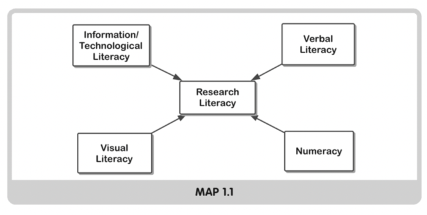
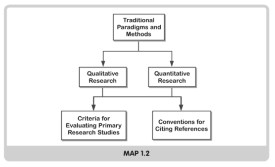
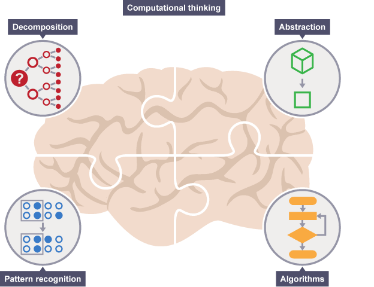

<!-- _paginate: false -->
<!-- _footer: Image: Unsplash. <a href="https://unsplash.com/photos/an-abstract-painting-of-a-person-holding-a-piece-of-paper-GAHhNJSOkmo" target="_blank">Source</a>. -->

# DH & Data Management per i Beni Culturali (2026/2027)

## 04. Research, Data, AI Literacies

➡️ Mail: [laurent.fintoni2@unibo.it](mailto:laurent.fintoni2@unibo.it)
➡️ ORCID: [0000-0002-8656-4602](https://orcid.org/0000-0002-8656-4602)
➡️ Sito: [laurent.fintoni2](https://www.unibo.it/sitoweb/laurent.fintoni2)

---

<!-- _footer: Image: Unsplash. <a href="https://unsplash.com/photos/two-women-talking-in-the-library-gm09x1AgA1A" target="_blank">Source</a>. -->

### C'era una volta...

Le biblioteche! Luoghi di conoscenza e di comunità.

Queste biblioteche sono gestite da persone il cui compito è valutare le richieste degli utenti e aiutarli a trovare i libri, o altre risorse, di cui hanno bisogno.

Non è un sistema perfetto, ma è un buon sistema che ha superato la prova del tempo.

Finché non è arrivato un nuovo tipo di macchina.

---

<!-- _footer: Novak, M. (2025). Librarians Are Tired of Being Accused of Hiding Secret Books That Were Made Up by AI. *Gizmodo*. https://gizmodo.com/librarians-arent-hiding-secret-books-from-you-that-only-ai-knows-about-2000698176 Image: Unsplash. <a href="https://unsplash.com/photos/people-studying-under-lamps-in-a-library-hMlZ7CKA7TM" target="_blank">Source</a>. -->

### C'è oggi...

C'è un piccolo problema.

Ai bibliotecari viene chiesto di trovare libri che non esistono. Questi libri, così come altre fonti, sono inventati dalla GenAI.

Chi usa la GenAI per cercare informazioni tende a credere che la macchina “abbia” autorità e potrebbe non accettare l’idea che possa sbagliarsi.

Le fonti hanno sempre contenuto menzogne, ma ora queste sono più frequenti e potenzialmente più pericolose.

---

<!-- _class: impact -->

###### Part 1
# **research** literacy
## (or why knowing how to find matters as much as finding)

---

<!-- _footer: Bishop, C. (2023). Information Overload. *Artforum*. https://www.artforum.com/features/claire-bishop-on-the-superabundance-of-research-based-art-252571/ -->

### Search vs Research

> "Searching is the preliminary stage of looking for something [...] Research proper involves analysis, evaluation, and a new way of approaching a problem." — Bishop (2023)

È una distinzione semplice ma importante. Il modo in cui si effettua la ricerca è spesso influenzato dalle tecnologie con cui siamo cresciuti. Si deve adattare. Un sistema che un tempo davi per scontato potrebbe non funzionare più come desideri o di cui hai bisogno.

A volte, adattarsi può anche significare fare un passo indietro, per abbracciare modi di fare “più semplici”: utilizzare una biblioteca; utilizzare un browser che elimina l’intelligenza artificiale e la pubblicità, ecc.

---

<!-- _footer: Grinnell College Libraries. (n.d.). *Teaching Research Literacy*. https://www.grinnell.edu/academics/libraries/faculty-staff/services-teaching/teaching-research-literacy -->

### Research literacy

> “Research literacy is a set of **interdisciplinary, transferable competencies** that help individuals determine and diminish knowledge gaps. [...] Research literacy is the sum of the attributes required of lifelong learners.” — Grinnell College Libraries (n.d.)

Nel mondo accademico ciò significa rispondere a una domanda di ricerca o a un’ipotesi avvalendosi di ricerche, risultati e approfondimenti già esistenti. Nel mondo reale significa essere in grado di risolvere un problema ampliando le proprie conoscenze. Si tratta di un percorso che dura tutta la vita.

🤔 Quali tipi di conoscenze/competenze ritenete siano necessarie per l’alfabetizzazione alla ricerca?

---

<!-- _footer: Beaudry, J., & Miller, L. (2016). *Research Literacy: A Primer for Understanding and Using Research*. Guilford Publications. https://books.google.it/books?id=emueCwAAQBAJ -->

---

<!-- _footer: ACRL. (2015). *Framework for Information Literacy for Higher Education*. https://www.ala.org/acrl/standards/ilframework Image: Unsplash. <a href="https://unsplash.com/photos/a-picture-of-a-painting-on-a-wall-P3aEFrDcRjY" target="_blank">Source</a>. -->

### Information literacy

Pietra miliare fondamentale della research literacy. Ecco i 6 principi su cui si fonda:

- L’autorità è costruita e contestuale
- La creazione di informazioni come processo
- L’informazione ha valore
- La ricerca come indagine
- La ricerca accademica come dialogo
- La ricerca come esplorazione strategica

---

<!-- _footer: ACRL. (2015). *Framework for Information Literacy for Higher Education*. https://www.ala.org/acrl/standards/ilframework Image: Unsplash. <a href="https://unsplash.com/photos/a-piece-of-art-that-is-on-a-wall-JapoB9GcCz4" target="_blank">Source</a>. -->

### Information literacy

_L'autorità è contestuale_ allo stesso modo in cui <a href="https://laurentfintoni.github.io/dh-ravenna-26-27/lessons/03/20261113-workshop01.html" target="_blank">la conoscenza è situata</a>. Non bisogna mai fidarsi ciecamente di una fonte.

_L’informazione ha valore_ perché oggi spesso consiste in dati e metadati relativi al mondo (incluso noi!).

Si dever valutare i fonti, risultati, ecc.

Per una guida in italiano su tutto questo, consultate <a href="https://www.aib.it/repertori/information-literacy-strumenti-di-lavoro/" target="_blank">Information Literacy – Strumenti di lavoro</a> dell’AIB.

---

<!-- _class: impact -->

###### Part 2
# **Search** Literacy
## (or where and how to find sources)

---

<!-- _class: steps -->
<!-- _footer: Image: Unsplash. <a href="https://unsplash.com/photos/abstract-composition-with-overlapping-geometric-shapes-and-patterns-GXtOq9iaXNI" target="_blank">Source</a>. -->

### Where to find sources?

* 🤔 Se avete bisogno di trovare una fonte online, dove cercate?

* Motori di ricerca commerciali o specializzati (<a href="https://scholar.google.com/" target="_blank">Google Scholar</a>).
* Archivi istituzionali (Unibo, <a href="https://iccd.cultura.gov.it/" target="_blank">ICCD</a>, <a href="https://archivinazionali.cultura.gov.it/it/" target="_blank">Archivi Nazionali</a>, <a href="https://opac.sbn.it/" target="_blank">SBN</a>).
* L’<a href="https://archive.org/" target="_blank">Internet Archive</a> e la <a href="https://web.archive.org/" target="_blank">Wayback Machine</a>.
* Riferimenti e bibliografie (articoli scientifici ma anche pagine web).

---

<!-- _class: steps -->
<!-- _footer: Image: Unsplash. <a href="https://unsplash.com/photos/abstract-composition-with-geometric-shapes-and-bold-colors-CXL6Nyf5uY8" target="_blank">Source</a>. -->

### How to evaluate sources?

* 🤔 Se bisogna valutare una fonte, quali domande bisogna porsi?

* Di che fonte si tratta? Quali sono le affermazioni riportate?
* Chi è l’autore? Quali sono le sue credenziali?
* A quando risale? È ancora attuale?
* Valutare una fonte non è sempre facile, ma dedicarci anche solo qualche minuto può aiutare ad assicurarsi di non commettere errori.

---

### Tips, Tricks, Pitfalls

#### Operators
Gli operatori di ricerca sono comandi o caratteri che consentono di affinare la ricerca. Il più comune è `“la mia query”`, dove le virgolette `“”` indicano al motore di ricerca di cercare una corrispondenza esatta. Google mantiene un <a href="https://support.google.com/websearch/answer/2466433?hl=en" target="_blank">elenco degli operatori accettati</a> e la maggior parte dei motori di ricerca o delle funzioni li segue (o ne utilizza di simili).

#### Ads & Sponcon
Oggi la maggior parte dei motori di ricerca combina risultati “organici” con risultati sponsorizzati (annunci pubblicitari). Allo stesso tempo, alcuni contenuti online sono in realtà annunci pubblicitari mascherati da qualcos’altro.

---

### Tips, Tricks, Pitfalls

#### Personalised results
Se durante la ricerca avete effettuato l'accesso a un servizio come Google o Microsoft (il profilo), i risultati saranno personalizzati in base ai dati che l'azienda possiede. La stessa ricerca effettuata in un browser senza accesso potrebbe dare risultati diversi. Lo stesso vale per la posizione (indirizzo IP fornito dalla connessione, per quello si usa VPN).

#### There is more than one page!
È assolutamente possibile trovare ciò che si cerca anche oltre la prima pagina dei risultati.

#### AI summaries
La genAI sintetizza i risultati principali. Controllate sempre oppure <a href="https://surnex.io/blog/non-ai-search-engine" target="_blank">utilizzate un browser dotato di controlli più rigorosi in materia di privacy e intelligenza artificiale</a>.

---

### Sources for the final exam

Potete scegliere autonomamente la fonte dei dati per l'esame finale. Per aiutarvi, vi fornisco anche un elenco di fonti che potete consultare o da cui potete partire; tutte offrono diversi tipi di oggetti digitalizzati, tra cui mappe, testi e immagini. La lista è nelle linee guida.

<a href="https://www.europeana.eu/it" target="_blank">Europeana</a> (EU); <a href="https://www.loc.gov/free-to-use/" target="_blank">Library of Congress</a> (US); <a href="https://www.library.universiteitleiden.nl/special-collections/collections" target="_blank">Leiden University</a> (NL); <a href="https://historica.unibo.it/home" target="_blank">AMS Historica</a> (IT); <a href="https://www.nga.gov/artworks/free-images-and-open-access" target="_blank">National Gallery of Art</a> (US); <a href="https://www.internetculturale.it/" target="_blank">Internet Culturale</a> (IT); <a href="https://alphabetica.it/web/alphabetica" target="_blank">Alphabetica</a> (IT); <a href="https://imago.regione.emilia-romagna.it/opac/.do" target="_blank">Imago</a> (IT); <a href="https://commons.wikimedia.org/wiki/Main_Page" target="_blank">Wikimedia Commons</a>; <a href="https://archive.org" target="_blank">Internet Archive</a>.

Parleremo dei diritti, compreso il riutilizzo, nella Lezione 07. Per ora basta sapere che la maggior parte di queste fonti ha licenze permissive. In caso di dubbio, bisogno sempre di cercare un'oggetto con una licenza aperta o di dominio pubblico.

---

<!-- _class: impact -->

###### Part 3
# **Data** Literacy
## (or how to understand data)

---

<!-- _paginate: false -->
<!-- _footer: Abner, K. (2020). Data Literacy as Digital Humanities Literacy: Exploration of Threshold Concepts. *dh+lib*. https://dhandlib.org/data-literacy-as-digital-humanities-literacy-exploration-of-threshold-concepts/ -->

### Data Literacy

> “Digital humanities literacy is a combination of many literacy areas. Still, **the prevalence of data in both our daily lives and in digital humanities places data literacy in a position of importance**.” — Abner (2020)

Oggi, l'information literacy si sta espandendo verso nuove forme di alfabetizzazione specifica, come la data literacy.

Data literacy, in senso lato, è la capacità di **creare, manipolare, gestire, analizzare, comprendere e comunicare i dati in modo critico**. È un modo per confrontarsi con il potere e l’impatto dei dati, i loro usi e i loro limiti.

---

<!-- _footer: Abner, K. (2020). Data Literacy as Digital Humanities Literacy: Exploration of Threshold Concepts. *dh+lib*. https://dhandlib.org/data-literacy-as-digital-humanities-literacy-exploration-of-threshold-concepts/ Image: Unsplash. <a href="https://unsplash.com/photos/a-painting-with-a-green-circle-on-top-of-it-s2UR2Wg0Fec" target="_blank">Source</a>. -->

### Data Literacy concepts

- I dati sono generati sia da macchine che da esseri umani.
    - Non sono intrinsecamente oggettivi.
- I dati rappresentano solo una parte della storia.
    - Da soli non possono fornire un quadro completo.
- I dati fanno parte del dibattito accademico e professionale.
    - Risultano di determinati processi.

🤔 Quali sono alcune delle implicazioni etiche legate all’uso/creazione dei dati?

---

<!-- _footer: 1/ D'Ignazio, C., & Klein, L. (2020). *Data Feminism*. MIT Press. https://data-feminism.mitpress.mit.edu/ 2/ Risam, R. (2026). *Data Empire*. Random House. Image: Unsplash. <a href="https://unsplash.com/photos/a-painting-with-a-circle-and-lines-on-it-p1b063_AAqY" target="_blank">Source</a>. -->

### Data Ethics

- Qual è la licenza per l’uso/il riutilizzo?
- Comeperché sono stati raccolti i dati?
- Chi ne è stato, e potrebbe ancora esserne, interessato?
- Perché vengono condivisi i dati?
- Come vengono descritti i dati?

La scienza dei dati è sempre stata una forma di potere. Fin dall’antichità è stata utilizzata per organizzare la società.

Come sostiene Roopika Risam, "anche se non tutto è dato, i dati sono ovunque."

---

<!-- _footer: 1/ Candela, G., Dritsou, V., Chambers, S., Benardou, A., Irollo, A., & Tasovac, T. (2024). *Introduction to Collections as Data* (Version 1.0.0) [Training module]. DARIAH-Campus. https://hdl.handle.net/21.11159/019595c5-1bc8-751c-8201-bcdb34955a96 2/ Collections as Data. (n.d.). *Part to Whole*. https://collectionsasdata.github.io/part2whole/ Image: Unsplash. <a href="https://unsplash.com/photos/a-painting-with-a-lot-of-different-colors-on-it-O4gzS4NUEAc" target="_blank">Source</a>. -->

### Collections as data

<a href="https://collectionsasdata.github.io/part2whole/" target="_blank">“Collections as Data</a>” è un'iniziativa volta a promuovere la pubblicazione di collezioni digitali adatte a un utilizzo computazionale responsabile.

Si tratta di un quadro di riferimento che consente alle istituzioni del patrimonio culturale di riflettere su come e perché rendere le proprie collezioni disponibili al pubblico per il (ri)utilizzo.

Attualmente si sta lavorando su l’implementazione e l’uso responsabile.

---

<!-- _footer: Drucker, J. (2011). Humanities Approaches to Graphical Display. *Digital Humanities Quarterly*, *5*(1). https://dhq.digitalhumanities.org/vol/5/1/000091/000091.html Image: Unsplash. <a href="https://unsplash.com/photos/a-painting-with-blue-and-brown-squares-on-it-0_erDmzjMkA" target="_blank">Source</a>. -->

### What if data is the wrong word?

Possiamo cambiare il nostro modo di concepire i dati, riflettendo sul significato stesso del termine.

Nel 2011, Johanna Drucker ha sostenuto che "il concetto di dati come dato di fatto deve essere ripensato attraverso una lente umanistica e definito come **capta**, ovvero raccolti e costruiti."

I dati incarnano delle scelte su cosa contare e in che modo. Sono interpretazione (come i metadati in fatto).

---

<!-- _class: impact -->

###### Part 4
# **AI** Literacy
## (or how to peer into a black box)

---

<!-- _footer: Lodi, M., & Martini, S. (2021). Computational thinking, between Papert and Wing. *Science & Education*, *30*(4), 883–908. https://doi.org/10.1007/s11191-021-00202-5 Image: Computational thinking cornerstones, BBC. <a href="https://www.bbc.co.uk/bitesize/guides/zp92mp3/revision/1" target="_blank">Source</a>. -->

### Computational Thinking

* **Decomposizione**: dividere un problema in parti più piccole e gestibili;
* **Riconoscimento di pattern**: cercare somiglianze e tendenze nei componenti del problema;
* **Astrazione**: focalizzarsi solo sulle informazioni rilevanti, rimuovendo dettagli non necessari;
* **Sviluppo di algoritmi**: sviluppare una soluzione sequenziale al problema.

---

<!-- _footer: Stewart, B. (2026). *DPI 2026 Keynote*. Digital Pedagogy Institute, University of Waterloo. https://uwaterloo.ca/digital-pedagogy-institute/keynotes Image: Unsplash. <a href="https://unsplash.com/photos/abstract-blue-buildings-and-figures-on-a-cream-background-rhkb5dmNBPQ" target="_blank">Source</a>. -->

### What are we talking about?

Proprio come si amplia l’information literacy, così si amplia anche la technological literacy. Quindi il pensiero computazionale, ma ora anche l’IA.

Ma cos’è l’IA?

Significa **cose diverse per persone diverse in contesti diversi**: IA generativa, LLM, apprendimento automatico, visione artificiale, sistemi di raccomandazione, tecnologia di sorveglianza, sistemi commerciali e governativi ecc.

---

<!-- _paginate: false -->
<!-- _footer: 1/ McMillan Cottom, T. (2026, August 3). Want to Fight Back Against Big Tech? Start Here. *The New York Times*. https://www.nytimes.com/2026/08/03/opinion/artificial-intelligence-data-politics.html 2/ McMillan Cottom, T. (2026). *Data Politics*. Instagram. https://www.instagram.com/p/Dbl8-8eGsrl/ Image: Unsplash. <a href="https://unsplash.com/photos/a-piece-of-art-with-yellow-paint-on-it-4l1ahap6HJA" target="_blank">Source</a>. -->

### What are we talking about?

Ciò che conta, ma spesso rimane “non detto”, è che l’IA, come viene utilizzata la parola oggi, implica una <a href="https://www.instagram.com/p/Dbl8-8eGsrl/" target="_blank">teoria politica</a>.

> "The technology is the backbone of a superstructure that merges regressive politics with unchecked economic power in the guise of technological innovation." — McMillan Cottom (2026)

---

<!-- _footer: Image: Unsplash. <a href="https://unsplash.com/photos/a-painting-with-a-lot-of-different-colors-and-shapes-pycEuXHETPs" target="_blank">Source</a>. -->

### AI Literacy

Il problema dell' AI literacy è che questa tecnologia è in gran parte una “scatola nera”. Non sappiamo tutto ciò che accade al suo interno. Pertanto, non possiamo davvero “decifrarla” come faremmo con altre cose.

Utilizzare le competenze già esistenti – ricerca, dati, informazioni – con alcuni adeguamenti specifici per l’IA è una buona strada da seguire. Stanno emergendo nuovi framework incentrati sull’IA, come il recente <a href="https://ailiteracyframework.org/" target="_blank">AILit Framework</a> dell’Unione Europea.

---

<!-- _class: steps -->
<!-- _footer: Image: Unsplash. <a href="https://unsplash.com/photos/a-number-of-different-shades-of-paint-on-a-white-surface-41Wjp_3noHo" target="_blank">Source</a>. -->

### AI Literacy

* 🤔 Secondo voi, cos’è necessario per AI literacy?

* Valutare come vengono recuperate e organizzate le informazioni.
* Valutare l’accuratezza, la parzialità e la credibilità dei risultati prodotti dall’IA.
* Comprendere l’uso etico dei contenuti generati dall’IA.
* Riflettere su come l’IA influenzi il processo decisionale.

---

<!-- _footer: 1/ Buolamwini, J. (2018). *Gender Shades*. http://gendershades.org/overview.html 2/ Drucker, J., & Albrezzi, F. (2025). *The Digital Humanities Coursebook* (2nd ed.). Routledge. Image: Unsplash. <a href="https://unsplash.com/photos/watercolor-painting-of-a-tree-by-a-lake-at-dusk-ptxJU7LdidI" target="_blank">Source</a>. -->

### Biases

I dati di addestramento per la GenAI sono sbilanciati a favore di punti di vista di uomini bianchi europei. Una soluzione consiste nel progettare dataset più mirati per contribuire a risolvere tali squilibri.

### AI & humanities

L'uso dell'IA nel campo umanistico richiede lo stesso approccio che abbiamo già visto: fonti, processi, presentazione.

I risultati devono essere interpretati nel loro contesto: storico, culturale, politico.

---

<!-- _footer: Image: Unsplash. <a href="https://unsplash.com/photos/a-painting-of-a-yellow-sky-with-clouds-FZWUmI2OqKw" target="_blank">Source</a>. -->

### Costs

- Delega cognitiva
- Scelte etiche
- Illusione di comodità
- Inevitabilità
- Appropriazione dalla piattaforma
- Illusione di autorità

---

<!-- _class: steps -->
<!-- _footer: 1/ Bender, E. M., & Hanna, A. (Hosts). (2026, July 6). Who's Responsible for "Responsible AI"? [Audio podcast episode]. In *Mystery AI Hype Theater 3000*. https://www.buzzsprout.com/2126417/episodes/19595620-who-s-responsible-for-responsible-ai-2026-07-06 2/ Fiesler, C. (2026, August 21). *[Reel]*. Instagram. https://www.instagram.com/reel/DcT8NGsq5hD/ -->

* > "It's like you're short-cutting yourself. You're taking away from the work. It's a lot of work. It's boring even. But then you arrive at the thing, and that's the process." — singh (2026)

* > "It is possible to learn about this technology without using it." — Fiesler (2026)

---

<!-- _paginate: false -->

# Digital Humanities / Data Management / Informatica per i Beni Culturali (2026/2027)

## 04. Research, Data, AI Literacies ✅

### Thank you 🙏🏻
