<!-- _paginate: false -->
<!-- _footer: Image: Nascita di Venere, Sandro Botticelli / Wikimedia Commons. <a href="https://commons.wikimedia.org/wiki/File:Sandro_Botticelli_-_La_nascita_di_Venere_-_Google_Art_Project_-_edited.jpg" target="_blank">Source</a>. -->

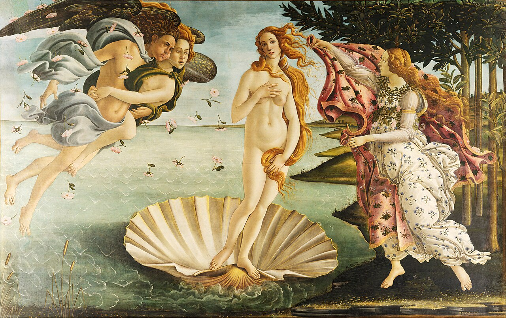

# DH & Data Management per i Beni Culturali (2026/2027)

## 05. Metadata & Standards

➡️ Mail: [laurent.fintoni2@unibo.it](mailto:laurent.fintoni2@unibo.it)
➡️ ORCID: [0000-0002-8656-4602](https://orcid.org/0000-0002-8656-4602)
➡️ Sito: [laurent.fintoni2](https://www.unibo.it/sitoweb/laurent.fintoni2)

---


### C'era una volta...

Un progetto volto a democratizzare il sapere umano attraverso la digitalizzazione di milioni di libri.

Google Books voleva consentire agli utenti di accedere a questi libri online e di effettuare ricerche nei loro contenuti.

Grazie ai progressi nella tecnologia e a collaborazioni, il progetto ha avuto un buon avvio a metà degli anni 2000.

Successivamente, gli studiosi hanno iniziato a utilizzarlo e ad analizzare i metadati.

---

<!-- _footer: Nunberg, G. (2009, August 29). *Google Books: A metadata train wreck*. Language Log. https://languagelog.ldc.upenn.edu/nll/?p=1701. Image: Unsplash. <a href="https://unsplash.com/photos/photo-of-brown-wooden-bookshelf-xrbbXIXAWY0" target="_blank">Source</a> -->


### C'era una volta...

Quello che hanno trovato era un vero caos.

Categorie, titoli, autori e date errati.

Il problema? _Trilioni di campi di metadati utilizzati per miliardi di decisioni automatizzate generano milioni di errori_.

Le scansioni erano “a posto”, ma i metadati no.

Digitalizzare un oggetto è una cosa. Descriverlo in modo che sia utile sia alle persone che alle macchine è un’altra.

---

<!-- _class: impact -->

###### Part 1
# metadata, **in depth**
## (a closer look at what metadata is and isn't)

---

<!-- _footer: 1/ Baca, M. (Ed.). (2016). *Introduction to Metadata* (3rd ed.). Getty Publications. https://www.getty.edu/publications/intrometadata/. 2/ Gilliland, A. J. (2016). Setting the Stage. In M. Baca (Ed.), *Introduction to Metadata* (3rd ed.). Getty Publications. https://www.getty.edu/publications/intrometadata/setting-the-stage/ -->

### What we have seen so far

➡️ I metadati sono "dati su dati" _che descrivono un oggetto informativo e ne documentano alcune caratteristiche_.

(oggetto informativo = qualsiasi cosa che possa essere trattata e gestita come entità distinta da un essere umano o da un sistema informatico.)

➡️ Hanno una struttura: un tipo (e.g. `title`) e un (o più) valori (e.g. `100 Ballads`).

➡️ Possono essere accompagnati da paradati per fornire un contesto.

➡️ Esistono da molto tempo, anche prima dell’era digitale (colofoni, tavolette).

➡️ Sono fondamentali per la gestione di oggetti. Oggi costituiscono una componente intrinseca dei sistemi informativi nel ambito dei beni culturali.

---

<!-- _footer: Australian Research Data Commons (ARDC). (2020). *ARDC Metadata Guide*. Zenodo. https://doi.org/10.5281/zenodo.6459832. Image: Solanum Nobile. <a href="https://powo.science.kew.org/taxon/urn:lsid:ipni.org:names:20008651-1/images" target="_blank">Source</a>. -->

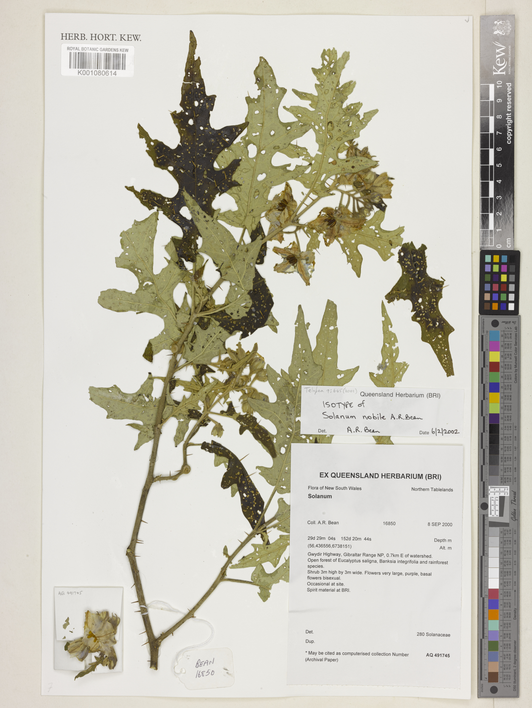

### Metadata can refer to...

💡 I metadati costituiscono _una forma di **documentazione**_ (di solito strutturata) che descrive o rappresenta le caratteristiche di un oggetto.

🔎 Possono essere usati per descrivere tanto gli oggetti _fisici_ (per esempio, frammenti di vasi, reperti archeologici, quadri, libri, persone, ecc.), quanto gli oggetti _digitali_ (per esempio, software, foto, dataset, videogiochi, modelli 3D, ecc.).

---

<!-- _footer: Australian Research Data Commons (ARDC). (2020). *ARDC Metadata Guide*. Zenodo. https://doi.org/10.5281/zenodo.6459832. Image: MARC record. <a href="https://mrc.cci.drexel.edu/2019/07/02/week-2-kai-li-its-all-about-marc/" target="_blank">Source</a>. -->

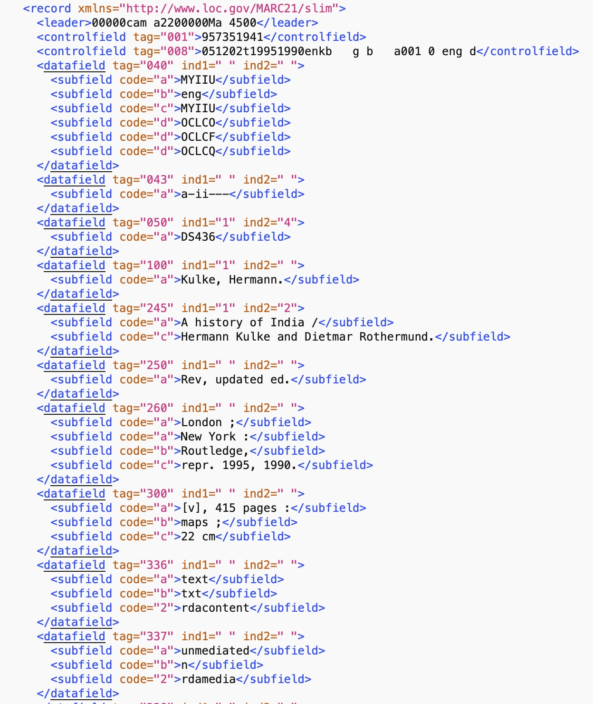

### Metadata can be...

💡 I metadati possono assumere molte _forme_ diverse.

🔎 A partire da semplice testo libero, pensato per un utilizzatore umano, possono esistere anche sotto forma di contenuto codificato _altamente strutturato, standardizzato e comprensibile dalle macchine_.

👉🏻 Tra i formati più diffusi per il salvataggio dei metadati figurano XML, CSV e JSON. (useremo CSV in questo corso)

---

<!-- _footer: Australian Research Data Commons (ARDC). (2020). *ARDC Metadata Guide*. Zenodo. https://doi.org/10.5281/zenodo.6459832. Image: Catalogue cards. <a href="https://en.wikipedia.org/wiki/Metadata" target="_blank">Source</a>. -->

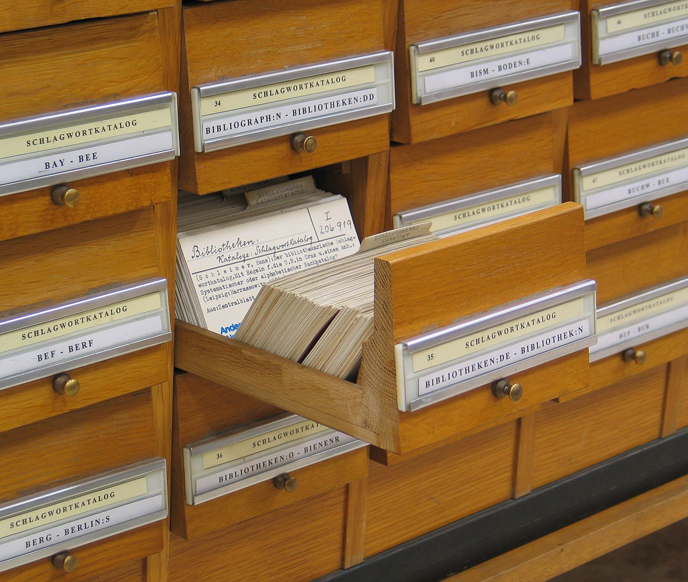

### Metadata are always...

💡 I metadati _accompagnano ciò che descrivono_ in vari modi.

🔎 Possono essere presenti direttamente _nei dati stessi_ (un file PDF o un'immagine digitale), oppure possono essere registrati _in oggetti separati collegati_ in qualche maniera ai dati che descrivono (file di testo, fogli di calcolo, scheda di catalogo o archivio, l'etichetta di un'opera in un museo).

👉🏻 I metadati aiutano a reperire i dati. Quindi vanno 'sempre' insieme.

---

<!-- _footer: 1/ Gualandi, B., Pareschi, L., & Peroni, S. (2023). What do we mean by "data"? A proposed classification of data types in the arts and humanities. *Journal of Documentation*, *79*(7), 51–71. https://doi.org/10.1108/JD-07-2022-0146. 2/ Gilliland, A. J. (2016). Setting the Stage. In M. Baca (Ed.), *Introduction to Metadata* (3rd ed.). Getty Publications. https://www.getty.edu/publications/intrometadata/setting-the-stage/ -->

### Types of metadata

- **Descrittivi**: descrivono dati usando dettagli sul contenuto che permettono a questi dati di essere rintracciabili, identificabili e selezionabili (es. titolo);
- **Strutturali**: forniscono informazioni sulla costruzione e sull'organizzazione dei dati all'interno della loro collezione o ogetto (es. indice);
- **Amministrativi**: permettono la gestione dei dati nel tempo, fornendo informazioni sulle loro origini e le loro modalità di utilizzo (es. created & updated).

### More (sub)types of metadata

- **Conservativi**: gestione della conservazione delle collezioni (es. stato del oggetto);
- **Tecnici**: funzionamento di un sistema o comportamento dei metadati (es. formatti) ;
- **Utilizzo**: livello e tipo di utilizzo (es. diritti).

---

<!-- _class: steps -->
<!-- _footer: Gilliland, A. J. (2016). Setting the Stage. In M. Baca (Ed.), *Introduction to Metadata* (3rd ed.). Getty Publications. https://www.getty.edu/publications/intrometadata/setting-the-stage/. Image: Lifecycle of an information object. <a href="https://www.getty.edu/publications/intrometadata/setting-the-stage/" target="_blank">Source</a>. -->

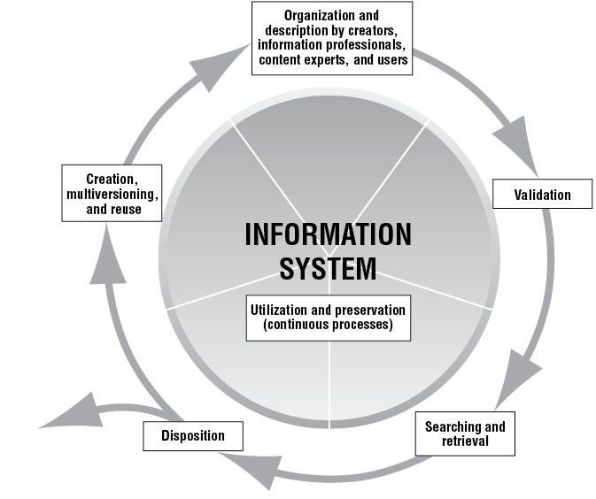

### Metadata is like interest...

* Si accumulano nel tempo!

* Ogni volta che un oggetto informativo attraversa una fase del proprio ciclo di vita (come illustrato in questa immagine), può acquisire un livello di metadati.

* 🤔 Quale tipo di metadati tra quelli che abbiamo appena visto si inserisce in quale fase di questo ciclo di vita?

---

<!-- _class: steps -->
<!-- _footer: Drucker, J., & Albrezzi, F. (2025). *The Digital Humanities Coursebook* (2nd ed.). Routledge. Image: Nascita di Venere, Sandro Botticelli / Wikimedia Commons. <a href="https://commons.wikimedia.org/wiki/File:Sandro_Botticelli_-_La_nascita_di_Venere_-_Google_Art_Project_-_edited.jpg" target="_blank">Source</a>. -->


### Metadata is an interpretation

* Proprio come i dati vengono raccolti, non dati, i metadati sono **un’interpretazione**. Richiedono delle scelte su cosa descrivere e in che modo.

* 🤔 Se si dispone di una versione digitale della fotografia di un dipinto, cosa si descrive? E in che modo?

* La <a href="https://catalogo.fondazionezeri.unibo.it/scheda/opera/15928/" target="_blank">scheda della Fondazione Zeri</a> relativa a la *nascita di Venere* elenca l’opera una volta e, separatamente, sei fotografie della stessa. Ciascuna ha una propria scheda.

---

<!-- _class: impact -->

###### Part 2
# Standards, schemas, **structure**
## (or how to agree on what to say, and how)

---

<!-- _footer: Sint, R., Schaffert, S., Stroka, S., & Ferstl, R. (2009, June). Combining unstructured, fully structured and semi-structured information in semantic wikis. In *CEUR workshop proceedings* (Vol. 464, No. 12, pp. 73-87). Crete, Greece: Heraklion. https://ceur-ws.org/Vol-464/paper-14.pdf. Image: Data types. <a href="https://www.researchgate.net/figure/Unstructured-semi-structured-and-structured-data_fig4_236860222" target="_blank">Source</a>. -->

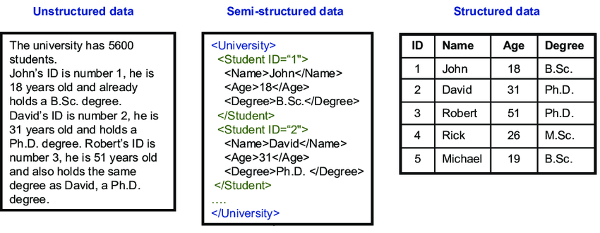

### Data types

Nell'informatica i dati vengono spesso suddivisi in tre tipologie.

1️⃣ **non-strutturati** = senza struttura organizzata (es. testo libero).

2️⃣ **semi-strutturati** = struttura parziale e flessibile (es. XML).

3️⃣ **strutturati** = organizzati in uno schema rigido e predefinito (es. database).

⚠️ Ciò riflette la **necessità** che i dati si adattino a un sistema informativo.

---

<!-- _footer: Prescott, A. (2013). Bibliographic records as humanities big data. In *2013 IEEE International Conference on Big Data* (pp. 55-58). IEEE. https://doi.org/10.1109/BigData.2013.6691670. Image: Citation example. <a href="https://guides.lndlibrary.org/c.php?g=360080&p=3824704" target="_blank">Source</a>. -->

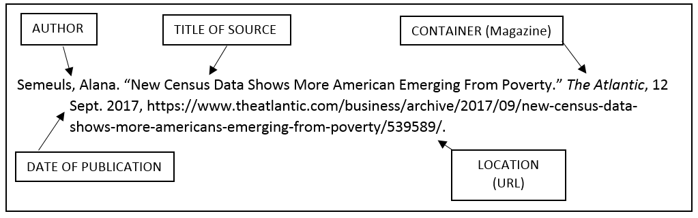

### Data has hidden structures

A tutti gli effetti, un riferimento bibliografico è una **stringa** (in informatica, il termine utilizzato per riferirsi al testo), quindi un dato _non-strutturato_.

⚠️ Ma in realtà un riferimento bibliografico (come altre tipologie di testo libero) ha una struttura _implicita_, determinata dallo stile citazionale scelto, che ci permette di dire una serie di _cose_ su questo dato...

E cosa sono queste _cose_? Sono metadati.

---

<!-- _footer: Ram, S., & Liu, J. (2008). A Semiotics Framework for Analyzing Data Provenance Research. *JCSE*, *2*(3), 221-248. http://dx.doi.org/10.5626/JCSE.2008.2.3.221. Image: Page 1 of the nascita di Venere ICCD OA record. <a href="https://sigecweb.beniculturali.it/sigec/item/print/ICCD15782128" target="_blank">Source</a>. -->

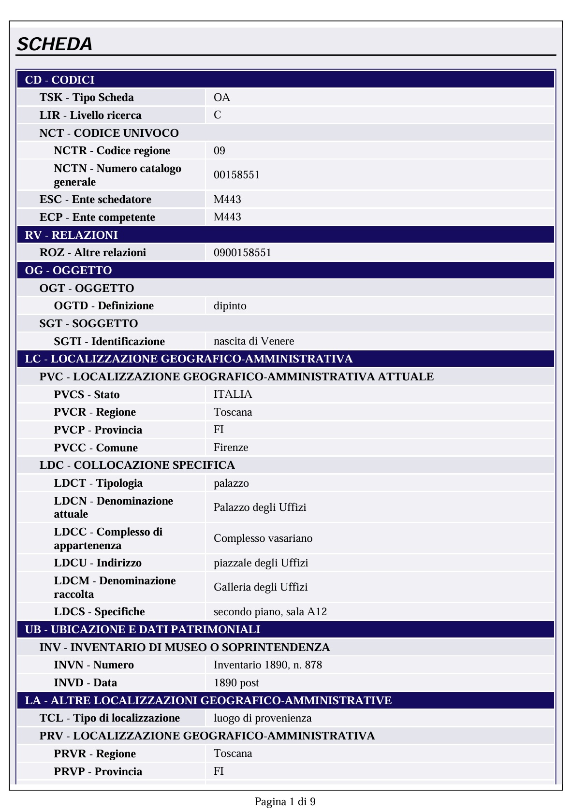

### Metadata can get out of control

🔎 Per un singolo dipinto possiamo avere metadati relativi all’opera originale, alle fotografie di tale opera, alle ubicazioni di entrambe, ai link ad altri documenti ecc.

⚠️ I metadati sono un’interpretazione, una scelta, e quindi complessi: dove ci si ferma? E come?

💡 È qui che tornano utili le regole, ovvero le linee guida che ci indicano come registrare i metadati e perché.

---

<!-- _footer: Image: Standards. <a href="https://xkcd.com/927/" target="_blank">Source</a>. -->

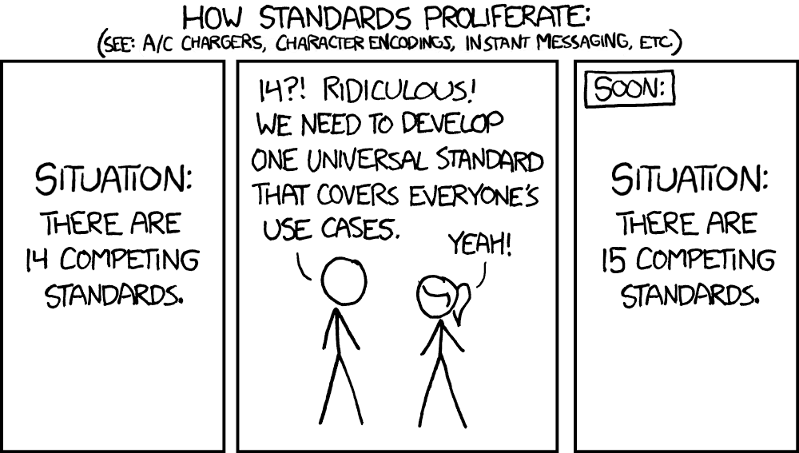

### Standards, Schemas, Structure

Una breve nota terminologica.

Uno standard definisce le **regole d’uso** affinché i sistemi possano comunicare tra loro (interoperabilità!).

Uno schema definisce la **struttura da utilizzare** (uso/riutilizzo).

Uno standard può includere uno schema. Quindi **regole + struttura**.

_Uno schema non necessita di uno standard_. Potete crearne uno vostro!

---

<!-- _footer: Ulrich, H., Kock-Schoppenhauer, A. K., Deppenwiese, N., Gött, R., Kern, J., Lablans, M., Majeed, R. W., Störh, M. R., Stausberg, J., Varghese, J., Dugas, M., & Ingenerf, J. (2022). Understanding the nature of metadata: Systematic review. *Journal of Medical Internet Research*, *24*(1), Article e25440. https://doi.org/10.2196/25440. Image: DataCite schema. <a href="https://project-thor.readme.io/docs/datacite-metadata-schema" target="_blank">Source</a>. -->

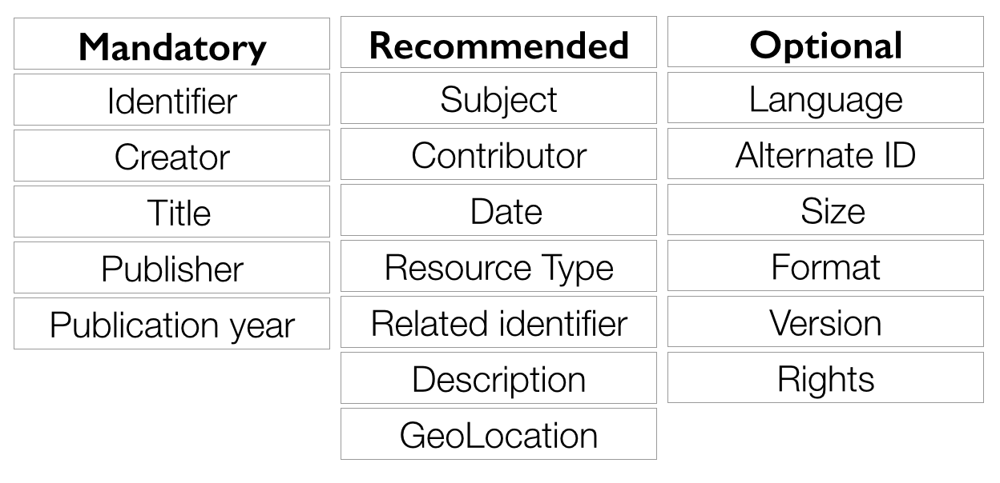

### Metadata standards & schemas

➡️ Gli **schemi di metadati** sono _strutture concettuali che specificano quali metadati utilizzare e secondo quali regole_.

Stabiliscono termini, definizioni, regole comuni per facilitare l'interpretazione, la comunicazione, la coerenza, la prevedibilità dei dati.

💡 Uno schema è composto da **elementi**, accompagnati dalle relative definizioni e regole di utilizzo (per esempio, se va utilizzata una stringa o un numero).

---

<!-- _footer: Drucker, J., & Albrezzi, F. (2025). *The Digital Humanities Coursebook* (2nd ed.). Routledge. Image: DC elements. <a href="https://marketplace.heritageinnovation.eu/product/the-dublin-core-metadata-initiative-dcmi/" target="_blank">Source</a>. -->

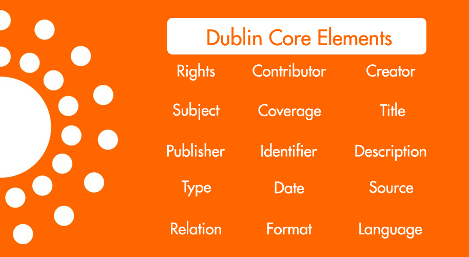

### Dublin Core

_**Dublin Core**_ (DC) è uno degli standard/schema di metadati più semplici e utilizzati, una sorta di minimo comune denominatore.

Svilupato negli anni 90 per descrivere risorse web, è applicabile a ogni tipo di risorsa, ed è composto da 15 elementi _core_ che vedete nel immagine.

Viene poi esteso in [DC Terms](https://www.dublincore.org/specifications/dublin-core/dcmi-terms/), con ulteriori elementi. Perché? Perché c'è sempre qualcosa in più, o di nuovo, che va descritto.

---

### Dublin Core meets _Venus_

La _nascita di Venere_ descritta con i sei elementi che useremo più spesso:

| Element | Value |
|---|---|
| `title` | nascita di Venere |
| `creator` | Filipepi Alessandro, Botticelli  |
| `date` | 1486 |
| `type` | dipinto |
| `subject` | Venere, mare, conchiglia, vento, donne |
| `identifier` | 0900158551 |

---

### Dublin Core meets _Venus_

🤔 E gli altri nove elementi core? Riuscite a individuare come applicarli a _Venere_?

`description` ➡️ ?
`format` ➡️ ?
`coverage` ➡️ ?
`contributor` ➡️ ?
`publisher` ➡️ ?
`source` ➡️ ?
`relation` ➡️ ?
`language` ➡️ ?
`rights` ➡️ ?

---

<!-- _footer: Drucker, J., & Albrezzi, F. (2025). *The Digital Humanities Coursebook* (2nd ed.). Routledge. Image: DC elements. <a href="https://marketplace.heritageinnovation.eu/product/the-dublin-core-metadata-initiative-dcmi/" target="_blank">Source</a>. -->


### Schemas have limits

Dublin Core non offre un modo semplice per descrivere:

- **la tecnica** in contrapposizione al **materiale**;
- **l’attribuzione**;
- **la provenienza**.

Concetti diversi riuniti sotto un elemento.

Schemi come Dublin Core sono utili, ma devono sacrificare *specificità* (più difficile da apprendere) a favore dell’*adozione* (più facile da implementare).

---

<!-- _footer: Istituto Centrale per il Catalogo e la Documentazione. (n.d.). *Nascita di Venere* [Catalogue record 0900158551]. Catalogo generale dei beni culturali. https://catalogo.beniculturali.it/detail/HistoricOrArtisticProperty/0900158551 -->

### Dublin Core meets _Venus_ in the Catalogo

Il Catalogo generale pubblica una <a href="https://dati.cultura.gov.it/lodview-arco/resource/HistoricOrArtisticProperty/0900158551.html" target="_blank">versione RDF</a> della propria scheda relativa alla *nascita di Venere* che utilizza Dublin Core (torneremo sull'argomento RDF):

```
dc:title     dipinto
dc:type      dipinto
dc:subject   nascita di Venere
dc:coverage  Firenze (FI)
dc:rights    proprietà Stato
```

Perché “titolo” e “tipo” hanno lo stesso valore? Perché il valore del “soggetto” corrisponde al titolo del dipinto? Perché gli standard dei metadati non sono sempre facilmente compatibili. Se si confronta la <a href="https://catalogo.beniculturali.it/detail/HistoricOrArtisticProperty/0900158551" target="_blank">scheda online</a> del Catalogo con la sua <a href="https://sigecweb.beniculturali.it/sigec/item/print/ICCD15782128" target=“_blank”>scheda completa (PDF)</a> e la sua <a href="https://dati.cultura.gov.it/lodview-arco/resource/HistoricOrArtisticProperty/0900158551.html" target="_blank">scheda RDF</a>, si comincia a capire come i metadati “viaggino” e cambino tra standard e schemi.

---

<!-- _footer: Gilliland, A. J. (2016). Setting the Stage. In M. Baca (Ed.), *Introduction to Metadata* (3rd ed.). Getty Publications. https://www.getty.edu/publications/intrometadata/setting-the-stage/. Image: Metadata standards, a selected list. <a href="https://metadataetc.org/metadatabasics/standards.htm" target="_blank">Source</a>. -->

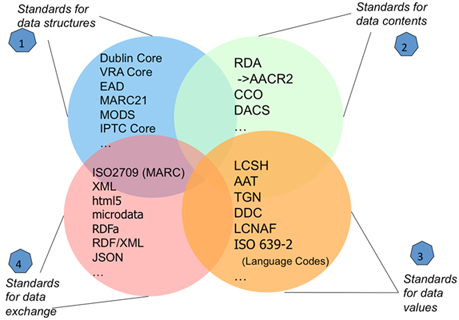

### So. Many. Standards.

➡️ **contenuti**: regole e codici di catalogazione;

➡️ **valori**: vocabolari controllati, tesauri;

➡️ **strutturali**: insiemi di elementi di metadati, schemi;

➡️ **formati/scambio**: standard di metadati espressi in forma leggibile da macchina.

⚠️ Livelli diversi di applicazione! Collezione vs Oggetto. Human vs Machine.

---

<!-- _class: impact -->

###### Part 3
# one **work**, three **standards**
## (Libraries, Archives, Museums)

---

<!-- _footer: Istituto Centrale per il Catalogo e la Documentazione. (2018). *Normativa OA: Opere e oggetti d'arte* (Version 3.00). https://iccd.cultura.gov.it/getFile.php?id=9810 Image: Page 1 of the _nascita di Venere_ ICCD OA record. <a href="https://sigecweb.beniculturali.it/sigec/item/print/ICCD15782128" target="_blank">Source</a>. -->


### Museums: ICCD scheda OA

La Normativa Scheda OA dell'ICCD è il modello standard ufficiale per i beni storici e artistici.

È molto più completo rispetto al Dublin Core. Quindi è più difficile da imparare, ma anche più specifico.

😵‍💫 ICCD ha <a href="https://github.com/ICCD-MiBACT/Standard-catalografici/blob/master/schede-di-catalogo/readme.md" target="_blank">definito 30 tracciati catalografici</a>, in relazione alle differenti tipologie di beni, che fanno riferimento a nove settori disciplinari.

---

<!-- _footer: Images: 1/ SBN record for the _nascita di Venere_. 2/ UNIMARC view of the SBN record. <a href="https://id.sbn.it/bid/CFI0402166" target="_blank">Source</a>. -->

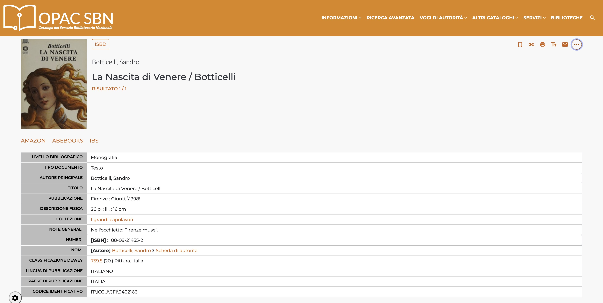
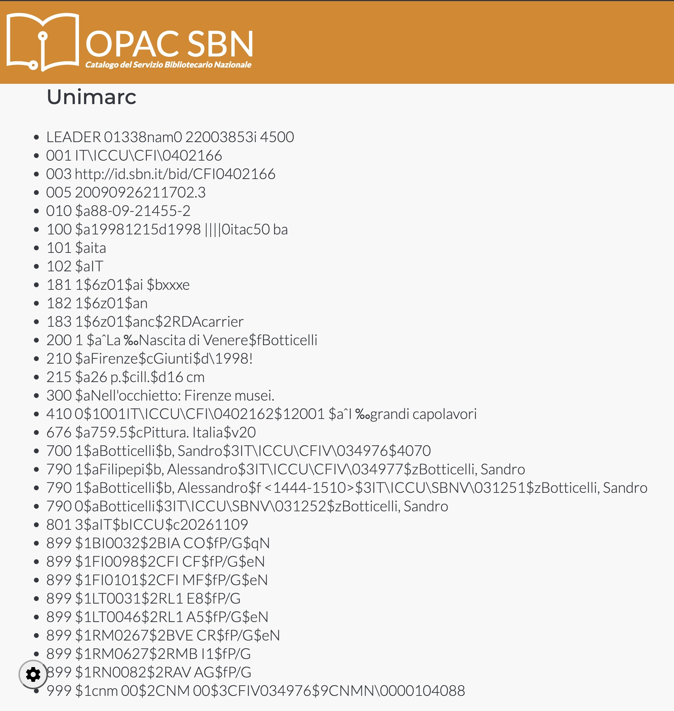

### Libraries: SBN and UNIMARC

Una biblioteca non cataloga il dipinto, ma **i libri che ne parlano**. Una scheda bibliografica si basa su REICAT, norme SBN, e UNIMARC.

La <a href="https://norme.iccu.sbn.it/w/index.php?title=Guida_moderno" target="_blank">scheda SBN</a> è destinata ai bibliotecari (che catalogano) e alle persone (che cercano la risorsa). Si tratta di uno “standard” nazionale condiviso.

<a href="https://www.aib.it/aib/lis/std/unimarc.htm" target="_blank">UNIMARC</a> è destinato alle macchine. Deriva dal MAchine Readable Cataloguing (MARC) standard, sviluppato dalla Library of Congress negli anni ’60.

---

<!-- _footer: Image: Nascita di Venere record, Fondazione Zeri. <a href="https://catalogo.fondazionezeri.unibo.it/scheda/opera/15928/" target="_blank">Source</a>. -->

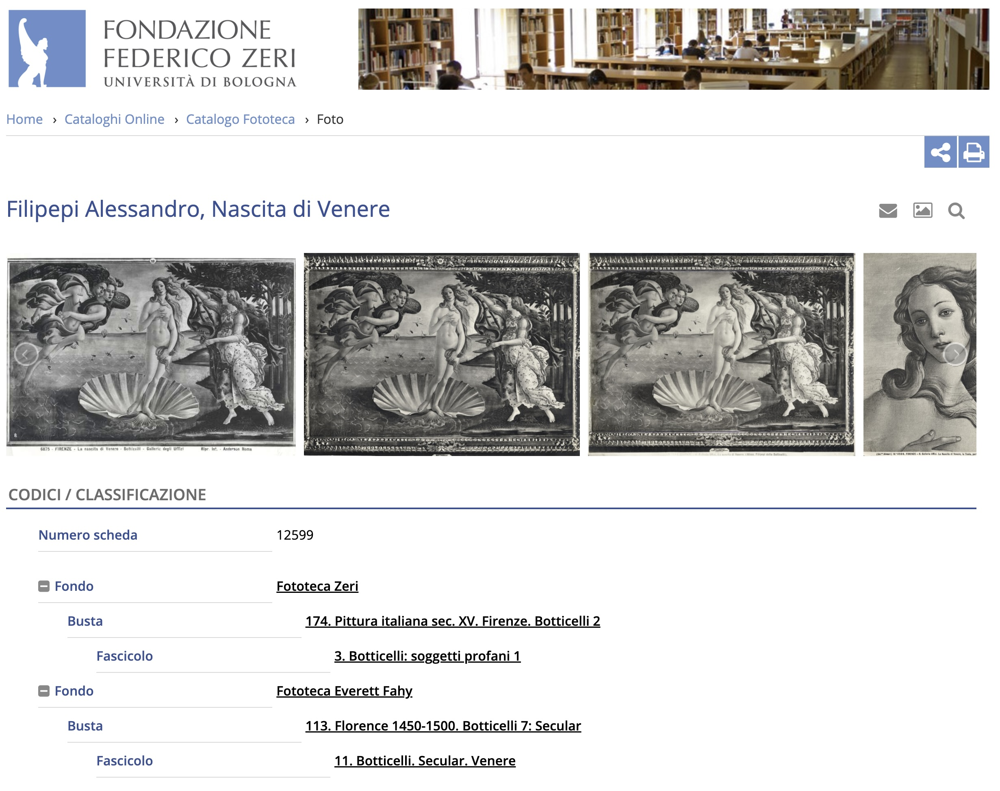

### Archives: ISAD (G)

Un archivio descrive **prima il tutto**, poi le sue parti.

_Fondo -> Busta -> Fascicolo -> Oggetto_.

Un archivio spesso include documenti non disponibili da altre fonti, e deve sapere dove si trova il documento, in quale contesto al interno del archivio.

Lo standard è <a href="https://icar.cultura.gov.it/standard/standard-internazionali/isad-g" target="_blank">ISAD (G)</a>, un'iniziativa internazionale che risale agli anni '90.

---

<!-- _footer: 1/ Gilliland, A. J. (2016). Setting the Stage. In M. Baca (Ed.), *Introduction to Metadata* (3rd ed.). Getty Publications. https://www.getty.edu/publications/intrometadata/setting-the-stage/ 2/ Drucker, J., & Albrezzi, F. (2025). *The Digital Humanities Coursebook* (2nd ed.). Routledge. -->

### Standards differ because of community and materials

| Community | Materials | Describes | Cares most about |
|---|---|---|---|
| Library | Books | the published object(s) | access (universal) |
| Archive | Objects | the object(s) within a group | provenance (specific) |
| Museum | Cultural Heritage | the (unique) object | context (historical) |

Quando i metadati di un oggetto vengono trasferiti (tramite un record) da una comunità all’altra (tramite uno standard o uno schema), i termini che non hanno un equivalente vengono eliminati o spostati.

È ciò che è accaduto al titolo del dipinto quando è stato trasferito da Scheda OA a DC o quando Google Books ha acquisito milioni di metadati relativi a milioni di libri.

---

<!-- _class: impact -->

###### Part 4
# describing is **interpreting**
## (who decides what a thing is?)

---

<!-- _footer: 1/ Fondazione Federico Zeri. (n.d.). *Nascita di Venere* [Catalogue record 15928]. https://catalogo.fondazionezeri.unibo.it/scheda/opera/15928/ 2/ Istituto Centrale per il Catalogo e la Documentazione. (n.d.). *Nascita di Venere* [Catalogue record 0900158551]. Catalogo generale dei beni culturali. https://catalogo.beniculturali.it/detail/HistoricOrArtisticProperty/0900158551 -->

### Two catalogues, two answers

**Quando è stata dipinta la _Nascita di Venere_?**
- Catalogo generale (cronologia specifica): 1484-1485
- Fondazione Zeri (date): 1482–1486

**Chi l’ha dipinta?**
- ICCD: Filipepi Alessandro detto Botticelli
- Zeri: Filipepi Alessandro (Sandro Botticelli)

Decisioni prese secondo le regole degli standard. Tutte 'corrette'. Tutte interpretazioni della storia. Ecco perché abbiamo bisogno anche di controlli di autorità (tesauri, tassonomie). Un tesaurus aiuta a riunire varianti (es. nomi).

---

<!-- _footer: 1/ Drucker, J., & Albrezzi, F. (2025). *The Digital Humanities Coursebook* (2nd ed.). Routledge. 2/ Gilliland, A. J. (2016). Setting the Stage. In M. Baca (Ed.), *Introduction to Metadata* (3rd ed.). Getty Publications. -->

### Standards help and hinder

I metadati relativi a un oggetto possono derivare dalla **creazione** (metadati tecnici) e dall’**interpretazione** (metadati descrittivi).

Gli standard _impongono visioni del mondo e valori_. Comportano _questioni etiche_. Sono una _forma di potere_. Ma favoriscono anche _l’interoperabilità e lo scambio_.

Se lavori come bibliotecario, devi seguire uno schema standard, ma (forse) puoi avvalerti del tuo giudizio per creare una descrizione. Lo stesso vale per gli archivi e i musei.

Ecco perché anche il progetto come unità didattica (lezione 02) è prezioso. Vi permette di spingere oltre i confini dei sistemi, di esaminare e mettere in discussione, di creare qualcosa vostro da aggiungere al discorso.

---

<!-- _class: impact -->

###### Part 5
# **prototype** metadata
## (what to do with all this for the exam)

---

<!-- _footer: Ulrich, H., Kock-Schoppenhauer, A. K., Deppenwiese, N., Gött, R., Kern, J., Lablans, M., Majeed, R. W., Störh, M. R., Stausberg, J., Varghese, J., Dugas, M., & Ingenerf, J. (2022). Understanding the nature of metadata: Systematic review. *Journal of Medical Internet Research*, *24*(1), Article e25440. https://doi.org/10.2196/25440 -->

### Checklist for good metadata

I metadati sono uno dei requisiti del prototipo. Ecco alcuni aspetti da tenere in mente quando preparate i metadati per il vostro progetto:

- Consistenza con **standard già esistenti** dove possibile.
    - Dublin Core ✅ se aggiungete elementi provenienti da altri standard 👌🏻
- Fornire (tutte) le informazioni necessarie a **identificare** i dati.
    - Esiste un identificatore? ✅ Potrebbe essere necessario crearne uno 👌🏻  
- Fornire (tutte) le informazioni necessarie a **descrivere** i dati.
    - Elementi ovvi ✅ altri elementi utili per l'utente 👌🏻
- Fornire (tutte) le informazioni necessarie a **ricostruire la storia** dei dati.
    - Provenienza per almeno una fonte ✅ Se ce ne sono di più, tanto meglio 👌🏻
- Fornire (tutte) le informazioni necessarie ad **accedere** e **utilizzare** i dati.
    - Link alle fonti dove sono disponibili o alle vostre copie ✅ formatti e licenze correte 👌🏻

---

### Dublin Core is your baseline

Per ogni percorso vi verrà fornito un template. Questi template utilizzano già alcuni elementi Dublin Core (o elementi simili dal punto di vista concettuale).

- **Collection:** `objectid`, `title`, `format`, `language` etc.
- **Text:** `title`, `creator`, `date`, `description`, etc.
- **Map:** `date`, `source`, `rights`, `wikidata`, etc.

Nella seconda parte del corso (lezioni 05 - 09) imparerete tutto ciò che vi serve per creare i vostri metadati. **I vostri metadati vi aiuteranno a raccontare la storia che volete, nel modo che preferite**. E mi aiuteranno ad assicurarmi che abbiate capito i concetti spiegati in questo corso. Ogni sessione pratica si basa su quella precedente:

**campi dei metadati** (oggi) → **modello** (lezione 06) → **fonte di autorità** (lezione 07) → **pulire metadati** (lezione 08)

---

<!-- _paginate: false -->


# DH & Data Management per i Beni Culturali (2026/2027)

## 05. Metadata & Standards ✅

### Thank you 🙏🏻
