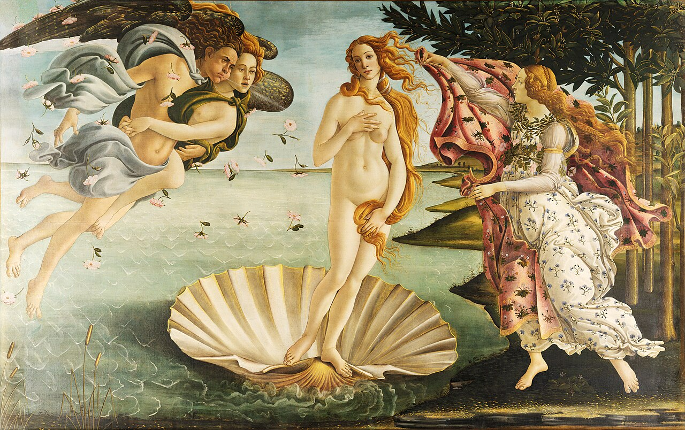
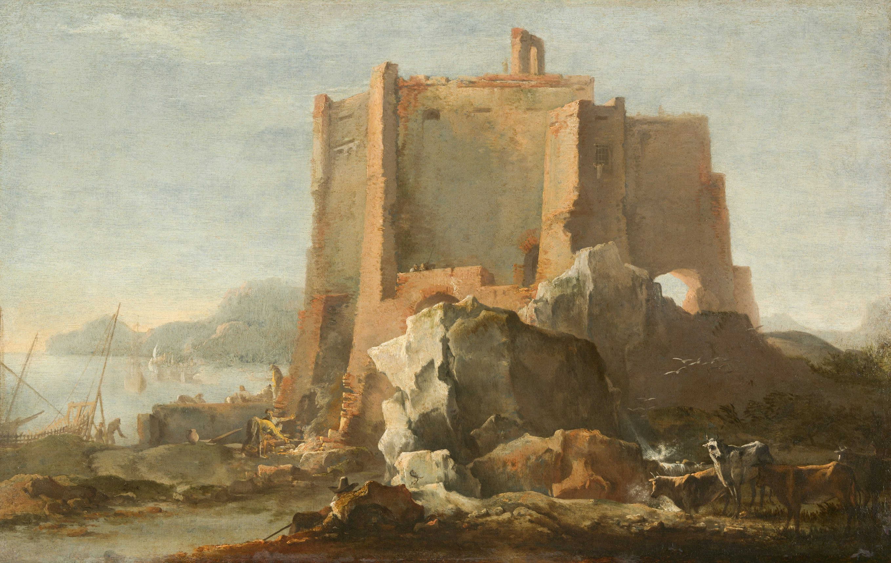
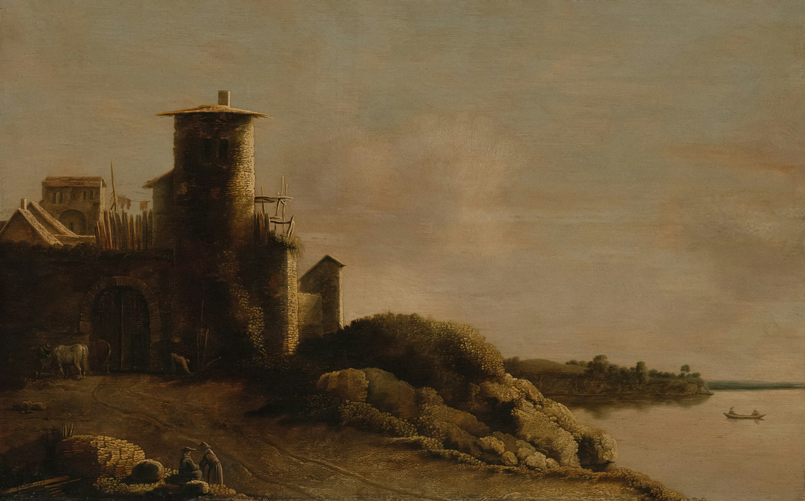
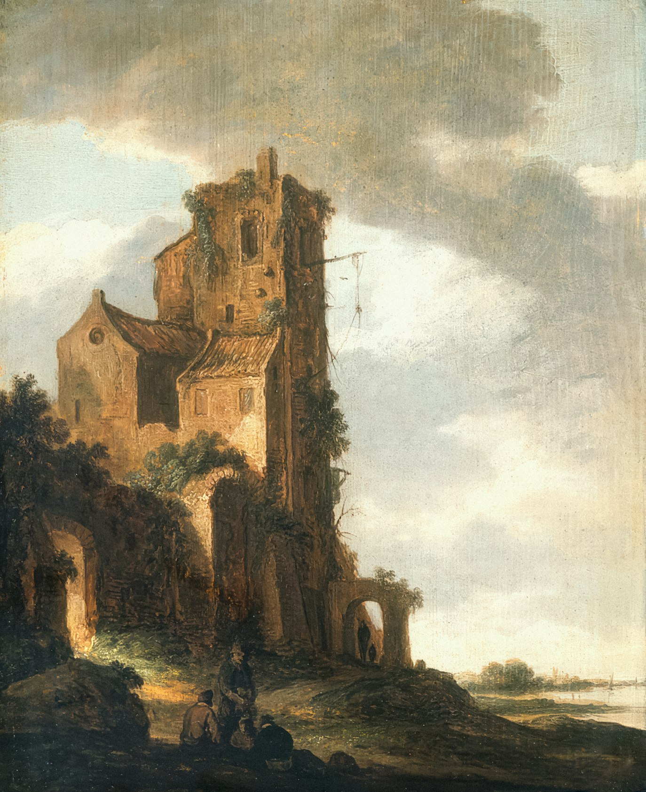

<!-- _paginate: false -->
<!-- _footer: Image: Nascita di Venere, Sandro Botticelli / Wikimedia Commons. <a href="https://commons.wikimedia.org/wiki/File:Sandro_Botticelli_-_La_nascita_di_Venere_-_Google_Art_Project_-_edited.jpg" target="_blank">Source</a>. -->

# Digital Humanities / Data Management / Informatica per i Beni Culturali (2026/2027)

## 05. Metadata & Standards / PRATICA

➡️ Mail: [laurent.fintoni2@unibo.it](mailto:laurent.fintoni2@unibo.it)

---

<!-- _class: impact -->

###### Exercise 1
# A **Dublin Core** record
## one object, six elements (or fifteen)

---

<!-- _footer: Image: Unsplash. <a href="https://unsplash.com/photos/ancient-stone-tower-on-a-rocky-coastline-with-distant-boats-4RtXHcr0dk4" target="_blank">Source</a>. -->

### What do you need?

✅ Computer o tablet.

✅ Il vostro account GitHub e un repository (facoltativo).

✅ DC Template in <a href="https://github.com/laurentfintoni/dh-ravenna-26-27/blob/main/lessons/05/templates/l05_template_1_dublin_core.docx" target="_blank">doc</a> o <a href="https://github.com/laurentfintoni/dh-ravenna-26-27/blob/main/lessons/05/templates/l05_template_1_dublin_core.md" target="_blank">Markdown</a>.

😌 Easy mode: scarica e modifica come documento di testo.

😓 Hard mode: scarica in formato Markdown, carica su GitHub, modifica nel browser.

👯 Gruppo o individualmente. ⏰ 20 mins.

---

### A Dublin Core record

1. Scegliete una fonte -> trovate un oggetto culturale che vi interessa.
2. Aprite il template (testo o Markdown).
3. Compilate i sei elementi fondamentali: `title`, `creator`, `date`, `type`, `subject`, `identifier`. Ogni elemento è stato definito per aiutarvi a utilizzarlo.
4. Se avete tempo, provate i nove elementi facoltativi.
5. Prendete nota di ciò che volete registrare ma per cui non c'era un elemento corrispondente, e di quali elementi non vi erano chiari.

👉🏻 Tra le possibili fonti figurano Europeana, il Catalogo Generale, la Library of Congress, ecc.

🤫 Non c'è nulla? Molte delle slides di questo corso presentano opere d'arte con l'indicazione della fonte.

🫠 Vi farò una breve demo.

---

<!-- _class: impact -->

###### Exercise 2
# A **second** standard
## the same object, described again

---

<!-- _footer: Image: Unsplash. <a href="https://unsplash.com/photos/a-painting-of-a-castle-by-a-body-of-water-r_2i_AcpTwE" target="_blank">Source</a>. -->

### What do you need?

Stesso dell'esercizio 1.

⚠️ Template diversi ⚠️

Scheda OA (<a href="https://github.com/laurentfintoni/dh-ravenna-26-27/blob/main/lessons/05/templates/l05_template_2a_iccd_oa.docx" target="_blank">doc</a> / <a href="https://github.com/laurentfintoni/dh-ravenna-26-27/blob/main/lessons/05/templates/l05_template_2a_iccd_oa.md" target="_blank">markdown</a>)

o

SBN (<a href="https://github.com/laurentfintoni/dh-ravenna-26-27/blob/main/lessons/05/templates/l05_template_2b_sbn_unimarc.docx" target="_blank">doc</a> / <a href="https://github.com/laurentfintoni/dh-ravenna-26-27/blob/main/lessons/05/templates/l05_template_2b_sbn_unimarc.md" target="_blank">markdown</a>)

⏰ Da fare quando desiderate. Potete scrivermi via e-mail o chiedere nelle prossime lezioni se avete domande/dubbi su quello fatto.

---

### Same object, different record

1. Scegliete il template più adatto al vostro oggetto:
   - **2a** Scheda OA ICCD, per oggetti d’arte;
   - **2b** SBN, per libri e materiale stampato.
2. Descrivete lo **stesso oggetto** dell’esercizio 1.
3. Elencate ciò che è stato inserito qui e non è stato inserito nel Dublin Core, e viceversa.
4. Trovate la scheda dell’istituzione relativa all’oggetto scelto. Cosa hanno registrato loro che non avete registrato?

🔍 Nel template ci sono alcune domande aggiuntive per voi.

---

<!-- _class: impact -->

###### Exercise 3
# A **tag** set
## aka a folksonomy

---

<!-- _footer: Image: Unsplash. <a href="https://unsplash.com/photos/a-painting-of-a-castle-on-a-hill-3vHv5ZbI2uA" target="_blank">Source</a>. -->

### Folksonomy

Tassonomia = classificazione e denominazione delle cose. Regolata.

Folksonomia = parole chiave, etichette e tag liberi utilizzati per organizzare i contenuti. Non segue regole, poiché proviene dalle “persone” e non dalle “istituzioni”.

Una folksonomia è una forma di collaborazione sociale (molte persone aggiungono tag allo stesso contenuto) e di classificazione personale (si aggiungono tag alle cose che interessano nel modo che si ritiene più logico).

---

### Create your own tag set (folksonomy)

⚠️ Se non sapete ancora quali elementi volete utilizzare per il vostro progetto, potete semplicemente scegliere cose che vi interessano: film, luoghi, cibo, attività ecc.

1. Scrivete **5–10 tags (keywords)** per gli oggetti scelti. Ad esempio, un tag che possa descrivere lo stile di un’opera d’arte o una caratteristica specifica.
2. In un documento, associate i tag agli oggetti.
3. Conservate questo documento, ci torneremo nella Lezione 07. Non preoccupatevi se non lo fatte prima della lezione 07, in ogni caso vi fornirò i dati necessari.

### Example

Objects: <a href="https://www.artic.edu/departments/PC-10/painting-and-sculpture-of-europe" target="_blank">Painting & Sculpture of Europe</a>
Tags: #painting #sculpture #europe #portraits #landscapes #nature mortes #architecture

---

<!-- _class: impact -->

###### Exercise 4
# Draft **your** metadata table
## for your prototype

---

### Draft what metadata you need/want for your project

Quali campi vi servono o desiderate per gli oggetti del vostro progetto? Create una semplice tabella come quella qui sotto e compilate i campi. Aggiungete colonne se ne avete bisogno!

| field | definition | DC equivalent | required? | value rule | example |
|---|---|---|---|---|---|
| `title` | name given to the object | `title` | yes | free text | Nascita di Venere |
| `date` | year of creation | `date` | yes | YYYY or YYYY–YYYY | 1482–1486 |

Conservate questa lista, ci torneremo per ogni lezione della seconda parte del corso. Vi fornirò comunque i dati di prova, quindi non preoccupatevi se non avete tempo di farlo.

💯 Caricate la tabella (e il tag set) nel vostro GitHub. Annotate il lavoro svolto nel worklog!

---

<!-- _paginate: false -->

# Digital Humanities / Data Management / Informatica per i Beni Culturali (2026/2027)

## 05. Metadata & Standards / PRATICA ✅

### Thank you 🙏🏻
