<!-- _paginate: false -->
<!-- _footer: Image: Unsplash. <a href="https://unsplash.com/photos/photo-of-5-story-library-building-PkbZahEG2Ng" target="_blank">Source</a>. -->

# DH & Data Management per i Beni Culturali (2026/2027)

## 06. Modelling & Databases

➡️ Mail: [laurent.fintoni2@unibo.it](mailto:laurent.fintoni2@unibo.it)
➡️ ORCID: [0000-0002-8656-4602](https://orcid.org/0000-0002-8656-4602)
➡️ Sito: [laurent.fintoni2](https://www.unibo.it/sitoweb/laurent.fintoni2)

---

<!-- _footer: Manovich, L. (1998). *Database as a Symbolic Form*. https://manovich.net/content/04-projects/025-database-as-a-symbolic-form/19_article_1998.pdf Image: Lev Manovich. -->

### C'era una volta...

Il romanzo e il cinema. Due forme che hanno reso la **narrazione** (storie con un inizio, una parte centrale e una fine) la forma culturale chiave dell’era moderna.

Poi è arrivato il computer e, con esso, il **database**, una raccolta di elementi _in cui ogni elemento ha lo stesso significato di qualsiasi altro_.

E quindi sorge una domanda: cosa succede alla nostra esperienza del mondo quando gran parte di essa è organizzata dai database?

---

<!-- _footer: Manovich, L. (1998). *Database as a Symbolic Form*. https://manovich.net/content/04-projects/025-database-as-a-symbolic-form/19_article_1998.pdf Image: Lev Manovich. -->

### C'era una volta...

È ciò che si chiedeva Lev Manovich in un saggio del 1998 intitolato *Database as a Symbolic Form*.

Sostiene che il database rappresenti un nuovo paradigma attraverso il quale strutturiamo la nostra esperienza. Perché seguire una narrazione, quando si può scegliere di ordinare i dati come si vuole?

Seguendo questa logica, afferma, un museo può trasformarsi in un database grazie a nuove esperienze digitali come i CD o i siti web.

---

<!-- _class: steps -->
<!-- _footer: 1/ Manovich, L. (1998). *Database as a Symbolic Form*. https://manovich.net/content/04-projects/025-database-as-a-symbolic-form/19_article_1998.pdf 2/ Hayles, N. K. (2007). Narrative and Database: Natural Symbionts. *PMLA*, *122*(5), 1603–1608. http://www.jstor.org/stable/25501808 -->

* >  "A narrative creates a cause-and-effect trajectory of seemingly unordered items. Therefore, **database and narrative are natural enemies**." — _Manovich_ (1998)

* > "**Narratives remain the necessary others to databases**, [they] invest the formal logic of database operations with human meanings." — _Hayles_ (2007)

* Mentre una collezione (di oggetti) è un database, una mostra offre una narrazione attraverso di essa. (🤫 ecco di cosa tratta il vostro progetto)

* Ma prima di poter raccontare una storia partendo da un database di oggetti, bisogna decidere quali siano questi oggetti. E per farlo è necessaria la **modellazione dei dati**.

---

<!-- _class: impact -->

###### Part 1
# from **sources** to **data**
## (or why you need modelling)

---

<!-- _class: steps -->

### What we have seen so far

* ➡️ Il termine “dati” deriva dal latino “datum”, che significa “dato”.

* ➡️ Ma! Essi vengono ricavati (taken, not given) dal mondo reale. Sono un’interpretazione (così come i metadati).

* ➡️ Sono soggetti a normative. Chi può fare cosa con quali dati?

* ➡️ Nell’informatica vengono classificati come _non strutturati_, _semi-strutturati_ o _strutturati_.

* ➡️ Ma! Anche i dati non strutturati possono avere strutture nascoste (come una citazione).

* ➡️ Possiamo produrre dati digitalizzando un oggetto fisico. Possiamo anche estrarre dati dagli oggetti (scheda con titolo, provenienza, contesto storico ecc.).

* ➡️ Nella lezione 05 abbiamo visto come creare metadati (dati sui dati!). Oggi facciamo un piccolo passo indietro, per vedere da dove provengono i dati e come vengono concettualizzati.

---

<!-- _class: steps -->
<!-- _footer: Posner, M. (2015). *Humanities Data: A Necessary Contradiction*. https://miriamposner.com/blog/humanities-data-a-necessary-contradiction/ Image: Unsplash. <a href="https://unsplash.com/photos/wavy-pattern-of-marbled-paper-in-earth-tones-gTJhb4dNmlA" target="_blank">Source</a>. -->

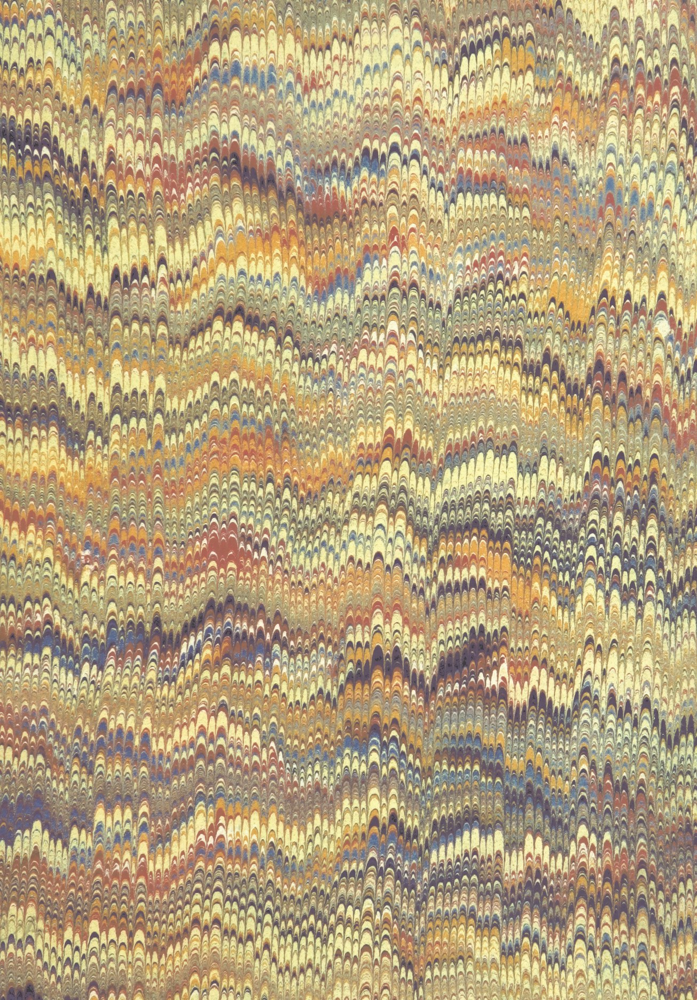

### "Oh, I don't have any data."

Nelle discipline umanistiche, ci confrontiamo con le fonti attraverso l’immersione: leggiamo, osserviamo, contestualizziamo. Arriviamo a comprendere la ricchezza di un oggetto.

* Ma come si traduce tutto questo in dati?

* Può essere difficile “catturare” un oggetto sotto forma di dati. Alcuni elementi dell’oggetto vanno persi.

* 🤔 Cosa andrebbe perso se qualcosa a cui tieni diventasse un dato?

---

<!-- _footer: Drucker, J., & Albrezzi, F. (2025). *The Digital Humanities Coursebook* (2nd ed.). Routledge. Image: Unsplash. <a href="https://unsplash.com/photos/abstract-marbled-paper-with-yellow-blue-and-brown-patterns-p-FmhBjXTuU" target="_blank">Source</a>. -->

### Data are taken, and made!

I dati vengono ricavati. Ma vengono anche creati. In che modo? Attraverso un processo di _astrazione_ chiamato **modellazione dei dati**.

La modellazione consiste nella scelta di quali caratteristiche di un oggetto conservare, con quali nomi, e quali tralasciare. Gli schemi (es. Dublin Core) vengono creati attraverso la modellazione.

Nel **modello** Dublin Core, secondo l’ICCD, _La nascita di Venere_ è il soggetto di un dipinto (tipo), realizzato tra il 1484 e il 1485 (data), a Firenze (copertura).

---

<!-- _footer: 1/ Drucker, J., & Albrezzi, F. (2025). *The Digital Humanities Coursebook* (2nd ed.). Routledge. 2/ Tomasi, F. (2020). *Modelling in the Digital Humanities: Conceptual Data Models and Knowledge Organization in the Cultural Heritage Domain*. Historical Social Research Supplement 31, 170–179. https://doi.org/10.12759/ hsr.suppl.31.2018.170-179. Image: Unsplash. <a href="https://unsplash.com/photos/abstract-wavy-pattern-of-yellow-blue-red-and-brown-VFLyCmoPF3c" target="_blank">Source</a>. -->

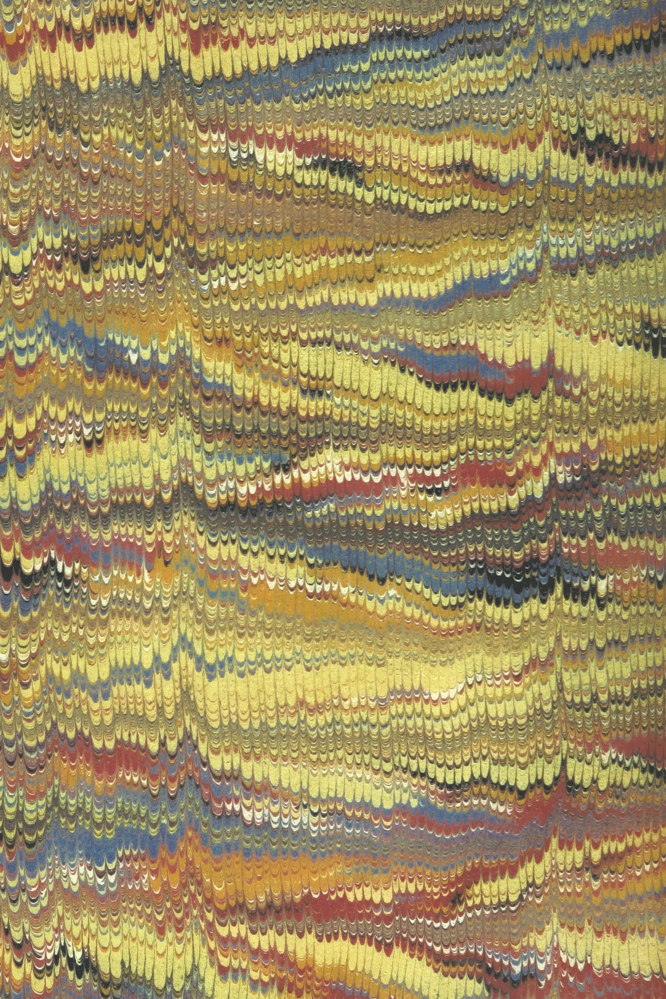

### Reading a data model

Anche un modello di dati è un oggetto! Consente di leggere un oggetto, ma può anche essere letto a sua volta.

La sua struttura incarna scelte e valori.

La Scheda OA sostiene che ciò che conta per _Venere_ sia la cronologia. Il Dublin Core sostiene che sia la data.

Un modello di dati è un _punto di vista_ sul mondo. Non è **mai completo, ma sempre parziale**.

---

<!-- _footer: 1/ Drucker, J., & Albrezzi, F. (2025). *The Digital Humanities Coursebook* (2nd ed.). Routledge. 2/ Tomasi, F. (2020). *Modelling in the Digital Humanities: Conceptual Data Models and Knowledge Organization in the Cultural Heritage Domain*. Historical Social Research Supplement 31, 170–179. https://doi.org/10.12759/hsr.suppl.31.2018.170-179 -->

### You are making a model!

Negli esercizi della <a href="https://laurentfintoni.github.io/dh-ravenna-26-27/lessons/05/20261119-metadata.html" target="_blank">lezione 05</a>, vi ho chiesto di creare una tabella e di inserirvi i campi di metadati che desiderate per gli oggetti del vostro progetto.

| field | definition | value rule | example |
|---|---|---|---|
| `title` | name of object | free text | Nascita di Venere |
| `date` | year of creation | YYYY or YYYY–YYYY | 1482–1486 |

Questa tabella è un esempio di un modello per gli oggetti che si desidera utilizzare nel progetto. Si **sceglie una caratteristica** (campo), si definisce come **renderla esplicita** (definizione) e se ne specifica il **formato** (regola di valore).

😵‍💫 Più punti di vista abbiamo sullo stesso oggetto, più modelli potremo raccogliere!

---

<!-- _class: impact -->

###### Part 2
# The **Entity relationship** model
## (or how to easily model things)

---

<!-- _footer: Tomasi, F. (2020). *Modelling in the Digital Humanities: Conceptual Data Models and Knowledge Organization in the Cultural Heritage Domain*. Historical Social Research Supplement 31, 170–179. https://doi.org/10.12759/hsr.suppl.31.2018.170-179 Image: Unsplash. <a href="https://unsplash.com/photos/abstract-marbled-pattern-with-pastel-colors-NytGEQcaf-E" target="_blank">Source</a>. -->

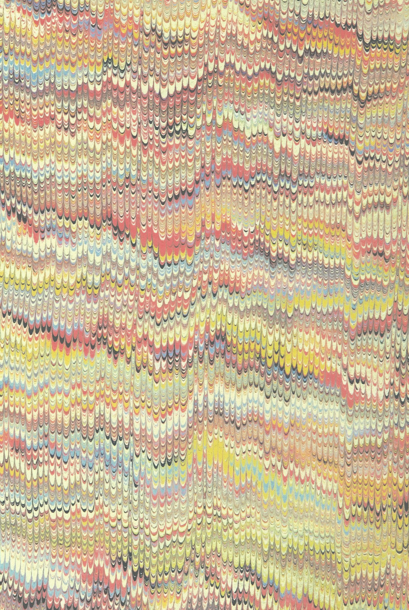

### Entity relationship model

Esistono diversi modi per modellare gli oggetti e trasformarli in dati.

Il più comune è il **modello entità-relazione (E/R)**, sviluppato da Peter Chen negli anni ’70. Esso _rappresenta i dati in termini di entità e relazioni descritte nei dati stessi_.

Un **autore** _crea_ un'**opera**. L’**opera** viene _pubblicata_ da un **editore**.

**Entità** ➡️ _Relazione_ ➡️ **Entità**.

---

<!-- _footer: Ramsay, S. (2004). Databases. In S. Schreibman, R. Siemens, & J. Unsworth (Eds.), *A Companion to Digital Humanities*. Blackwell. https://companions.digitalhumanities.org/DH/?chapter=content/9781405103213_chapter_15.html -->

### Entities, Relations AND Attributes

Le entità e le relazioni hanno degli **attributi** (ciò che le rende ciò che sono).

- **Entità:** reale (una persona, un'opera, un edificio) o non reale (il Rinascimento come periodo storico).
- **Attributo:** cosa sappiamo, cosa possiamo ricavarne? (titolo, date, luogo).
- **Relazione:** in che modo due entità sono collegate? (creata da, situata in).

| Entity | Attributes | Relation |
|---|---|---|
| work | title, date, technique | made by a person; held by a museum |
| person | name, born, died | made one or more works |
| museum | name, city | holds one or more works |

---

<!-- _footer: Ramsay, S. (2004). Databases. In S. Schreibman, R. Siemens, & J. Unsworth (Eds.), *A Companion to Digital Humanities*. Blackwell. https://companions.digitalhumanities.org/DH/?chapter=content/9781405103213_chapter_15.html Image: Unsplash. <a href="https://unsplash.com/photos/abstract-marbled-pattern-with-yellow-and-gray-waves-k5hY7Bc58T8" target="_blank">Source</a>. -->

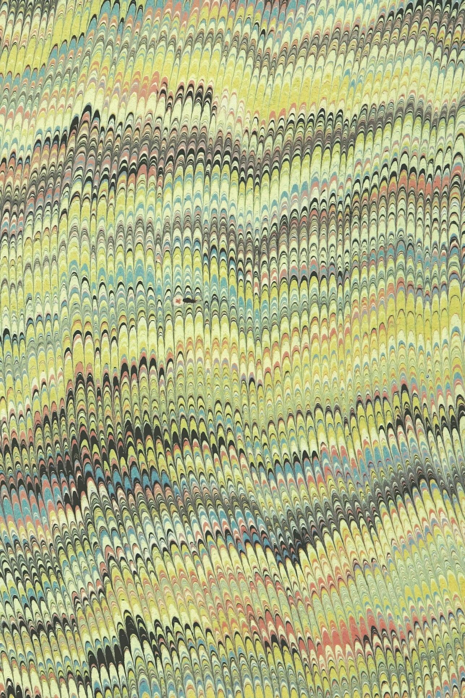

### One to many, many to many

Le relazioni presentano anche un altro tipo di caratteristica: quante entità sono collegate? Uno a uno, uno a molti, molti a molti.

**Uno a molti:** un artista, molte opere. Un museo, molte opere.

**Molti a molti:** un editore, molti autori che hanno realizzato molte opere.

Nel modello E/R questa idea di “uno” o “molti” viene utilizzata per rappresentare diversi tipi di relazioni.

---

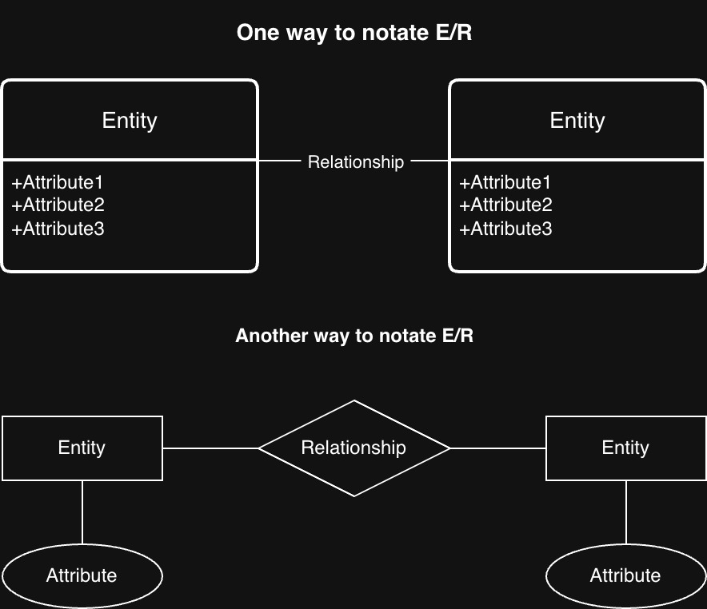

### Data modelling notation

La modellazione dei dati viene rappresentata sotto forma di **diagramma**. Per garantire la loro leggibilità, è necessario un sistema di notazione.

La modellazione E/R non dispone di un sistema di notazione formale, ma è facile da rappresentare!

Qua sono illustrate le due opzioni più comuni utilizzate oggi.

**Strumenti**: <a href="https://draw.io/" target="_blank">draw.io</a> o qualsiasi altro strumento che già utilizzi per disegnare, come Canva, Miro, ecc. (pen and paper!)

---

<!-- _class: impact -->

###### Part 3
# the **relational** model
## (or why you need tables and keys)

---

<!-- _footer: Drucker, J., & Albrezzi, F. (2025). *The Digital Humanities Coursebook* (2nd ed.). Routledge. Image: Unsplash. <a href="https://unsplash.com/photos/abstract-wavy-pattern-of-yellow-blue-red-and-brown-VFLyCmoPF3c" target="_blank">Source</a>. -->

### So what's a database?

Qualsiasi **raccolta organizzata di informazioni strutturate** (dati) archiviata (elettronicamente) e gestita da un sistema per l'accesso, il recupero e la gestione può essere definita un database.

I dati semi-strutturati (documento XML) sono **gerarchici**: un'entità “contiene” un'altra entità, esiste un ordine dall'alto verso il basso. I dati strutturati (una tabella) sono **piatti**: un’entità (riga) “possiede” diversi attributi (colonne).

⚠️ Entrambi presentano dei limiti.

---

<!-- _footer: Drucker, J., & Albrezzi, F. (2025). *The Digital Humanities Coursebook* (2nd ed.). Routledge. -->

### One flat table, many issues

| title | artist | artist_born | museum | museum_city |
|---|---|---|---|---|
| Nascita di Venere | Sandro Botticelli | 1445 | Galleria degli Uffizi | Firenze |
| Primavera | Botticelli, Sandro | 1445 | Uffizi | Firenze |
| Venere e Marte | S. Botticelli | 1445 | National Gallery | Londra |

- L'artista e la data di nascita sono riportati per esteso in ogni riga;
- Lo stesso artista è indicato in diversi modi.
- Anche il museo e la città vengono ripetuti

Ciò crea problemi sia in termini di relazioni tra i dati (si tratta della stessa persona?), sia in termini di gestione (per correggere l'errore è necessario modificare ogni singola occorrenza).

---

<!-- _footer: University of York. (2024). *Data: A Practical Guide*. https://subjectguides.york.ac.uk/data -->

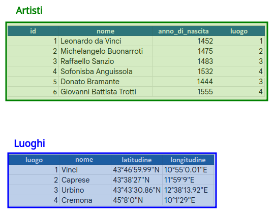

### One solution: normalization!

La **normalizzazione dei dati** è _il processo di riduzione della ridondanza nei dati_.
- **Una tabella per ogni entità** (es. una tabella per gli artisti, una per i luoghi);
- Ogni campo è **unico e identificato** in maniera univoca.
- I dati normalizzati **non hanno valori ripetuti**.

🤔 Da un tavolo se ne creano molti. Come facciamo a collegarli tra loro? Dobbiamo usare l'astrazione!

---

<!-- _footer: 1/ University of York. (2024). *Data: A Practical Guide*. https://subjectguides.york.ac.uk/data 2/ Drucker, J., & Albrezzi, F. (2025). *The Digital Humanities Coursebook* (2nd ed.). Routledge. -->

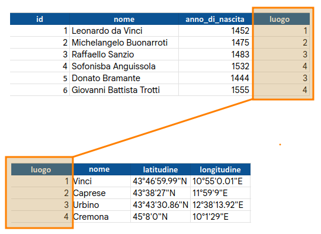

### The Relational Model

⚠️ Quando si lavora con i dati, è raro avere a che fare con una singola tabella.

Spesso diventa quindi necessario combinare più tabelle per rispondere alle domande.

Quando abbiamo più tabelle di dati collegate tra loro, abbiamo _dati relazionali_.

➡️ Il _**modello di dati relazionale**_ è _un modo per rappresentare questi collegamenti tra tabelle di dati_, ed è il fondamento dei _database relazionali_.

---

<!-- _footer: University of York. (2024). *Data: A Practical Guide*. https://subjectguides.york.ac.uk/data -->

### Ok, but why?

Il modello relazionale è usato per progettare database relazionali, la tipologia di database più comune. Ciononostante, _non è necessario usare un database relazionale per poter usufruire dei vantaggi di un modello relazionale_!

💡 I vantaggi del modello di dati relazionale sono:
* Più facile gestire dataset complessi;
* Più integrità dei dati;
* Più facile gestire gli errori.

---

<!-- _footer: University of York. (2024). *Data: A Practical Guide*. https://subjectguides.york.ac.uk/data -->

### Keys = relations

Quando lavoriamo con dati relazionali, dobbiamo **unire** le informazioni da diverse tabelle. Per farlo, dobbiamo utilizzare le **chiavi**, il meccanismo con cui vengono codificate le relazioni tra tabelle diverse.

➡️ Una _**chiave**_ è _una variabile i cui valori identificano univocamente i dati_.

➡️ In altre parole: _una chiave è una colonna della tabella che contiene un valore differente in ogni cella_.

⚠️ Una tabella può avere più chiavi.

---

<!-- _footer: University of York. (2024). *Data: A Practical Guide*. https://subjectguides.york.ac.uk/data -->

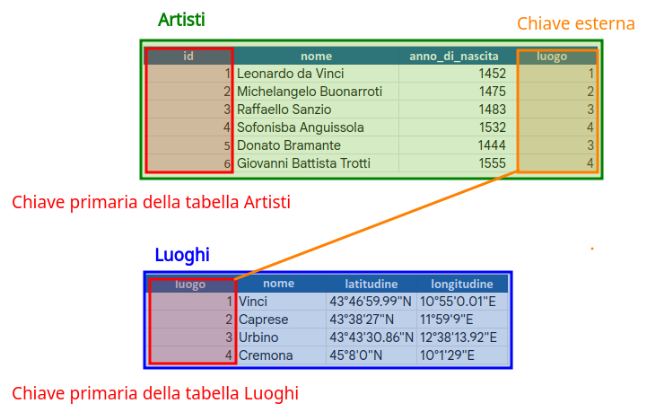

### Primary and external keys

I due tipi di chiave più comuni nel modello di dati relazionali sono:
- _**Primaria**_: _una chiave che identifica univocamente i dati in una tabella_ (è la definizione di chiave, in pratica);
- _**Esterna**_: _un riferimento ad una chiave primaria in un'altra tabella_ (chiave esterna in tabella 1 = primaria in 2).

Chiavi primarie (meccanismo di identificazione univoca) e chiavi esterne (riferimento a quell'identificazione) permettono le relazioni tra tabelle.

---

<!-- _footer: 1/ Ciula, A., Eide, Ø., Marras, C., & Sahle, P. (2018). Models and Modelling between Digital and Humanities: Remarks from a Multidisciplinary Perspective. *Historical Social Research*, *43*(4), 343-361. https://doi.org/10.12759/hsr.43.2018.4.343-361 2/ Tomasi, F. (2020). *Modelling in the Digital Humanities: Conceptual Data Models and Knowledge Organization in the Cultural Heritage Domain*. Historical Social Research Supplement 31, 170–179. https://doi.org/10.12759/hsr.suppl.31.2018.170-179 Image: Unsplash. <a href="https://unsplash.com/photos/abstract-wavy-pattern-with-red-yellow-and-blue-colors-KbSdthZ2lZ8" target="_blank">Source</a>. -->

### From objects to databases via models

Nelle Digital Humanities, i modelli vengono spesso creati con l’obiettivo di essere utilizzati e manipolati da una macchina.

Si modella il mondo reale per trasformarlo in dati, che vengono poi strutturati per consentire di interagire con essi.

💡 _Il modello fornisce le basi teoriche per l’attività pratica_.

---

<!-- _class: impact -->

###### Part 4
# **spreadsheet** databases
## (or how to love comma separated values)

---

<!-- _footer: Image: Unsplash. <a href="
https://unsplash.com/photos/marbled-paper-with-swirling-patterns-in-muted-colors-8eDovdAAxKU" target="_blank">Source</a>. -->

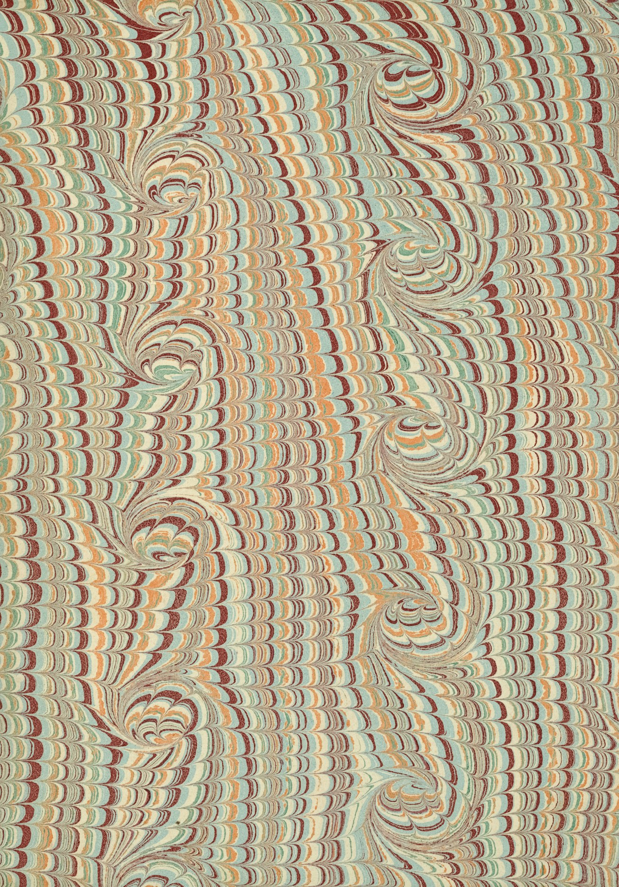

### Databases everywhere

Oggi i database sono fondamentali per consentire alle istituzioni di gestire i propri dati e agli utenti di poterli consultare.

Tutte le fonti che vi ho presentato finora utilizzano database:

- Si digita nella casella di ricerca;
- Il sito interroga le proprie 'tabelle';
- Restituisce un record creato sulla base di tutti i dati disponibili.

La gestione dei dati implica _la comprensione e l’interazione con i database_.

---

<!-- _footer: Drucker, J., & Albrezzi, F. (2025). *The Digital Humanities Coursebook* (2nd ed.). Routledge. Image: Unsplash. <a href="
https://unsplash.com/photos/marbled-paper-with-swirling-patterns-and-muted-colors-nEJJANhuNh0" target="_blank">Source</a>. -->

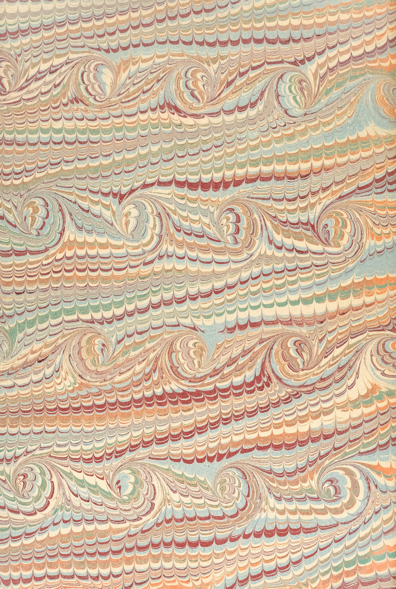

### Databases for dummies

Un database relazionale implica che i dati possano essere voluminosi, articolati e complessi.

Ma! I dati possono essere **voluminosi senza essere complessi**. Possono essere **articolati senza essere voluminosi**. A volte basta un foglio di calcolo.

Spreadsheet databases (una sola tabella) rappresentano il modo migliore per imparare e acquisire familiarità con i sistemi di database e gestione dei dati.

---

<!-- _footer: Image: Unsplash. <a href="
https://unsplash.com/photos/marbled-paper-with-swirling-red-yellow-and-blue-patterns-z9PydKn2vSk" target="_blank">Source</a>. -->

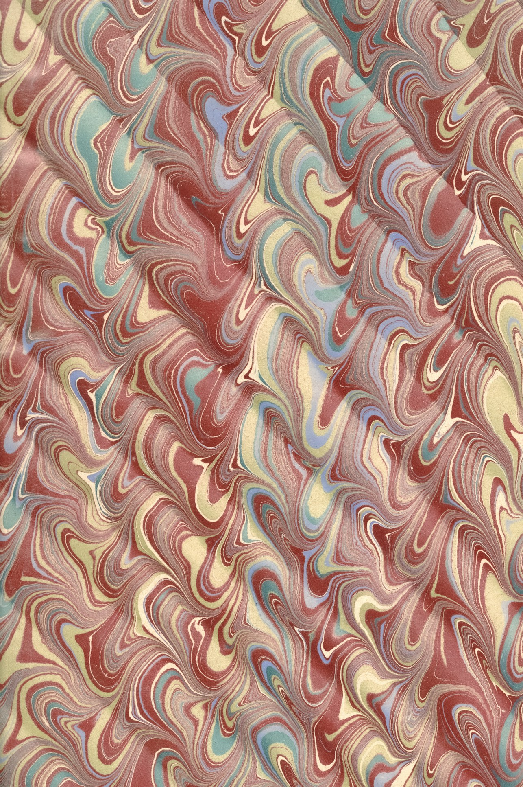

### Comma Separated Values

⚠️ Un database in formato foglio di calcolo solitamente usa CSV (valori separati da virgole) come formatto.

- Una riga per ogni entita.
- Valori separati da **virgole**.
- La prima riga contiene i nomi delle colonne.
- Un valore che contiene una virgola va racchiuso tra **virgolette**.

🥳 È una tabella! È piatta! È un database!

🤫 È anche la rappresentazione di un modello.

---

<!-- _footer: Image: Unsplash. <a href="
https://unsplash.com/photos/abstract-marbled-paper-with-swirling-patterns-kDg5_LwY3wU" target="_blank">Source</a>. -->

### CSV files are very sensitive

Un CSV è un “tipo” di foglio di calcolo.

Quando apri un file .csv in un programma, questo viene _interpretato_. E **a volte i dati vengono distorti**.

✅ Opzione più semplice: Google Sheets.

❌ Da non utilizzare: Apple Sheets.

⚠️ Alcune lingue (come l’italiano) richiedono l’uso dei **punti e virgola**; se il testo contiene **accenti**, la codifica potrebbe non funzionare correttamente (_salvare/leggere sempre in formato UTF-8_); le **date** a volte vengono riformattate.

---

<!-- _paginate: false -->

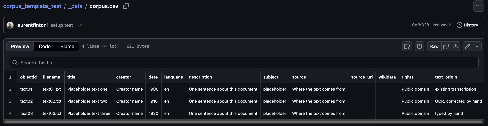
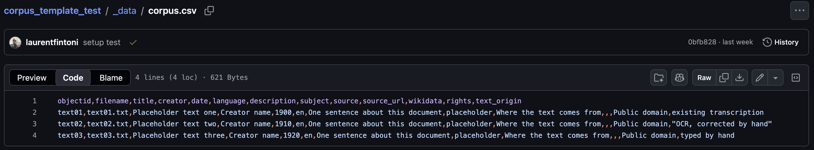

---

### CSVs in Google Sheets

Google Sheets vi permette di modificare il vostro file CSV come qualsiasi altro tipo di foglio di calcolo, il che è utile se preferite “vedere” i vostri dati in un formato familiare (una tabella!).

**Procedura**: 1️⃣ Copiare il file .csv su Google Drive. 2️⃣ Fare doppio clic su nomefile.csv in Google Drive -> si vede un'anteprima. 3️⃣ Selezionare “Apri con” -> Google Sheets. 4️⃣ Il vosto file CSV è ora un file di 'tipo' Google Sheets (avete due file su Google Drive) e potete modificarlo. 5️⃣ Al termine, selezionare “Scarica” -> “Valori separati da virgola (.csv)”. 6️⃣ Ora disponete nuovamente di un file .csv con le modifiche apportate.

È possibile lavorare con i file CSV utilizzando diversi programmi; se non avete familiarità con questo formato, vi consiglio Google Sheets, poiché è molto sicuro e offre un'interfaccia visiva intuitiva. Il software in sé non ha importanza: ciò che conta è che l'interfaccia vi risulti comoda da usare.

---

<!-- _class: impact -->

###### Part 5
# **prototype** data model
## (what to do with all this for the exam)

---

### The requirement

Le linee guida per l'esame richiedono “dati e modello di dati”. Cosa significa?

✅ In base ai dati che scegliete per il vostro progetto e al tipo di metadati che volete registrare, dovete creare **un semplice diagramma E/R** che rappresenti le entità, gli attributi e le relazioni dei vostri dati. La tabella di esempio della lezione 05 vi offre un punto di partenza!

| field | definition | value rule | example |
|---|---|---|---|
| `title` | name of object | free text | Nascita di Venere |
| `date` | year of creation | YYYY or YYYY–YYYY | 1482–1486 |
| `publisher` | makes object available | free text | Uffizi |

Questa tabella vi aiuta a capire quali sono le relazioni e attributi delle vostre entità. **Fa parte del modello di dati**! Quindi: diagramma + tabella dei metadati.

---

<!-- _paginate: false -->

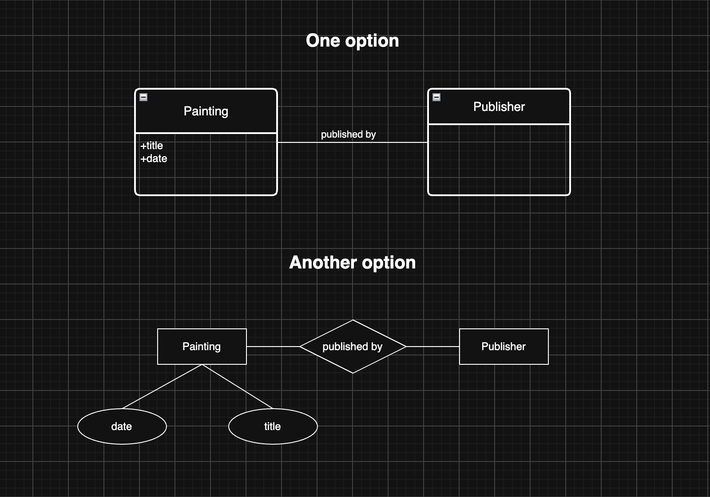

---

### You are creating a small, flat database

✅ Una volta scelti gli oggetti e il modello, potrete creare i dati da inserire in un file CSV, che verrà utilizzato per “popolare” il sito web del vostro progetto.

⚠️ Vi verrà fornito un template CSV in base al percorso che sceglierete. Potrete aggiungere, rimuovere o modificare le colonne all’interno del template per allinearlo al vostro data model (e alla tabella dei metadati).

Una riga = un entità (oggetto e i suoi dati).

Colonne = gli attributi dei vostri oggetti, in base al vostro modello. Le colonne presenti nel template rappresentano un punto di partenza, ovvero attributi comuni a molti tipi di oggetti. Il vostro data model ne aggiunge o ne rimuove alcuni.

Valori (di ciascuna colonna) = metadati.

---

### What you do and don't 'need'

❌ NON state creando un database relazionale! Avete bisogno solo di un file CSV (tabella) piatto.

✅ Avete BISOGNO di una **chiave primaria**. Questa garantisce che ogni elemento del vostro database sia unico e stabile.

✅ Dovete normalizzare i vostri dati mantenendo la coerenza ortografica.

💡 Se i vostri oggetti hanno lo stesso autore (per esempio), forse non avete bisogno di un attributo “autore”, poiché l’autore è un attributo della collezione e non dei singoli elementi (quindi lo includete nella vostra narrazione)! Smart data management 😉

Nelle prossime due lezioni vedremo come utilizzare le autorità per controllare l’ortografia e i valori dei vostri dati e per creare un collegamento a un database esterno (una semplice chiave esterna).

---

### Things to think about

💡 Quando avete modellato i vostri oggetti, quali informazioni avete tralasciato? Cosa è stato difficile rappresentare?

💡 Documentate le vostre scelte! Le regole relative ai metadati costituiscono un tipo di documentazione (perché ho scelto di rappresentare le date in un certo modo? come gestire le incertezze, ad esempio riguardo all’autore di un oggetto).

💡 Se per un attributo non è presente alcun valore, dovete decidere come rappresentare il valore “vuoto” (ne parleremo più nel dettaglio nelle prossime lezioni).

💡 Ricordatevi che le vostre scelte di modellazione hanno delle conseguenze!

---

### Database and narrative, together

I vostri _oggetti diventano dati attraverso la modellazione_. Il vostro _database conserva questi dati secondo il modello_. Il vostro _prototipo è la narrazione_.

- Lezione 05: come utilizzare i metadati ✅
- Lezione 06: come modellare i vostri dati ✅
- Lezione 07: come collegare i dati ad altri database.
- Lezione 08: come pulire i vostri dati.
- Parte 3: come raccontare una storia con i vostri dati.

L'astrazione e la modellizzazione possono sembrare difficili, ma in realtà le mettiamo in pratica continuamente mentre interagiamo con il mondo. Sono la teoria che sta alla base delle storie che raccontiamo sul mondo.

La modellizzazione appartiene all'informatica. La narrativa appartiene alle discipline umanistiche. Devono essere usato insieme!

---

<!-- _paginate: false -->

# DH & Data Management per i Beni Culturali (2026/2027)

## 06. Modelling & Databases ✅

### Thank you 🙏🏻
