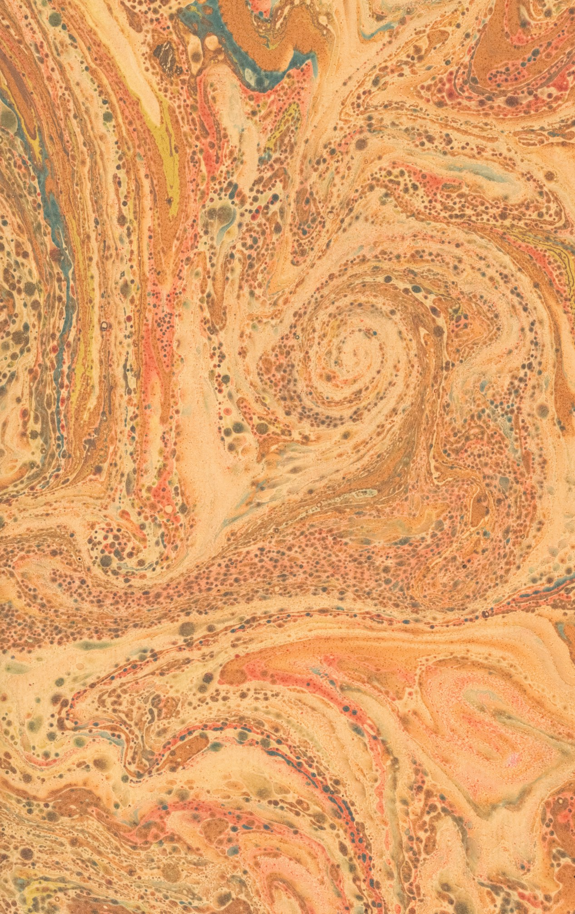
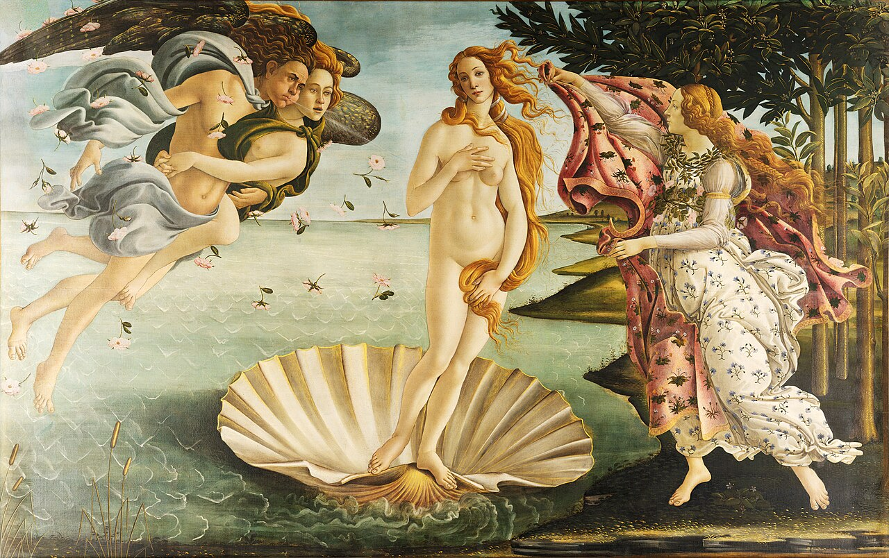
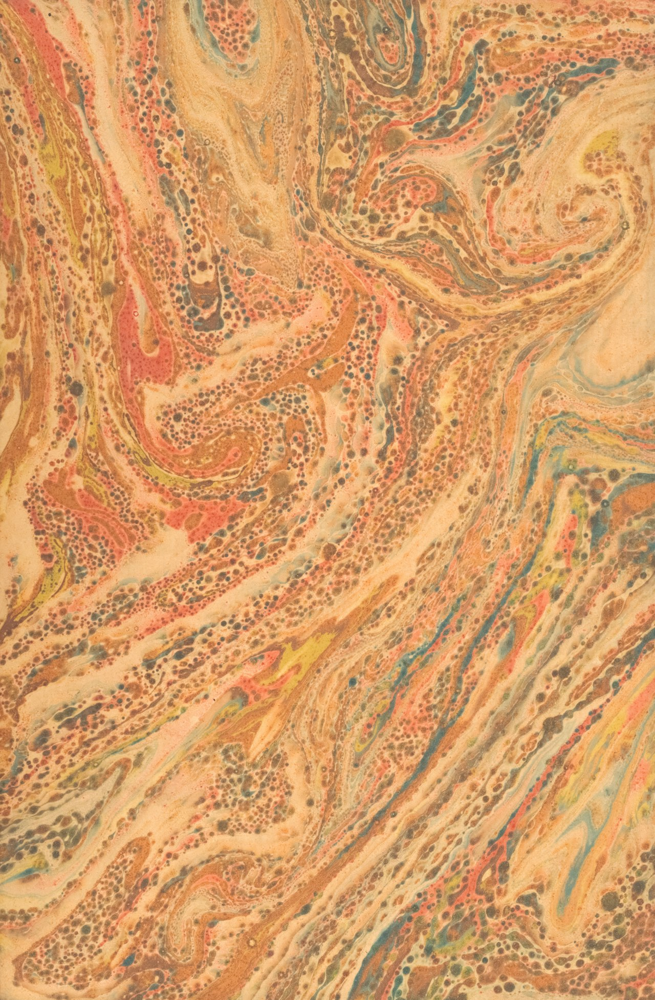
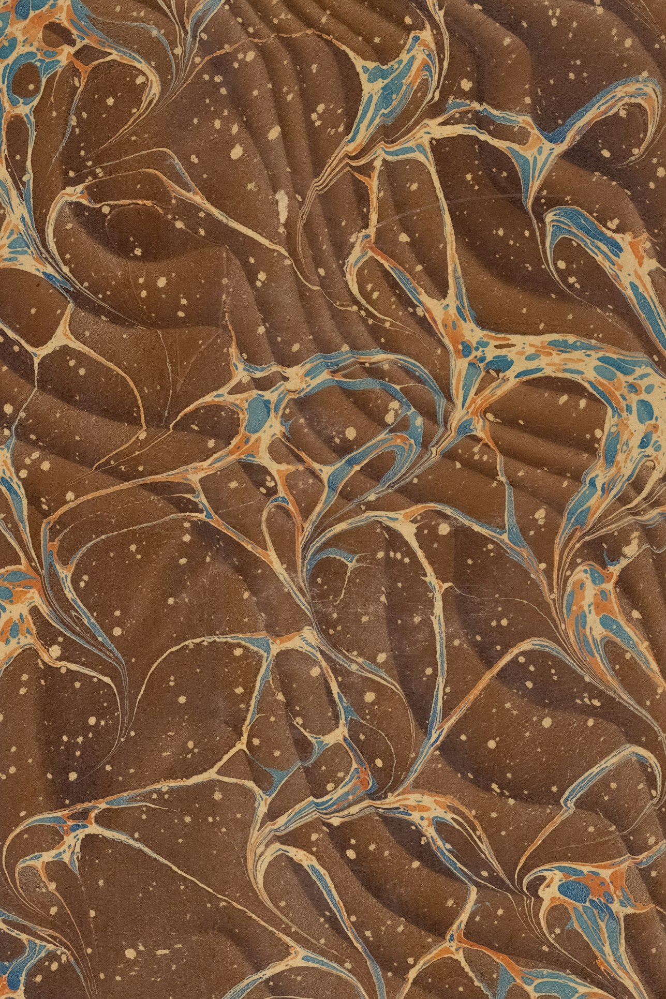

<!-- _paginate: false -->
<!-- _footer: Image: Unsplash. <a href="https://unsplash.com/photos/abstract-swirling-pattern-with-warm-earth-tones-VBPMsHV1EBM" target="_blank">Source</a>. -->

# Digital Humanities / Data Management / Informatica per i Beni Culturali (2026/2027)

## 06. Modelling & Databases / PRATICA

➡️ Mail: [laurent.fintoni2@unibo.it](mailto:laurent.fintoni2@unibo.it)

---

<!-- _class: impact -->

###### Exercise 1
# data **modelling**
## how to model an object, and a collection of objects

---

<!-- _class: steps -->

### The *Venere* and Botticelli

* 👉🏻 Userò draw.io sul mio computer.
* 👉🏻 Dovete dirmi voi cosa includere.
* 👉🏻 Prima modelleremo _La nascita di Venere_ (un oggetto), poi “i dipinti di <a href="https://en.wikipedia.org/wiki/Sandro_Botticelli" target="_blank">Botticelli</a>” (una collezione di oggetti).

* 🤔 Quali sono le **entità**? (opera, persona, ecc...)
* 🤔 Quali sono gli **attributi**? (le caratteristiche dell’entità che ci interessano)
* 🤔 Quali sono le **relazioni** tra le entità? Sono relazioni uno a uno o uno a molti?

---

<!-- _class: impact -->

###### Exercise 2
# Flat to **relational**
## one table becomes...

---

<!-- _footer: Image: Unsplash. <a href="https://unsplash.com/photos/abstract-marbling-pattern-with-swirling-colors-and-textures-DK8y9naXJBs" target="_blank">Source</a>. -->

### What do you need

✅ Computer o tablet.

✅ Questo <a href="" target="_blank">file CSV</a> (<a href="" target="_blank">versione Google Sheets</a>). Si tratta di un elenco di 14 dipinti, con dati tratti da Wikidata (è stato utilizzato l'anno scorso per l'esame).

✅ Account GitHub e repository (facoltativo).

👯 In gruppo o individualmente.

⏰ 15-20 minuti.

---

### Flat to relational

#### Part 1
1. Aprire il file CSV con un programma per fogli di calcolo (Google Sheets è il più semplice).
2. Evidenziare tutti i valori **ripetuti**.
3. Individuare le **incongruenze**.
4. Individuare quali tipi di **entità** sono presenti nella tabella.

---

<!-- _class: steps -->

#### Part 2 (we can do together)
Suddividiamo la tabella in un modello relazionale!
* 🤔 Ci serve una tabella per ogni entità. **Quante** tabelle?
* 🤔 Quali colonne vanno **spostate** in quali tabelle?
* 🤔 Di quali **nuove colonne** abbiamo bisogno in ciascuna tabella?
* 🤔 Quali **valori** vanno inseriti in queste **nuove colonne**?

#### Some questions to think about
* Se si desidera modificare il nome di un artista, quante volte bisogna farlo?
* Se si aggiunge un dipinto con due artisti, cosa bisogna fare?
* Gli anni sono nel formato YYYY. Cosa fare se si desidera consentire anche un altro formato (ad esempio YYYY-YYYY)?

---

<!-- _class: impact -->

###### Exercise 3
# Model **existing data**
## entities and relations

---

<!-- _footer: Image: Unsplash. <a href="https://unsplash.com/photos/brown-marbled-paper-with-blue-and-orange-swirls-JzlIpD8ZUpE" target="_blank">Source</a>. -->

### What do you need

✅ Computer o tablet.

✅ Questo <a href="" target="_blank">file CSV</a> (<a href="" target="_blank">versione Google Sheets</a>). Si tratta di un elenco di 40 dipinti, con la stessa fonte di dati ma con più attributi (più colonne).

✅ Account GitHub e repository (facoltativo)

👯 In gruppo o individualmente (iniziare in classe, finire a casa)

⏰ 20 minuti

---

### Model a project

1. Quali **entità** sono presenti in questa tabella?
2. Quali **attributi** sono presenti in questa tabella?
3. Quali relazioni sono **uno a molti**? Quali sono **molti a molti**?
4. Create il modello usando l'approcio E/R. (se abbiamo tempo, oppure a casa/più tardi)

#### Some more questions to think about
* Due dipinti hanno lo stesso nome. Come si fa a distinguerli?
* Alcuni campi sono vuoti. In che altro modo si potrebbe rappresentare la mancanza di informazioni?
* La colonna “id” è un URL completo di Wikidata. Cosa si potrebbe usare invece come chiave primaria?

---

<!-- _paginate: false -->

# Digital Humanities / Data Management / Informatica per i Beni Culturali (2026/2027)

## 06. Modelling & Databases / PRATICA ✅

### Thank you 🙏🏻
