<!-- _paginate: false -->
<!-- _footer: Image: Linked Open Data Cloud, 2009. Source: BBC. -->

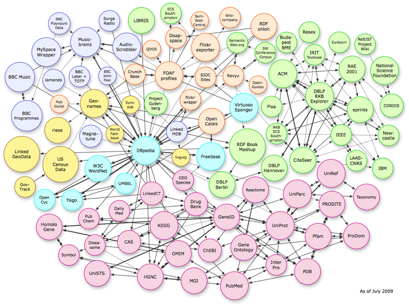

# DH & Data Management per i Beni Culturali (2026/2027)

## 07. Authorities & Linked Open Data

➡️ Mail: [laurent.fintoni2@unibo.it](mailto:laurent.fintoni2@unibo.it)
➡️ ORCID: [0000-0002-8656-4602](https://orcid.org/0000-0002-8656-4602)
➡️ Sito: [laurent.fintoni2](https://www.unibo.it/sitoweb/laurent.fintoni2)

---

<!-- _footer: Image: Printed Library of Congress Subject Headings, 29th edition. <a href="https://en.wikipedia.org/wiki/Library_of_Congress_Subject_Headings" target="_blank">Source</a>. -->

.jpg)

### C'era una volta...

Library of Congress organizza le conoscenze utilizzando i termini soggetti (subject headings): il termine ufficiale che le biblioteche dovrebbero utilizzare per descrivere l’argomento di un libro.

Questi termini veicolano determinati valori, come quello relativo agli “Illegal aliens”, aggiunto nel 1980.

Nel 2014, studenti a Dartmouth hanno presentato una petizione affinché modificasse il termine per "Undocumented migrants". Non ci sono riusciti.

---

<!-- _footer: Image: Printed Library of Congress Subject Headings, 29th edition. <a href="https://en.wikipedia.org/wiki/Library_of_Congress_Subject_Headings" target="_blank">Source</a>. -->

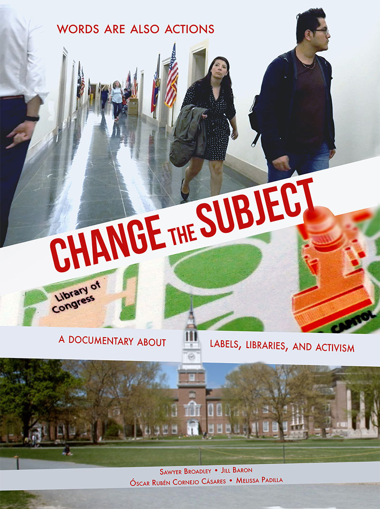

### C'era una volta...

Nel 2016 LoC ha annunciato che avrebbe apportato la modifica. I politici si sono opposti. Il termine è rimasto invariato.

Infine, nel 2021, la LoC ha sostituito il titolo con “**Non citizens**” e “**Illegal immigration**”.

Un termine, presente in un unico elenco ufficiale condiviso, **diventa un dato utilizzato ovunque**.

I vocabolari condivisi (controlli di autorità) sono utili e potenti, ma difficili da modificare.

---

<!-- _class: impact -->

###### Part 1
# names, terms, **identifiers**
## (or how to tell a machine who is who and what is what)

---

<!-- _footer: Image: Unsplash. <a href="https://unsplash.com/photos/a-detailed-drawing-of-a-bird-with-a-long-beak-qPXtl0XXZ7c" target="_blank">Source</a>. -->

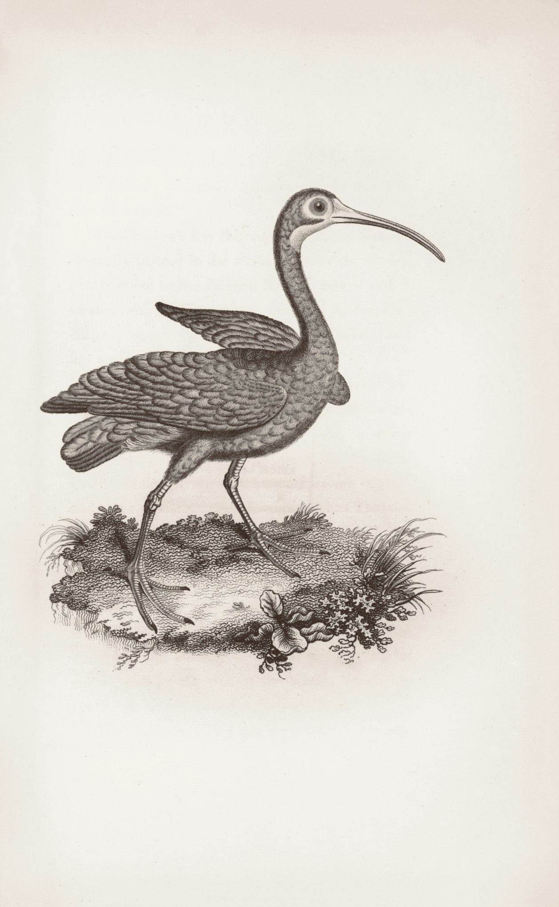

### One person, many name spellings

Come abbiamo già visto, il nome di una persona può diventare un dato, ma non sempre con lo stesso **valore**.

A seconda della fonte, del modello o delle regole, Botticelli può essere: “Filipepi Alessandro detto Botticelli” (ICCD), “Filipepi Alessandro (Sandro Botticelli)” (Zeri) o “Botticelli, Sandro” (SBN).

💡 Sappiamo che si tratta di diverse varianti ortografiche dello stesso nome. Ma **una macchina 'vede' tre nomi** (valori, in questo caso stringa) diversi.

---

<!-- _class: steps -->
<!-- _footer: Blaney, J. (2017). Introduction to the Principles of Linked Open Data. *Programming Historian*, *6*. https://programminghistorian.org/en/lessons/intro-to-linked-data Image: Unsplash. <a href="https://unsplash.com/photos/a-detailed-drawing-of-a-long-billed-bird-standing-on-grass-2efQmPxBxfg" target="_blank">Source</a>. -->

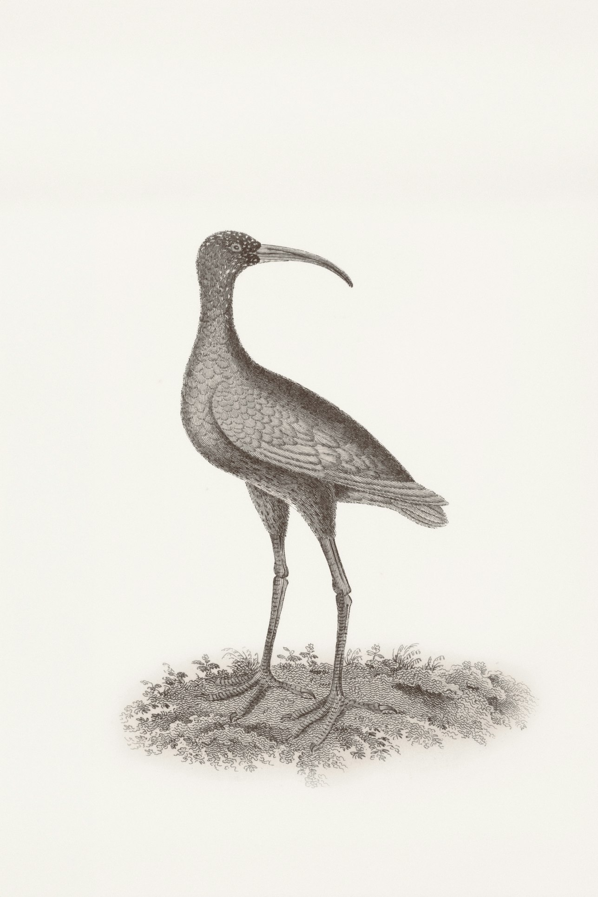

### One term, different concepts

Mercurio!

* 🤔 Quali concetti diversi può rappresentare Mercurio a seconda del contesto?
* Un pianeta, un dio, un metallo, persino un <a href="https://en.wikipedia.org/wiki/Freddie_Mercury" target="_blank">cantante</a>.
* Un nome o un termine di per sé non **identifica**. Ma un **identificatore** proveniente da un _controllo di autorità_ sì!
* Nell’informatica, il controllo di autorità è _un processo di organizzazione delle informazioni_.

---

<!-- _footer: 1/ Rocca-Serra, P., Sansone, S.-A., Gu, W., Welter, D., Abbassi Daloii, T., & Portell-Silva, L. (2022). *D2.1 FAIR Cookbook*. Zenodo. https://doi.org/10.5281/zenodo.6783564 2/ Blaney, J. (2017). Introduction to the Principles of Linked Open Data. *Programming Historian*, *6*. https://programminghistorian.org/en/lessons/intro-to-linked-data Image: The VIAF record for 'Botticelli, Sandro' as of 2026. http://viaf.org/viaf/179145970098632250973 -->

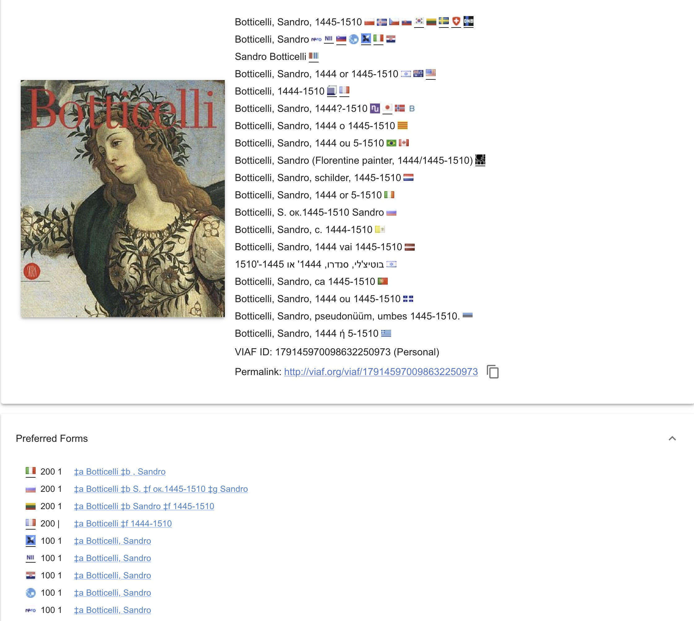

### Authority records

➡️ I **record di autorità** sono _elenchi strutturati di forme di superficie che vengono utilizzati come riferimenti autoritativi_ per garantire l’accuratezza e la coerenza dei dati.

<a href="https://viaf.org/" target="_blank">VIAF</a> per controllare nomi di persone, organizzazioni, luoghi, e opere.

<a href="https://thes.bncf.firenze.sbn.it/" target="_blank">Il Nuovo Soggettario</a> è l'equivalente italiano dei Library of Congress Subject Headings (LCSH), utilizzati da SBN per la classificazione per argomento.

---

<!-- _footer: 1/ Rocca-Serra, P., Sansone, S.-A., Gu, W., Welter, D., Abbassi Daloii, T., & Portell-Silva, L. (2022). *D2.1 FAIR Cookbook*. Zenodo. https://doi.org/10.5281/zenodo.6783564 2/ Gilliland, A. J. (2016). Setting the Stage. In M. Baca (Ed.), *Introduction to Metadata* (3rd ed.). Getty Publications. https://www.getty.edu/publications/intrometadata/setting-the-stage/ Image: Getty TGN search results for Ravenna. -->

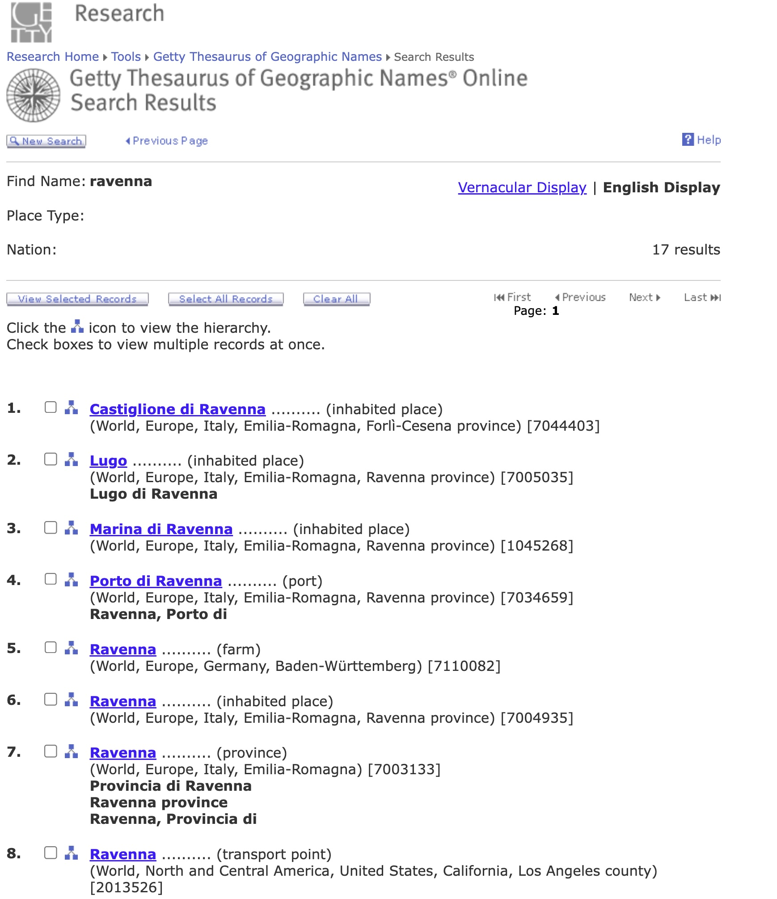

### Controlled Vocabularies

➡️ I **vocabolari controllati** sono _liste strutturate di termini organizzati in un esplicito sistema di relazioni_ (tra cui tassonomie e thesauri!).

Servono per la descrizione coerente dei dati e per controllare i possibili valori applicabili ad un elemento.

<a href="https://www.getty.edu/research-conservation/tools-databases/vocabularies/" target="_blank">Getty Vocabularies</a> per controllare termini relativi alle opera d'arte. <a href="https://iconclass.org/" target="_blank">Iconclass</a> per termini relativi al contenuto iconografico delle immagini.

---

<!-- _footer: Gilliland, A. J. (2016). Setting the Stage. In M. Baca (Ed.), *Introduction to Metadata* (3rd ed.). Getty Publications. https://www.getty.edu/publications/intrometadata/setting-the-stage/ Image: Unsplash. <a href="https://unsplash.com/photos/a-detailed-engraving-of-a-pelican-standing-on-grass-C1EjMQ7pB7U" target="_blank">Source</a>. -->

### Structure of an authority control

Quindi, record di autorità per forme, vocabolari controllati per definizione, entrambi per valori.

I controlli d'autorità utilizzano spesso strutture gerarchiche o alfabetiche per organizzare i propri contenuti, all'interno delle quali sono presenti i seguenti elementi comuni:

- **Termine preferito:** la forma da utilizzare.
- **Termini varianti/alternativi:** altre forme che rimandano al termine preferito (equivalenza).
- **Superiore:** il termine/la categoria di livello superiore (gerarchia).
- **Inferiore:** il termine/la categoria di livello inferiore (gerarchia).
- **Termini correlati:** termini affini con concetti simili (associativo).

Questa struttura consente alle persone o alle macchine di esplorare le relazioni tra i termini. Ogni termine è associato a un identificatore. 🤓 Controlli di autorità sono un tipo di standard per i valori dei dati! (<a href="https://laurentfintoni.github.io/dh-ravenna-26-27/lessons/05/20261119-metadata.html" target="_blank">lesson 05</a>)

---

<!-- _footer: Image: Unsplash. <a href="https://unsplash.com/photos/a-dodo-bird-standing-on-a-patch-of-grass-0NXIe7TegD4" target="_blank">Source</a>. -->


### Identifiers

**Unico:** una cosa = un identificatore. I codici a barre, i numeri di passaporto e i codici postali sono identificatori univoci.

**Persistente:** non cambia anche se l’oggetto cambia. Un <a href="https://doi.org/10.5281/zenodo.6783564" target="_blank">DOI</a> rimanda a dei dati; se i dati cambiano, il DOI no.

**Risolubile:** è possibile seguirlo e arrivare da qualche parte. Un <a href="http://viaf.org/viaf/179145970098632250973" target="_blank">identificatore VIAF</a> può risolversi in una pagina VIAF.

Il mio <a href="https://orcid.org/0000-0002-8656-4602" target="_blank">numero ORCID</a> riportato nella prima slide è un questo tipo di identificatore.

---

<!-- _footer: Image: Unsplash. <a href="https://unsplash.com/photos/a-detailed-sketch-of-a-large-seabird-standing-on-rocks-x8xHCKxg-Q0" target="_blank">Source</a>. -->

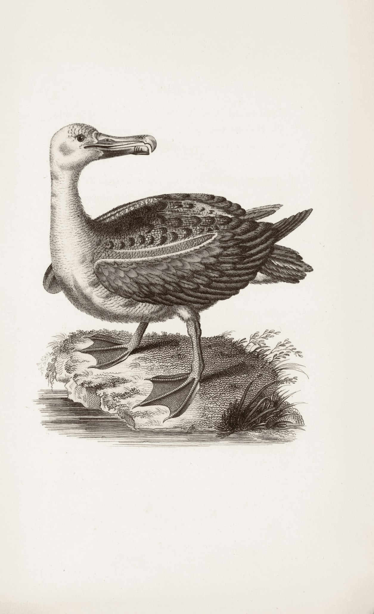

### A key that points outside?

Una chiave primaria in una tabella è un identificatore **unico**, ma non rimanda ad altro.

Una chiave esterna può rimandare a un'altra tabella. Quindi l'identificatore è **unico e si risolve**. Rimanda a qualcosa, in questo caso ai dati presenti in un'altra tabella.

🤔 Ma serve comunque la **persistenza**.

Entra il _URI_, che combina URL (locator) e URN (name).

---

<!-- _footer: Blaney, J. (2017). Introduction to the Principles of Linked Open Data. *Programming Historian*, *6*. https://programminghistorian.org/en/lessons/intro-to-linked-data Image: Unsplash. <a href="https://unsplash.com/photos/a-black-and-white-drawing-of-a-bird-on-rocks-rFnAS4vKSd0" target="_blank">Source</a>. -->

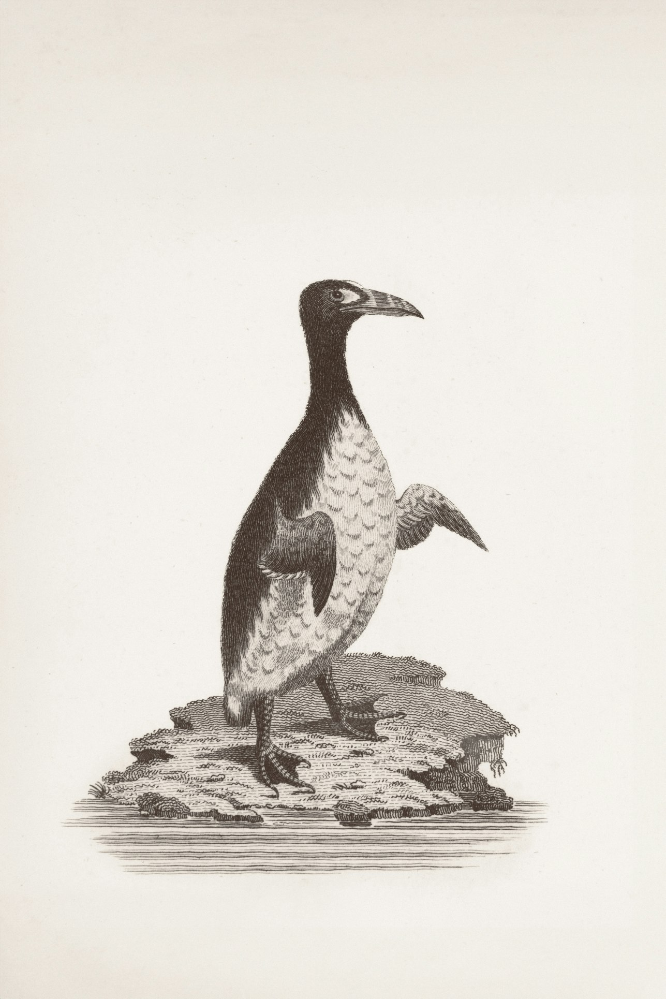

### Uniform Resource Identifier

Un URI è un identificatore costituito da **una sequenza univoca di caratteri** abbinata a un sistema di risoluzione che consente di raggiungere una destinazione (in genere una pagina web).

<a href="http://viaf.org/viaf/179145970098632250973" target="_blank">viaf.org/viaf/179145970098632250973</a> = _179145970098632250973_ è l’URI; _viaf.org/viaf/_ il risolutore.

Gli URI sono **identificatori persistenti** che 'rimandano alle tabelle di qualcun altro'. Sono una forma di chiave esterna per collegare i dati!

---

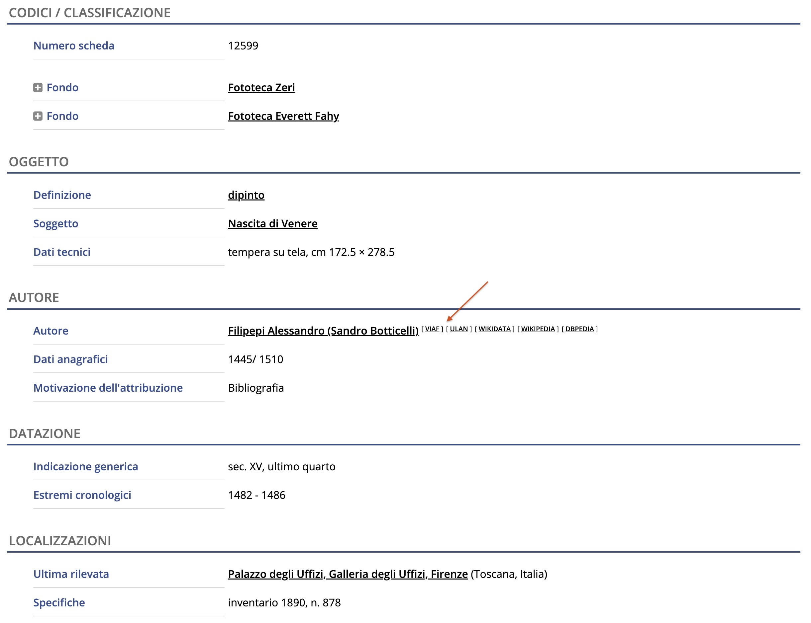

### Connecting databases

Ogni istituzione che si occupa di beni culturali dispone di propri database, spesso contenenti dati simili.

Se utilizzano controlli di autorità, tramite identificatori URI, i loro record possono essere collegati senza copiare nulla!

La Fondazione Zeri utilizza VIAF, ULAN e Wikidata per collegare il proprio valore “autore” a controlli di autorità esterni.

✅ Ora i sistemi automatici 'capiscono' chi è l’autore. E le persone possono verificare se hanno dei dubbi.

---

<!-- _class: impact -->

###### Part 2
# from relations to **statements**
## (or why graphs are sometimes better than tables)

---

<!-- _footer: Tomasi, F. (2020). _Modelling in the Digital Humanities: Conceptual Data Models and Knowledge Organization in the Cultural Heritage Domain_. Historical Social Research Supplement 31, 170–179. https://doi.org/10.12759/hsr.suppl.31.2018.170-179 Image: Unsplash. <a href="https://unsplash.com/photos/a-detailed-drawing-of-a-bird-standing-on-grass-t0pLFG65CYI" target="_blank">Source</a>. -->

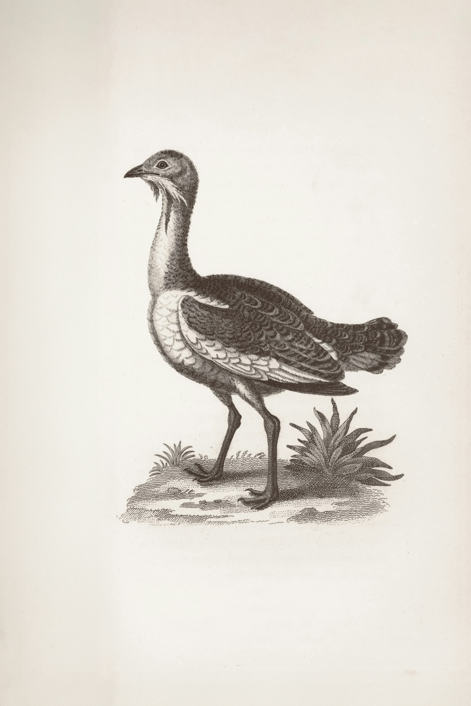

### From Relational to Graph

I dati possono essere strutturati come una sequenza (lista), una tabella (relazioni) o un albero (gerarchia).

🤓 Questi sono tutti modelli di dati!

💡 Il World Wide Web (Internet) è una **rete**, in cui i dati sono collegati tramite relazioni tra pagine web o tra database.

Il modo più comune per rappresentare una rete è tramite una **struttura di grafo**. Si tratta di un _altro tipo di modello di dati_, oggi molto diffuso.

---

<!-- _footer: Blaney, J. (2017). Introduction to the Principles of Linked Open Data. *Programming Historian*, *6*. https://programminghistorian.org/en/lessons/intro-to-linked-data -->

### Relationships as statements

Nella lezione 06 abbiamo trattato il modello Entità/Relazione: Entità ➡️ Relazione ➡️ Entità.

In un grafo questo è noto come **affermazione** (statement), ovvero ciò che i grafi comunicano attraverso la loro struttura.

| Entity | Relation | Entity |
|---|---|---|
| *Nascita di Venere* | made by | Sandro Botticelli |
| *Nascita di Venere* | held by | Galleria degli Uffizi |
| Sandro Botticelli | born in | Firenze |

In una tabella piatta la relazione si trova nel _nome della colonna_. In un grafo si trova nel _collegamento_ tra le entità (proprio come nel diagramma E/R).

---

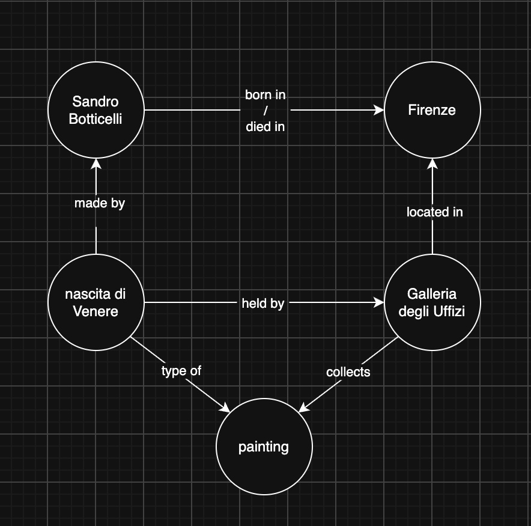

### Statements make a graph

In un grafo, le entità sono chiamate _nodi_, mentre le relazioni sono chiamate _archi_. Possono andare in qualsiasi direzione.

In un database relazionale, per aggiungere qualcosa è necessario creare una nuova colonna e inserire i valori. In un grafo basta semplicemente aggiungere una connessione!

In un database a grafo, un computer può seguire queste istruzioni per collegare i dati tra loro e 'comprenderli'.

Il <a href="https://it.wikipedia.org/wiki/Resource_Description_Framework" target="_blank">Resource Description Framework</a> (RDF) è uno standard (e modello) comune per la scrittura di queste affermazione.

---

<!-- _footer: Blaney, J. (2017). Introduction to the Principles of Linked Open Data. *Programming Historian*, *6*. https://programminghistorian.org/en/lessons/intro-to-linked-data Image: CIDOC CRM conceptualisation. <a href="https://en.wikipedia.org/wiki/CIDOC_Conceptual_Reference_Model" target="_blank">Source</a>. -->

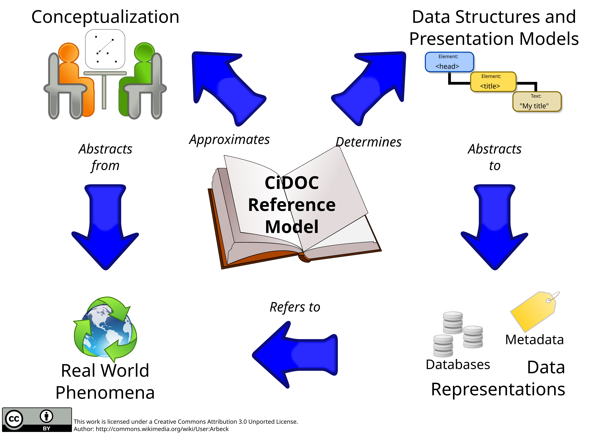

### Controlling statements

Se ognuno inventasse le proprie entità e relazioni, le affermazioni contenute in un grafo non potrebbero collegarsi tra loro.

Un’**ontologia** è un 'tipo' di vocabolario controllato (e di modello!) che definisce quali entità e relazioni esistono in un determinato dominio. Un database a grafo le utilizza affinché le macchine (e noi) possano 'capire' le affermazioni.

<a href="https://cidoc-crm.org/" target="_blank">CIDOC-CRM</a> è lo standard internazionale e l’ontologia per il patrimonio culturale.

---

<!-- _class: impact -->

###### Part 3
# the **semantic** web
## (or the dream of an internet where things have meaning)

---

<!-- _footer: Image: Unsplash. <a href="https://unsplash.com/photos/a-detailed-sketch-of-a-curlew-standing-on-a-rock-8Dm0kI3KCto" target="_blank">Source</a>. -->

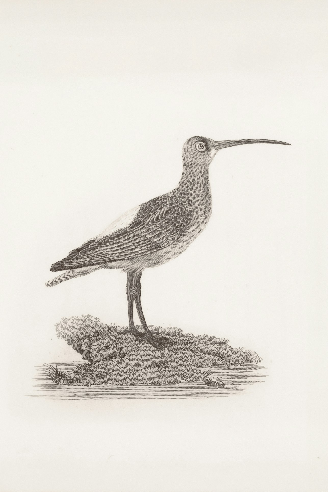

### World Wide Web: a short history

_Web 1.0_ è l'idea di un **web di pagine**, in cui le pagine rimandano ad altre, destinate alla lettura da parte delle persone. (1989)

_Web 2.0_ è l'idea di un **web sociale**, in cui gli utenti partecipano attivamente. (1999)

_Web 3.0_ è l’idea di un **web di dati**, in cui le affermazioni sono collegate tra loro, affinché le macchine possano seguirle e 'capirle'. (2001)

Tutto questo coesiste oggì. Web 3.0 è chiamato **web semantico** perché nelle affermazioni è presente un significato.

---

<!-- _footer: Image: Unsplash. <a href="https://unsplash.com/photos/an-ibis-bird-stands-on-a-patch-of-grass-Sf-ERTQbGPI" target="_blank">Source</a>. -->

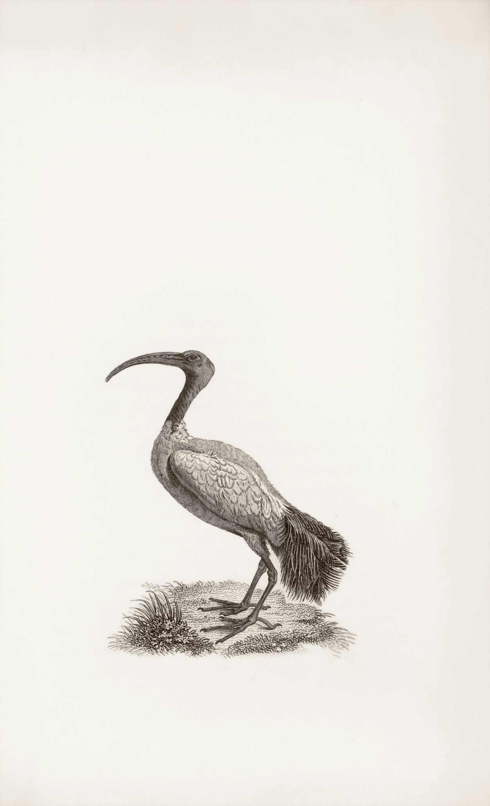

### Linked Open Data

L'idea di un web di dati nasce da Tim Berners-Lee, che nel 1989 ha inventato il World Wide Web (Internet = tecnologia, www = sistema informativo). Per renderla reale, sosteneva che i dati dovessero essere **collegati** e **aperti**.

**Collegati:** i dati utilizzano identificatori condivisi e rimandano ad altri dati (URI).

**Aperti:** una licenza per riutilizzo.

**Web semantico:** le macchine possono 'leggere' il web perché i dati hanno un significato.

---

<!-- _footer: Image: Deployment scheme for Linked Open Data. <a href="https://en.wikipedia.org/wiki/Linked_data#Linked_open_data" target="_blank">Source</a>. -->

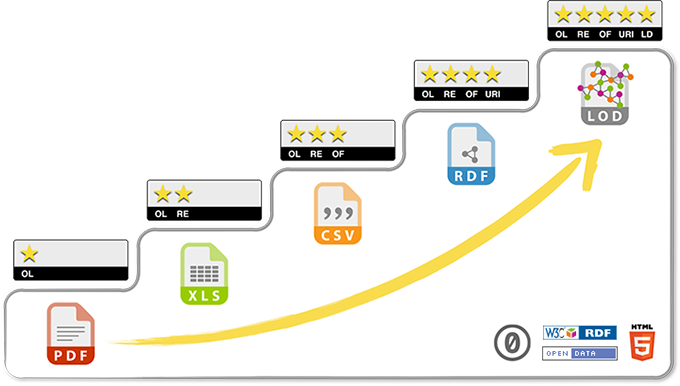

### Five stars

Berners-Lee ha proposto un sistema a cinque stelle per i dati aperti:

1. ⭐ Disponibili pubblicamente.
2. ⭐⭐ + i dati sono strutturati.
3. ⭐⭐⭐ + in un formato aperto (CSV).
4. ⭐⭐⭐⭐ + semantica (RDF, URI).
5. ⭐⭐⭐⭐⭐ + collegati ad altri dati.

Livello 5 = Linked Open Data.

State creando dati aperti per il progetto! (livello 3)

---

<!-- _footer: Image: The Linked Open Data Cloud. <a href="https://lod-cloud.net/" target="_blank">Source</a>. -->

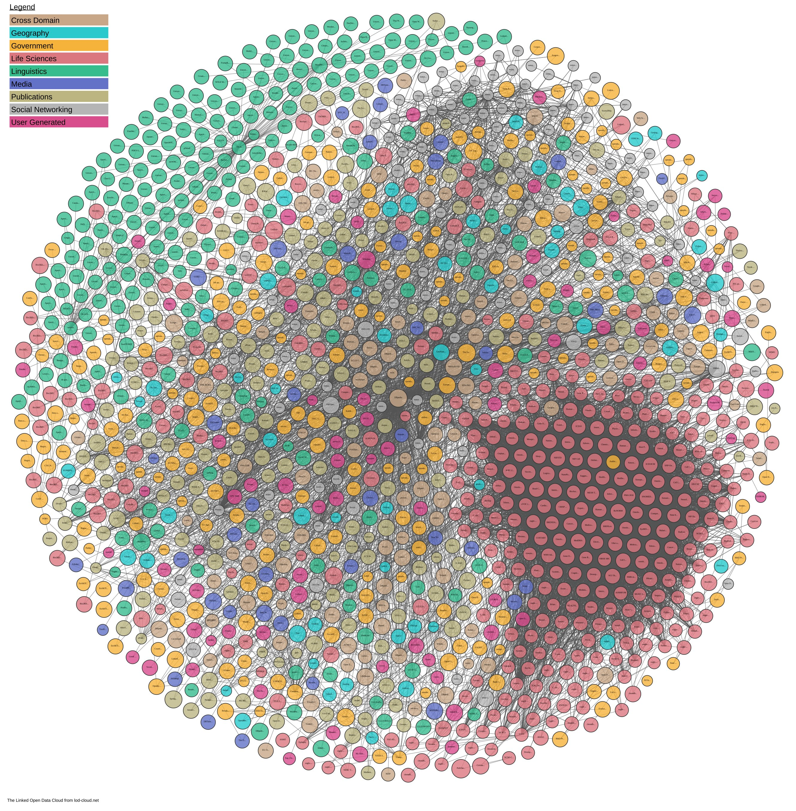

### The LOD cloud

Tutto questo è bello, ma solo se lo fanno tutti (o almeno in molti).

Nel 2007 c’erano 12 dataset di Linked Open Data. Oggi ce ne sono più di 1,300. Potete vederli in questa nuvola che viene di un progetto chiamato <a href="https://lod-cloud.net/" target="_blank">LOD Cloud</a>.

Ogni cerchio (nodo) rappresenta un dataset. Ogni linea indica un collegamento ad un altro (arco). È un grafo!

Aiuta a capire cosa esiste oggi in Linked Open Data e come (ri)utilizzarlo.

---

<!-- _footer: Daquino, M., Mambelli, F., Peroni, S., Tomasi, F., & Vitali, F. (2017). _Enhancing semantic expressivity in the cultural heritage domain: exposing the Zeri Photo Archive as Linked Open Data_. Journal on Computing and Cultural Heritage (JOCCH), 10(4), 1-21. https://arxiv.org/abs/1605.01188 -->

### Italian cultural heritage & Linked Open Data

1/ Il <a href="https://dati.beniculturali.it/lodview/resource/datasetNuovoSoggettario.html" target="_blank">Nuovo Soggettario</a> è pubblicato come Linked Open Data dal 2010, con licenza CC BY 4.0, e contiene collegamenti a LCSH e Wikidata. È presente nel <a href="https://lod-cloud.net/dataset/bncf-ns" target="_blank">LOD cloud</a>.

2/ Il Catalogo generale dei beni culturali è pubblicato in Linked Open Data sotto il nome <a href="https://dati.beniculturali.it/arco/index.php" target="_blank">grafo di conoscenza ArCo</a>. I <a href="https://dati.cultura.gov.it/lodview-arco/resource/HistoricOrArtisticProperty/0900158551.html" target="_blank">collegamenti RDF</a> presenti nelle schede del catalogo (lezione 05) vengono creati utilizzando ArCo.

3/ L'<a href="https://catalogo.fondazionezeri.unibo.it/home/en" target="_blank">Archivio Fotografico Zeri</a> è una versione digitale delle fotografie dello storico dell'arte Federico Zeri. Nel 2003, la Fondazione Zeri ha avviato la creazione di un database relazionale dei documenti (Scheda F e OA). Unibo collabora con loro dal 2016 per trasformare il tutto in un grafo di Linked Open Data (11 milioni di affermazioni, 1,6 milioni di entità!) che include ontologie, controlli di autorità e collegamenti ad altri dataset sull’arte.

---

<!-- _class: impact -->

###### Part 4
# Wiki**data**
## (or Wikipedia but for data)

---

<!-- _footer: Image: Wikidata page elements. <a href="https://en.wikipedia.org/wiki/Wikidata" target="_blank">Source</a>. -->

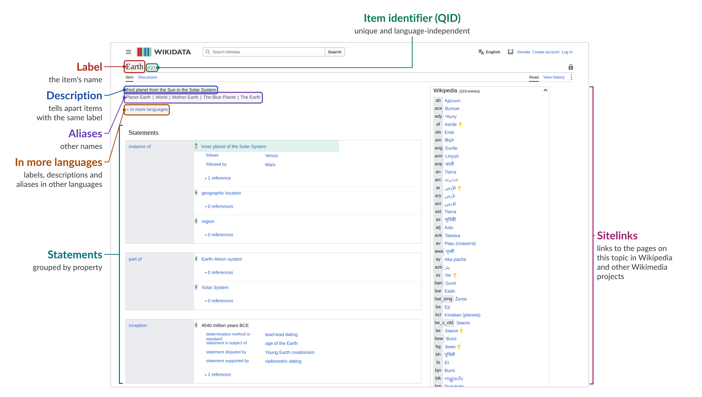

### What Wikidata is

È il 'database' dei dati strutturati utilizzati dai progetti Wikimedia, come Wikipedia. È gratuito e aperto.

Le schede di Wikidata hanno un identificatore (QID), affermazioni e collegamenti ad altri database aperti.

Chiunque può consultarlo, metterlo in discussione e modificarlo! Nel 2025 contava oltre 1,65 miliardi di affermazioni.

Perché? Per garantire che i dati di Wikimedia siano facilmente (ri)utilizzabili da tutti (aperti!).

---

<!-- _footer: Image: Wikidata page elements. <a href="https://en.wikipedia.org/wiki/Wikidata" target="_blank">Source</a>. -->

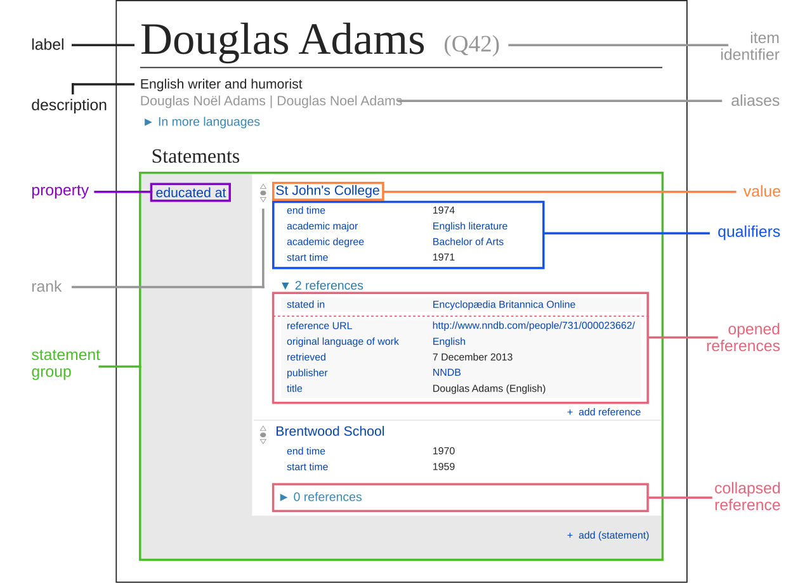

### Anatomy of an item

La *Venere* su Wikidata è <a href="https://www.wikidata.org/wiki/Q151047" target="_blank">Q151047</a>.

- **Etichetta:** il nome, in una o più lingue (il titolo della scheda).
- **Affermazioni:** relazione e valore, uno dopo l'altro.
- **Riferimenti:** da dove proviene il valore dell'affermazione.
- **Qualificatori:** contesto di un'affermazione.
- **Identificatori:** collegamenti a controlli di autorità e altre database.
- **Wikimedia:** collegamenti a items di Wikimedia relative alla stessa entità.

---

<!-- _footer: Image: Wikimedia family. <a href="https://en.wikipedia.org/wiki/Wikimedia_Foundation" target="_blank">Source</a>. -->

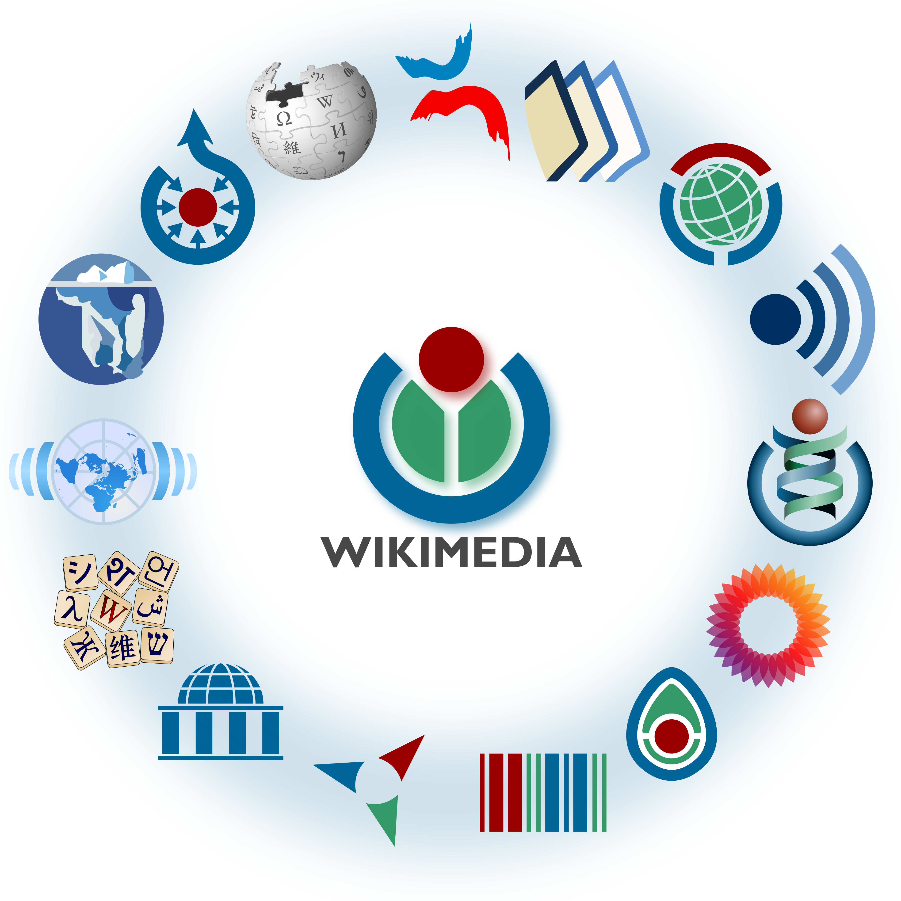

### An authority control, sort of

Wikidata non è stato creato come controllo di autorità, ma, essendo libero, aperto e basato sui principi del LOD, viene molto spesso utilizzato proprio come tale.

È un modo semplice per le persone (come voi!) di dire “questa cosa è questa” rimandando a una pagina di Wikidata, che a sua volta rimanda ad altri sistemi di controllo di autorità 'ufficiali'.

Un modo per considerarlo è come un sistema di controllo di autorità pubblico, proprio come Wikipedia è un’enciclopedia pubblica perché chiunque può contribuire.

---

### Asking the graph a question

È possibile interrogare molti dataset in LOD, come <a href="https://query-next.wikidata.org/" target="_blank">Wikidata</a>. Poiché il grafo è una rete di affermazioni, è possibile porre una domanda e il sistema è in grado di rispondere con il livello di semantica. A tal fine utilizziamo un linguaggio di interrogazione chiamato SPARQL.

```sparql
SELECT DISTINCT ?id ?titolo
WHERE {
  ?id wdt:P31 wd:Q3305213;
      wdt:P17 wd:Q38;
      rdfs:label ?titolo.
  FILTER(LANG(?titolo) = "it")
}
```

_In linguaggio naturale:_ trova tutti gli elementi che **sono** (P31) un dipinto (Q3305213), il cui **paese** (P17) è l'Italia (Q38), e indicami il loro **titolo** in italiano.

⚠️ Oggi ci divertiamo un po' con SPARQL, ma non è necessario impararlo (se non volete).

---

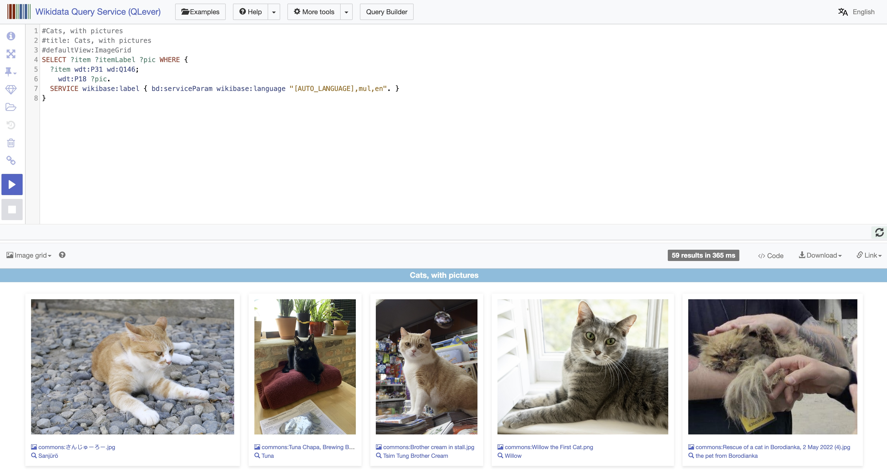

### Using Wikidata

L'esame di questo corso dell'anno scorso ha utilizzato Wikidata per creare un dataset a disposizione degli studenti.

Il contenuto dei file CSV della lezione 06 (e 08) è tratto proprio da lì: quindi è una versione “piatta” delle affermazioni del grafico.

⚠️ Poiché chiunque può contribuire, Wikidata presenta dei limiti e dei pregiudizi. 

Se qualcosa non è presente su Wikidata, ciò non significa che non esista!  

---

<!-- _class: impact -->

###### Part 5
# **connecting** to authority controls
## (what to do with all this for the exam)

---

<!-- _footer: Image: Unsplash. <a href="https://unsplash.com/photos/a-detailed-engraving-of-a-pelican-standing-on-grass-C1EjMQ7pB7U" target="_blank">Source</a>. -->

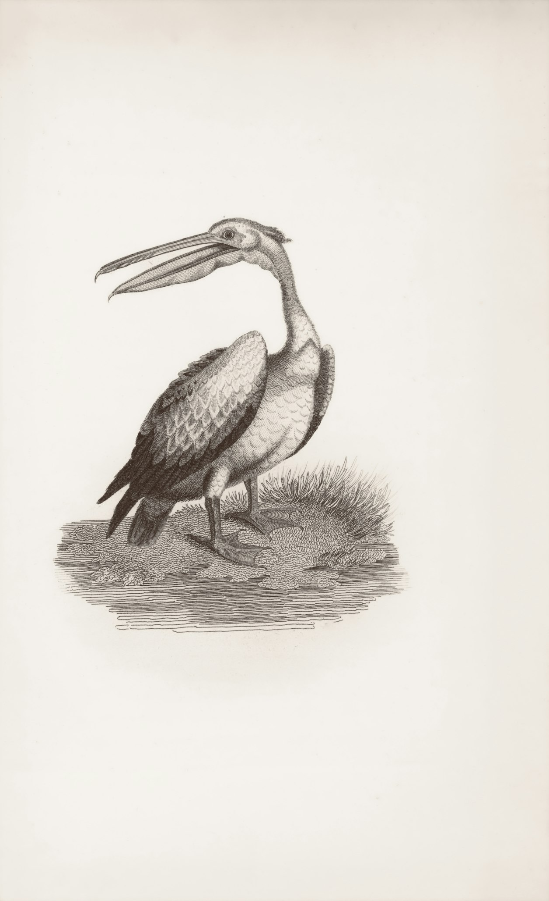

### Official vs community terms

Ricordate <a href="" target="_blank">gli esercizi della lezione 05</a>: una **tassonomia** è un elenco di termini stabiliti dall’alto, mentre una **folksonomia** è un elenco di termini stabiliti dagli utenti (dal basso).

Collegarsi a un controllo di autorità o a un vocabolario non significa rinunciare ai propri termini!

Se non esiste un termine condiviso per ciò che intendete, mantienete il vostro e documentate il motivo!

“Nessuna corrispondenza” è un risultato.

---

### The requirement

Le linee guida dell'esame richiedono un “collegamento ad almeno una **fonte di autorità** come Wikidata, VIAF, AAT ecc.”

In pratica: **almeno un campo** della vostra tabella di dati (CSV) deve utilizzare come valore un identificatore proveniente da un controllo di autorità. Il valore leggibile va inserito in una colonna (per gli utenti), mentre l'identificatore in un'altra (per i sistemi automatici).

| `creator` | `creator_id` |
|---|---|
| Sandro Botticelli | Q5669 |
| Giovanni Bellini | Q17169 |

Un campo compilato bene ✅ Se ne compilate di più, ancora meglio 👌🏻

Wikidata è ✅ Un controllo di autorità specifico è 👌🏻

---

<!-- _class: table-sm -->

### Your metadata table

In base ai **dati** (attributi, entità, relazioni) che desiderate estrarre dai vostri **oggetti** (secondo il vostro modello di dati, rappresentato da un diagramma E/R), dovete tenere traccia di come questi sono rappresentati utilizzando la tabella dei metadati, che abbiamo introdotto nella lezione 05.

| field | definition | DC equivalent | required | value rule | example |
|---|---|---|---|---|---|
| `title` | name given to the object | `title` | yes | free text | Nascita di Venere |
| `date` | year of creation | `date` | yes | YYYY or YYYY–YYYY | 1482–1486 |
| `style` | the artistic style of the object | N/A | no | from a controlled vocabulary | Early Renaissance |
| `publisher` | made/makes object available | `publisher` | yes | free text | Galleria degli Uffizi |
| `unique_id` | unique id for objects in my project | `identifier` | yes | w + underscore + triple digit | w_001 |

⚠️ Questa tabella è solo un esempio, non copiarla alla lettera!

---

<!-- _class: table-sm -->

### Your metadata table

Dopo la lezione di oggi, potrete aggiungere una nuova colonna e campi per i controlli di autorità.

| field | definition | DC equivalent | required | value rule | value source | example |
|---|---|---|---|---|---|---|
| `title` | name given to the object | `title` | yes | free text | N/A | Nascita di Venere |
| `date` | year of creation | `date` | yes | YYYY or YYYY–YYYY | N/A | 1482–1486
| `style` | the artistic style of the object | N/A | no | from a controlled vocabulary | Getty AAT | Early Renaissance |
| `publisher` | makes object available | `publisher` | yes | free text | VIAF | Galleria degli Uffizi
| `publisher_id` | URI for publisher | N/A | yes | URI | VIAF | http://viaf.org/viaf/169401840 |
| `unique_id` | unique id for objects in my project | `identifier` | yes | w + underscore + triple digit | N/A | w_001 |

---

<!-- _class: table-sm -->

### Your data table

Una possibile tabella di dati relativa ai dipinti di Botticelli (che verrà integrata con il template relativo al percorso che si sceglie) potrebbe quindi presentarsi così:

| unique_id | title | date | style | publisher | publisher_id |
|---|---|---|---|---|---|
| w_001 | Nascita di Venere | 1482-1486 | Early Renaissance | Galleria degli Uffizi | http://viaf.org/viaf/169401840 |
| w_002 | Madonna and Child with St. John the Baptist | 1470-1475 | Early Renaissance | Musée du Louvre | http://viaf.org/viaf/257711507 |

Domande da porsi:
- quali campi dei metadati (titolo, autore, ecc.) dovrebbero avere un valore controllato?
- da dove dovrebbe provenire questo valore? (autorità, vocabolario, un proprio elenco?)
- quali nuove colonne è necessario aggiungere?

**campi dei metadati** (lezione 05) → **modello** (lezione 06) → **fonte di autorità** (oggi) → **pulire metadati** (lezione 08)

---

<!-- _paginate: false -->


# DH & Data Management per i Beni Culturali (2026/2027)

## 07. Authorities & Linked Open Data ✅

### Thank you 🙏🏻
