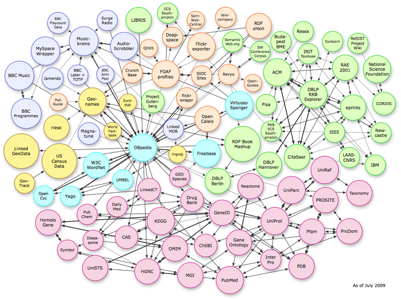

<!-- _paginate: false -->
<!-- _footer: Image: Linked Open Data Cloud, 2009. Source: BBC. -->

# Digital Humanities / Data Management / Informatica per i Beni Culturali (2026/2027)

## 07. Authorities & Linked Open Data / PRATICA

➡️ Mail: [laurent.fintoni2@unibo.it](mailto:laurent.fintoni2@unibo.it)

---

<!-- _class: impact -->

###### Exercise 1
# Read a Wikidata **item**
## how to understand graph statements

---

<!-- _class: steps -->

### Read a Wikidata item

#### Together

* 👉🏻 Leggiamo la pagina Wikidata di <a href="https://www.wikidata.org/wiki/Q151047" target="_blank">*Venere*</a>.
* 👉🏻 Stiamo cercando:
* 1️⃣ almeno un'affermazione, con la relazione (property) e il valore espressi in una frase in linguaggio naturale (ad es. 'La nascita di Venere è un'istanza di un dipinto').
* 2️⃣ un identificatore esterno (un altro controllo di autorità o database).
* 3️⃣ un qualificatore e/o un riferimento.

#### On your own or in groups

* * Scegliete un elemento su Wikidata. Ripetite i passaggi sopra indicati (ma individuate almeno 3 affermazioni) e documentate ciò che trovate!

---

<!-- _class: impact -->

###### Exercise 2
# Ask **Wikidata**
## run a query, change it, maybe even build one

---

### Ask Wikidata: run a query

⚠️ Lo farò sul mio computer. Collaboreremo per seguire i passaggi.

Potrete utilizzare questi steps nel vostro tempo libero per sperimentare con il servizio di query se vi interessa.

#### Run
1. Aprire il [Servizio di query Wikidata](https://query-next.wikidata.org/).
2. Aprire **Esempi** e selezionate un esempio (cats!!).
3. Nel query box, dove si scrive la query, se un termine è preceduto dal simbolo ? significa che si sta chiedendo al servizio di trovarlo (si puo scrivere quello che si vuole dopo ?, ma è meglio usare una formulazione logica); se passate il mouse sui valori wd/wdt, verrà mostrato il loro significato!
4. Premere il pulsante “play” nel menu a sinistra per eseguire la query.

---

#### Change
1. Partendo da una query di esempio, potete provare a modificare ciò che state cercando. Ci sono due modi 'semplici' per farlo: nel query box potete premere `CTRL+spazio` per attivare il completamento automatico, in modo che il sistema vi suggerisca entità e proprietà; o potete navigare all’interno di Wikidata e cercare i valori Q di cui avete bisogno (l’identificatore di una pagina o di una proprietà).
2. Si puo modificare la **modalità di visualizzazione dei risultati** (tabella, mappa, griglia di immagini, linea temporale, grafo). Se si seleziona il grafo, è possibile cliccare sul item per visualizzarne tutte le affermazioni!

#### Build a question

Potete anche imparare a creare query con il <a href="https://query.wikidata.org/querybuilder/?uselang=en" target="_blank">Query Builder</a>, che è una versione semplificata del sistema.

Ad esempio: trova tutti gli elementi con proprietà = istanza di e valore = dipinto.

---

<!-- _class: impact -->

###### Exercise 3
# Tags to **terms**
## your words, their vocabularies

---

<!-- _class: steps -->

### Tags to terms

Torniamo all’<a href="https://laurentfintoni.github.io/dh-ravenna-26-27/lessons/05/20261119-pratica.html" target="_blank">esercizio sui set di tag della lezione 05</a>!

1️⃣ Creiamo insieme un tag set, per qualcosa (di semplice) legato al patrimonio culturale.

2️⃣ Inseriamo i nostri tag in una tabella come questa.

| Our tag | Our definition | Vocabulary | Preferred term | Identifier | Same meaning? |
|---|---|---|---|---|---|
| tempera | paint using egg | AAT | egg tempera | 300015064 | yes |

3️⃣ Voi dovete cercare i tag in un vocabolario controllato: <a href="https://www.getty.edu/research/tools/vocabularies/aat/" target="_blank">AAT</a> per i materiali e le tipologie di oggetti; <a href="https://thes.bncf.firenze.sbn.it/ricerca.php" target="_blank">Nuovo soggettario</a> per i soggetti, in italiano; <a href="https://www.geonames.org/" target="_blank">Geonames</a> per le località; <a href="https://www.wikidata.org/" target="_blank">Wikidata</a> per (quasi) qualsiasi cosa.

4️⃣ Registrate i risultati delle vostre ricerche: quale vocabolario? identificatore? nome preferito? stesso significato? E poi completiamo insieme la tabella.

---

<!-- _paginate: false -->

# Digital Humanities / Data Management / Informatica per i Beni Culturali (2026/2027)

## 07. Authorities & Linked Open Data / PRATICA ✅

### Thank you 🙏🏻
