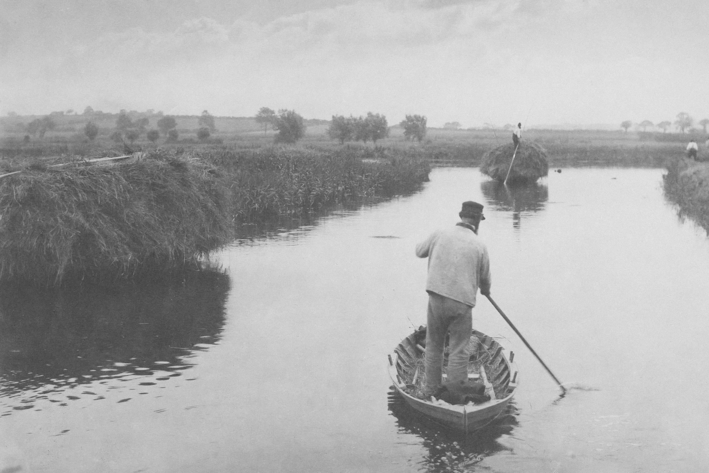
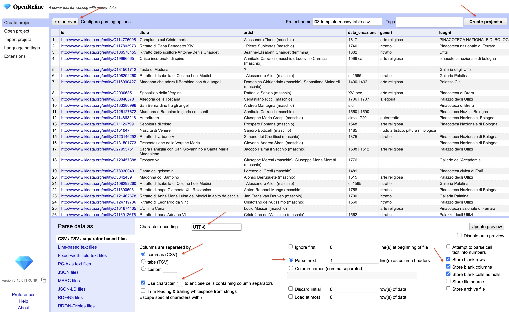
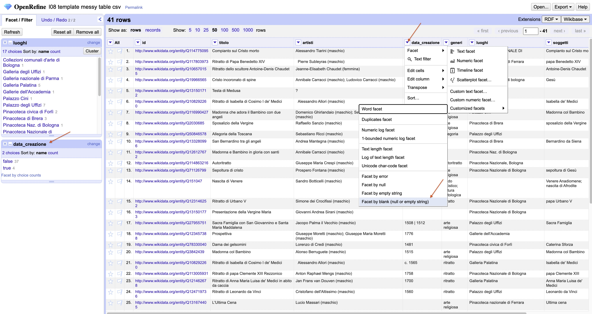
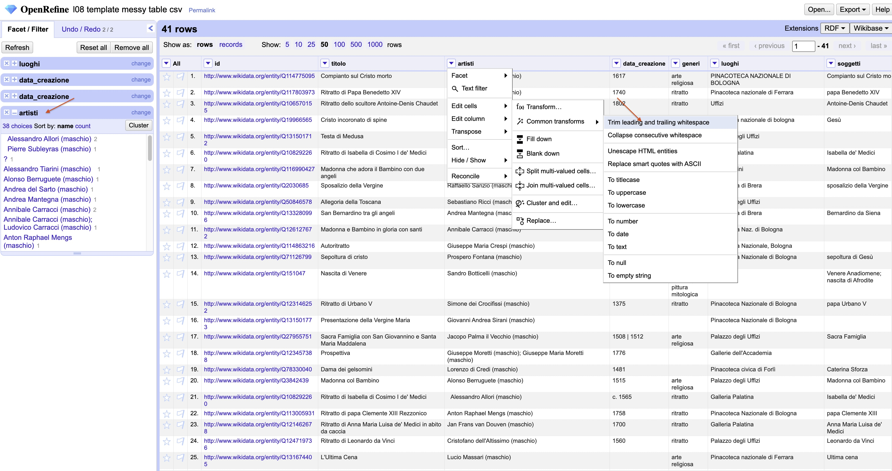
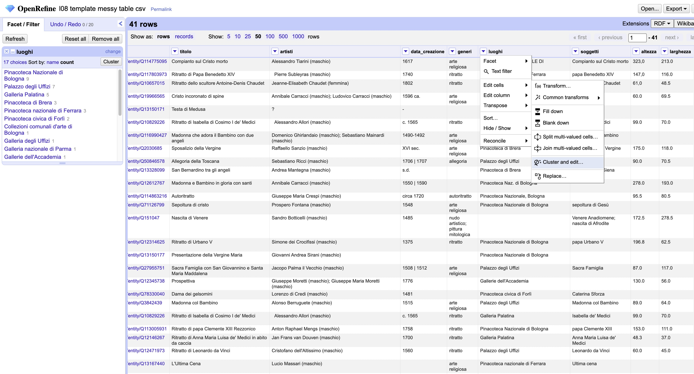
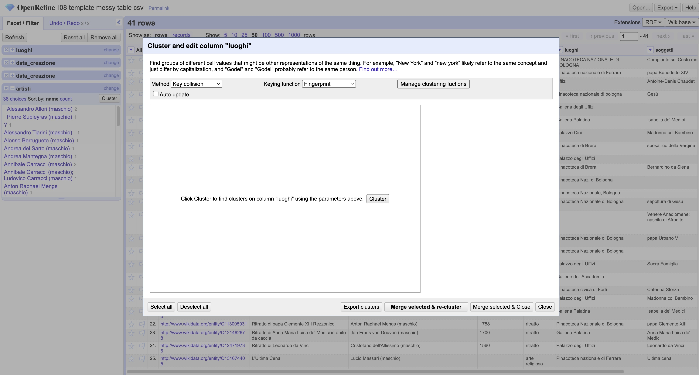
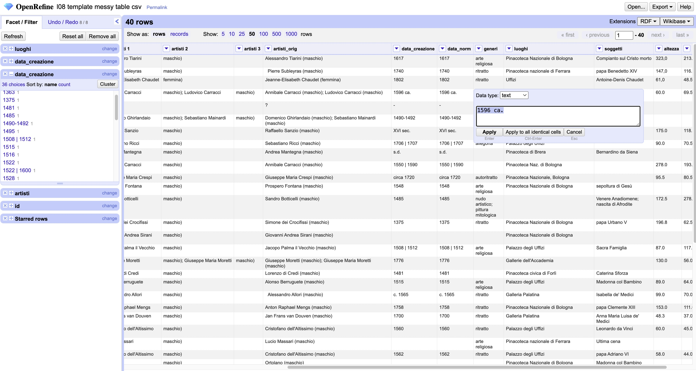

<!-- _paginate: false -->
<!-- _footer: Image: Unsplash. <a href="https://unsplash.com/photos/a-group-of-men-standing-on-top-of-a-building-ULiunopLquw" target="_blank">Source</a>. -->

# Digital Humanities / Data Management / Informatica per i Beni Culturali (2026/2027)

## 08. Data Cleaning / PRATICA

➡️ Mail: [laurent.fintoni2@unibo.it](mailto:laurent.fintoni2@unibo.it)

---

<!-- _footer: Image: Unsplash. <a href="https://unsplash.com/photos/a-man-standing-in-a-boat-on-a-river-QKAz3V0MK5Y" target="_blank">Source</a>. -->

### OpenRefine workshop

✅ È necessario avere <a href="https://openrefine.org/" target="_blank">OpenRefine</a> installato sul proprio computer (oppure collaborare con qualcuno che lo abbia già installato).

✅ Scaricate il <a href="https://github.com/laurentfintoni/dh-ravenna-26-27/blob/main/lessons/08/templates/l08_template_messy_table.csv" target="_blank">file CSV di esercitazione</a> sul stesso computer.

🧹 Faremo insieme sei (brevi) esercizi, ognuno dei quali si basa su quello precedente.

🤓 This is an experiment, let's see what we can get done!

---

<!-- _class: impact -->

###### step 1
# Open and **import**
## from a CSV file to an OpenRefine project

---

### Open and import

1. Avviare OpenRefine ➡️ a seconda del sistema operativo in uso (Mac o Windows), dopo pochi secondi dovrebbe aprirsi una finestra del browser con l’interfaccia di OpenRefine al un URL che inizia con http://127.0.0.1 (che indica il proprio computer locale)

2. Selezionare Crea progetto ➡️ Questo computer ➡️ Scegli file ➡️ selezionare il file CSV di esercitazione (l08_template_messy_table.csv).

OpenRefine creerà un progetto utilizzando questo file CSV; il file stesso rimarrà inalterato!

3. Osservare la schermata di anteprima dell’importazione 🤔

---

### Check the preview!

A questo punto avete diverse opzioni per impostare il vostro progetto in base ai vostri dati e alle vostre esigenze.

- **Separator:** virgole. Tutte le colonne sono nella posizione corretta?
- **Encoding:** UTF-8! Do `Gesù` and `Forlì` look right?
- **Rows:** 41.
- **Storing**: sono disponibili opzioni per mantenere righe, colonne e celle vuote; convertire il testo in numeri; e altre impostazioni di precisione.

Start over = Reset. Create project = Begin.

---

<!-- _class: impact -->

###### Step 2
# **Look** before you touch
## facets, and a list of problems

---

### Using facets to view your data differently

Ora potete vedere il file CSV come progetto OpenRefine. La prima cosa da notare è che il programma, per impostazione predefinita, mostra solo 10 righe. Cliccate sui numeri per visualizzare tutto (nel nostro caso 50 sono sufficienti, dato che abbiamo 41 righe).

Let's create our first facet!

1. Cliccate sulla freccia accanto a `luoghi` (nome della colonna) ➡️ selezionate **Facet** ➡️ selezionate **Text Facet**.
2. Nella colonna di sinistra vedrete il facet! Si tratta di una piccola casella che mostra il numero di valori distinti (17) e che vi permette di ordinarli per nome o per numero.
3. Se cliccate su un valore nel filtro, la tabella verrà filtrata e verranno visualizzate le righe relative a i valori selezionati. Premete il pulsante “Reset” nel filtro per tornare indietro (evita di tornare indietro nel browser, perché la pagina cambierebbe).

🤔 Quanti luoghi distinti ci sono? Quali sono gli stessi luoghi scritti in modo diverso? Tutte le celle vuote sono davvero vuote?

---

<!-- _class: steps -->

### Facet by blank

* Cliccate sulla freccia accanto a `data_creazione` ➡️ **Facet** ➡️ **Customized facets** ➡️ **Facet by blank**.

* Ora abbiamo 2 facets. `true` indica che la cella è vuota.

* Create un text facet sulla stessa colonna (seguendo la stessa procedura utilizzata per `luoghi`).

* In questo nuovo filtro, cercate i valori che riportano 'nulla' pur non essendo vuoti. Quali sono?

* Quali altri 'problemi' si riscontrano in questa colonna?

---

<!-- _class: impact -->

###### Step 3
# Fix and **split**
## actual cleaning

---

### Fix and split

Faremo una serie di piccoli esercizi di pulizia per mostrarvi come funziona OpenRefine e come può essere utilizzato sui vostri dati.

**Ricordate:** correggete direttamente nel dato quando si tratta chiaramente di un errore. Aggiungete una nuova colonna quando si tratta di un’interpretazione.

---

<!-- _class: steps -->

### Remove spaces

* Create un text facet su `artisti`.

* Cliccate sulla freccia accanto a `artisti` ➡️ **Edit cells** ➡️ **Common transforms** ➡️ **Trim leading and trailing whitespace**

* Osservate come cambia il text facet per `artisti`: il numero di valori distinti diminuisce.

---

<!-- _class: steps -->

### Clustering

* Cliccate sulla freccia accanto a `luoghi` ➡️ **Edit cells** ➡️ **Cluster and edit** ➡️ **Click Cluster**.

* Spuntate la casella sotoo **Merge?** se siete d’accordo con la proposta ➡️ Click **Merge Selected & Close**

* 🤔 Ha raggruppato tutte le versione della Pinacoteca di Bologna? Palazzo degli Uffizi è lo stesso che Galleria degli Uffizi?

* Ciò che il raggruppamento non rileva, potete correggerlo manualmente nel text facet (**edit** next to the value).

---

<!-- _class: steps -->

### Duplicate

Un dipinto è presente due volte nella tabella.

Per individuarlo e rimuoverlo:

* Cliccate sulla freccia di `id` ➡️ **Facet** ➡️ **Customized facets** ➡️ **Duplicates facet**.

* La facet restituisce il valore **true** (2) perché due righe sono identiche. Cliccate su `true` nella facet per filtrare sollo quelle due.

* Aggiungete una **stella** su una delle due. Poi: `All` ➡️ **Facet** ➡️ **Facet by star** ➡️ `true` ➡️ `All` ➡️ **Edit rows** ➡️ **Remove matching rows**.

* Cliccate su **Reset All** nella parte superiore della colonna di sinistra. Ora avete 40 righe.

---

<!-- _class: steps -->

### Two different types of values

La colonna `artisti` contiene due tipi di informazioni: nome e sesso. Dobbiamo separarle!

* Per prima cosa conservate l'originale: `artisti` ➡️ **Edit column** ➡️ **Add column based on this column** ➡️ chiamatela `artisti_orig`. Questa è il back up!

* Poi: `artisti` ➡️ **Edit column** ➡️ **Split into several columns** ➡️ **separator** = ` (`.

* ⚠️ Quattro celle ospitano **due artisti**. Che cosa è successo? Come possiamo risolvere la situazione?

* Cos’altro dobbiamo fare?

* Rimuovere le parentesi di chiusura (utilizzare la funzione Replace) e rinominare le nuove colonne.

---

<!-- _class: steps -->

### Several values in one cell

Alcuni dipinti presentano due artisti, due generi o due luoghi, separati da `;`.

Cosa facciamo?

* **split into columns:** menu colonna ➡️ **Edit columns** ➡️ **Split into several columns**
* **keep:** prendiamo nota che `;` è il separatore. Ma se lo facciamo per gli artisti, cosa succede ai dati sul genere che abbiamo appena creato?

---

<!-- _class: steps -->

### Normalization

Ritorniamo su `data_creazione`.

* Come possiamo normalizzare i diversi formati di data?

* Una possibile soluzione è l'EDTF.

* Create una copia della colonna e chiamatela `data_norm`.

* Usate la nuova colonna per normalizzare le date in base allo standard o al sistema che avete scelto. Non dimenticare i valori vuoti!

* In un facet, **edit** un valore per aggiornare tutte le celle che lo contengono.

---

<!-- _class: steps -->

### Numbers

* Diamo un'occhiata alle colonne relative a `altezza` e `larghezza`. Cosa c'è che non va nei valori?

* In alcuni casi si usa la virgola al posto del punto!

* Two steps. Prima: `altezza` ➡️ **Edit cells** ➡️ **Transform** ➡️ **scrivete**: `value.replace(",", ".")`

* Poi (stessa colonna) **Edit cells** ➡️ **Common transforms** ➡️ **To number**. Questo trasformerà il testo in numeri in un formato comprensibile per una macchina (formattazione).

* Se selezionate un **Numeric Facet** su queste colonne, potete visualizzarne l'intervallo!

---

<!-- _class: impact -->

###### Step 4
# **Reconcile** one column
## places for coordinates, or artists for identifiers

---

<!-- _class: steps -->

### Reconcile one column

Proviamo a riconciliare una colonna! Proveremo con `luoghi`.

* `luoghi` ➡️ **Reconcile** ➡️ **Start Reconciling** ➡️ **Add a standard service** ➡️ https://wikidata.reconci.link/it/api (Italian language) ➡️ **choose the service** ➡️ **Next**

* Il sistema proporrà alcune possibili entità di Wikidata! Scegliamo “museo (Q33506)” perché è quella più generica. ➡️ **Start Reconciling**

* Come potete vedere nella colonna, i valori sono ora collegati a Wikidata (se cliccate andate sulla pagina).

* Quando il sistema non è sicuro, vi proporrà diverse opzioni. Potete selezionare una singola cella o tutte le celle con lo stesso valore.

* Alcuni valori non hanno corrispondenze a causa del modo in cui sono scritti. È possibile assegnarne una selezionando l'opzione 'search for a match'.

---

<!-- _class: steps -->

### Bring more data from Wikidata!

* Una volta che avete dati riconciliati, è possibile cercare ulteriori dati correlati utilizzando le proprietà (relazioni) presenti su Wikidata.

* `luoghi` ➡️ **Edit column** ➡️ **Add columns from reconciled values**.

* Nella casella delle proprietà potete digitare “coordinate” (coordinate geografiche) per importare i dati di localizzazione. Verrà visualizzata un'anteprima. Cliccate OK. La nuova colonna viene creata.

* Questa nuova colonna contiene due valori (latitudine, longitudine) separati da una virgola. Se decidi di lavorare con la mappatura, questi valori dovranno essere suddivisi in colonne separate.

* ➡️ **Edit column** ➡️ **Split into several columns** ➡️ separator = `,`.

* Non dimenticare di rinominare le nuove colonne!

---

<!-- _class: impact -->

###### Step 5
# Export and **document**
## new csv, cleaning record

---

### Export and document

Una volta terminata la pulizia dei dati, è possibile esportarli nuovamente in formato CSV.

OpenRefine conserva il progetto separatamente, quindi è sempre possibile tornarci. Per farlo, cliccate sul logo di OpenRefine per tornare al punto di partenza e selezionate 'Open project' invece di 'Create project'.

1. **Export** (top right) ➡️ **Comma-separated value** ➡️ Give the file a new name!
2. Potete sempre consultare la scheda **Undo / Redo** per visualizzare la cronologia delle operazioni eseguite.
3. Utilizzate questa cronologia per documentare il vostro processo.

Questions? Doubts? Always check the <a href="https://openrefine.org/docs" target="_blank">documentation</a> for software and other tools.

---

<!-- _paginate: false -->

# Digital Humanities / Data Management / Informatica per i Beni Culturali (2026/2027)

## 08. Data Cleaning / PRATICA ✅

### Thank you 🙏🏻
