<!-- _paginate: false -->
<!-- _footer: Image: Unsplash. <a href="https://unsplash.com/photos/a-group-of-men-standing-on-top-of-a-building-ULiunopLquw" target="_blank">Source</a>. -->

# DH & Data Management per i Beni Culturali (2026/2027)

## 08. Data Cleaning

➡️ Mail: [laurent.fintoni2@unibo.it](mailto:laurent.fintoni2@unibo.it)
➡️ ORCID: [0000-0002-8656-4602](https://orcid.org/0000-0002-8656-4602)
➡️ Sito: [laurent.fintoni2](https://www.unibo.it/sitoweb/laurent.fintoni2)

---

<!-- _footer: Boddy, J. (2016). *One in five genetics papers contains errors thanks to Microsoft Excel*. https://www.science.org/content/article/one-five-genetics-papers-contains-errors-thanks-microsoft-excel Image: PLOS ONE PHYLOGENY. Source: Flickr. -->

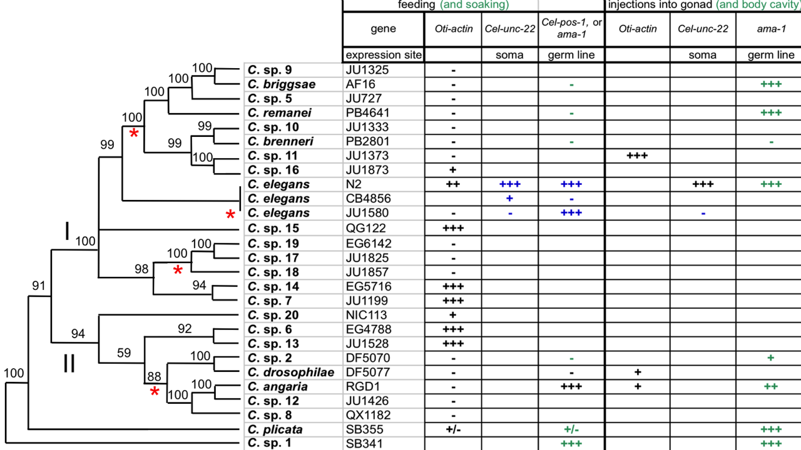

### C'era una volta...

I geni! Hanno nomi brevi. Uno si chiama **MARCH1**. Un altro è **SEPT1**.

Gli ricercatori utilizzano spesso fogli di calcolo quando lavorano con geni, e quindi Microsoft Excel. Ma quando si inserisce MARCH1 in Excel, il programma lo interpreta come qualcos’altro.

Uno studio del 2016 ha rilevato che 1 articolo scientifico su 5 in materia di genetica presentava errori dovuti all’uso di Excel, in cui un gene veniva trasformato in un numero o in una data.

---

<!-- _footer: Vincent, J. (2020). *Scientists rename human genes to stop Microsoft Excel from misreading them as dates*. https://www.theverge.com/2020/8/6/21355674/human-genes-rename-microsoft-excel-misreading-dates Image: Unsplash. <a href="https://unsplash.com/photos/dna-double-helix-structure--qycBqByWIY" target="_blank">Source</a>. -->

### C'era una volta...

La soluzione? Il comitato incaricato di denominare i geni umani ha rinominato 27 geni nel 2020 per evitare errori causati da Excel. MARCH1 è diventato **MARCHF1**.

I dati erano corretti. Sono state le macchine a leggerli in modo errato (Excel oggi è aggiornato). A volte, però, anche i dati sono errati!

Un solo errore, sia esso umano o di macchina, può alterare il significato di interi set di dati e, di conseguenza, anche della ricerca o delle affermazioni.

---

<!-- _class: impact -->

###### Part 1
# data **always** hides **errors**
## (or what it's like being human)

---

<!-- _footer: Image: Unsplash. <a href="https://unsplash.com/photos/a-black-and-white-photo-of-a-city-street-KPWiVEyLpZ4" target="_blank">Source</a>. -->

### Data must be checked...

Gli errori nella creazione, nella gestione e nell’analisi dei dati possono comportare conseguenze di varie tipo: da risultati inutili (fogli di calcolo sui geni) a danni diretti (statistiche errate sulla criminalità).

‼️ Per questo motivo è così importante **assicurarsi della correttezza dei dati**, che si tratti di controllo ortografico, formattazione o valori mancanti.

Dobbiamo sempre assicurarci che i dati siano ben **documentati** e che eventuali casi problematici vengano gestiti.

---

<!-- _footer: University of York. (2024). *Data: A Practical Guide*. https://subjectguides.york.ac.uk/data Image: Unsplash. <a href="https://unsplash.com/photos/a-black-and-white-photo-of-an-old-building-anlMsXParTw" target="_blank">Source</a>. -->

### ... otherwise chaos reigns

Formati eterogenei nella stessa colonna, dati mancanti, nomi varianti delle colonne, ecc.

💡 Dobbiamo **avere i dati in un formato utile per le necessità di utilizzo**: se stiamo analizzando o visualizzando dati, quali informazioni (e tipi di dati) richiede attenzione? Date, misure, nomi, ecc.

⚠️ Gran parte del lavoro sui dati è dedicato al processo di pulizia/bonifica dei dati e alla loro preparazione per ulteriori manipolazioni e analisi.

---

<!-- _class: steps -->
<!-- _paginate: false -->
<!-- _footer: 1/ van Hooland, S., Verborgh, R., & De Wilde, M. (2013). Cleaning Data with OpenRefine. *Programming Historian*, *2*. https://programminghistorian.org/en/lessons/cleaning-data-with-openrefine 2/ Drucker, J., & Albrezzi, F. (2025). *The Digital Humanities Coursebook* (2nd ed.). Routledge. -->

### Do not blindly trust data

* > "**Duplicate records, empty values and inconsistent formats** are phenomena we should be prepared to deal with when using historical datasets." — _van Hooland et al._ (2013)

* Schede nelle istituzioni del patrimonio culturale sono state spesso create da persone diverse, in momenti diversi. Gli errori si insinuano e, se non vengono individuati, si propagano. A volte gli standard cambiano, ad esempio i formati delle date, ma i vecchi dati rimangono invariati.

* Proprio come è necessario imparare a creare e leggere i dati, è importante imparare a pulirli. Non esiste **un unico modo**, perché pulire i dati significa trovare un equilibrio tra la **specificità** della propria fonte e le **convenzioni** relative a standard, strutture e sistemi. È **sempre un compromesso**!

---

<!-- _footer: University of York. (2024). *Data: A Practical Guide*. https://subjectguides.york.ac.uk/data -->

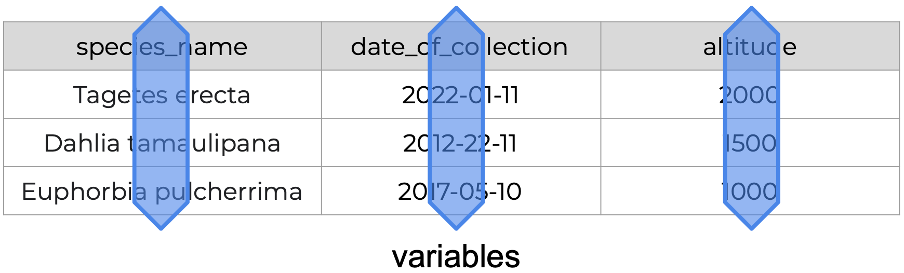
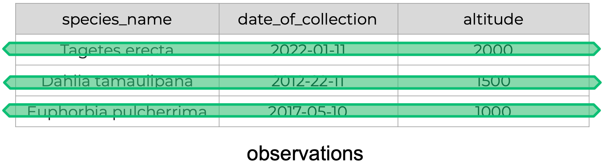
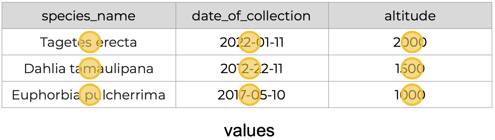

### Data cleaning terms

➡️ _**Variabile**_: _una caratteristica misurata, contata o descritta con i dati_. Esempi: specie di pianta, peso, altezza.

➡️ _**Osservazione**_: _un singolo dato per cui la misura, il conteggio o la descrizione di una o più variabili viene registrato_. Esempio: se stiamo raccogliendo le variabili sopracitate, ogni pianta è un'osservazione.

➡️ _**Valore**_:  _La misura, il conteggio o la descrizione di una variabile_. Esempi: _cucurbitacea_, 15kg, 1.5m.

---

<!-- _footer: University of York. (2024). *Data: A Practical Guide*. https://subjectguides.york.ac.uk/data -->

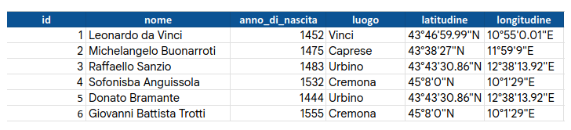
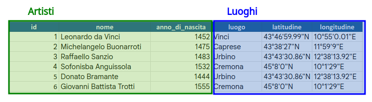

### Data cleaning and modelling

Questi termini (variabili, osservazioni, valori) sono correlati alle entità, relazioni e attributi di un modello di dati!

💡 Un’entità alla qualle viene associato una tabella in un modello relazionale può essere pensata come una “categoria” per le osservazioni.

“Artisti” è un'osservazione (entità); le sue variabili possono includere il nome e la data di nascita (attributi), con valori diversi.

---

<!-- _footer: Image: Unsplash. <a href="https://unsplash.com/photos/a-black-and-white-photo-of-a-cathedral-xi3gf9otsCM" target="_blank">Source</a>. -->

### Common sources for errors

- **Digitazione:** a tutti capita di commettere errori di battitura!
- **Copia da una fonte:** cosa succede se i dati sono errati e non te ne accorgi o non vedi l’errore fino a più tardi?
- **Esportazione:** i valori cambiano, i formati cambiano.
- **Strumenti:** alcuni software interpretano i dati in modi ben precisi e specifici.

È necessario tenere sempre presenti queste possibilità quando si lavora con i dati.

---

<!-- _class: impact -->

###### Part 2
# data **cleaning**
## (or why you need to look carefully at what you take)

---

<!-- _class: steps -->
<!-- _footer: Image: Unsplash. <a href="https://unsplash.com/photos/a-person-riding-a-horse-down-a-snow-covered-road-TCI9PA9n42c" target="_blank">Source</a>. -->

### Data cleaning?

➡️ La **_bonifica dei dati_** è _il processo di identificazione e correzione di errori e incongruenze presenti nei dati_.

Ha l'obiettivo di garantire, con una certa soglia di affidabilità, la fattibilità della manipolazione e dell'analisi dei dati.

* 🤔 Secondo voi, quali sono alcuni aspetti a cui prestare attenzione quando si lavora con i dati e li si pulisce?

* Chi li utilizzerà? I formati (date) sono tutti uguali? Come verranno condivisi? Manca qualcosa? Cosa viene eliminato? ecc.

---

<!-- _footer: UiT The Arctic University of Norway. (2023). *Data Cleaning*. Zenodo. https://doi.org/10.5281/zenodo.8375643 -->

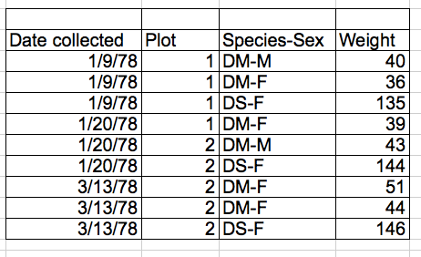
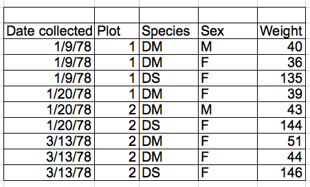

### Good practice: no aggregation

⚠️ L'inserimento di più di un tipo di informazione nella stessa cella (es. due valori/attributi diversi) è da **evitare**.

💡 Quando possibile, suddividiamo i valori in colonne separate (due attributi).

Tabella 1: La colonna `Species-Sex` contiene due attributi diversi di dati.

Tabella 2: La colonna viene divisa.

🤓 Esistono variabili che rappresentano più di un attributo, ma non dovrebbero servirvi per questo corso.

---

<!-- _footer: UiT The Arctic University of Norway. (2023). *Data Cleaning*. Zenodo. https://doi.org/10.5281/zenodo.8375643 -->

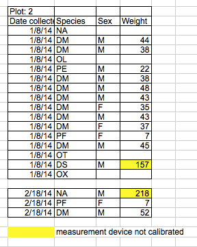
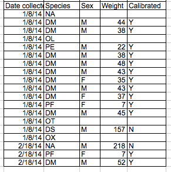

### Good practice: formatting is not information

⚠️ L'utilizzo di colori, stili ortografici, celle vuote, ecc. per esprimere informazioni sui dati stessi è un'attività da **evitare**. Invece, aggiungiamo le informazioni aggiuntive nei titoli delle colonne, nei campi, o in colonne separate.

Tabella 1: Il colore della cella viene usato come informazione aggiuntiva.

Tabella 2: Viene invece aggiunta una colonna con un variable (Y/N).

---

<!-- _footer: UiT The Arctic University of Norway. (2023). *Data Cleaning*. Zenodo. https://doi.org/10.5281/zenodo.8375643 -->

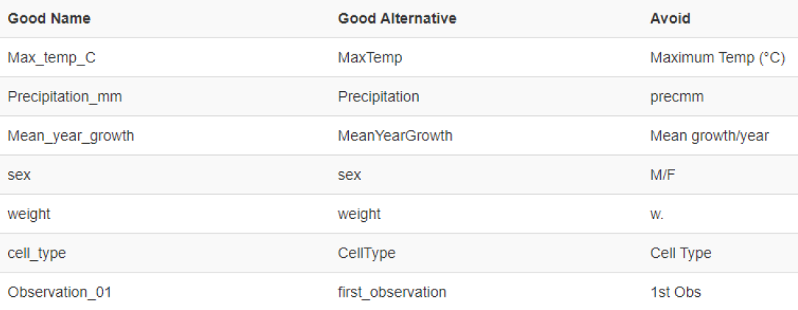

### Good practice: use standards consistently

* Utilizziamo _standard internazionali_ (es. ISO-639 per le lingue), _record di autorità_ (es. VIAF), _vocabolari controllati_ (es. AAT);
* Assicuriamo la _coerenza nella capitalizzazione_ delle parole (detto <a href="https://miro.medium.com/v2/resize:fit:1400/format:webp/1*nFtmnWh6TmLLIniNfg-2yA.png" target="_target">case types</a>);
* Assicuriamo la _coerenza nella scelta dei delimitatori_;
* Assicuriamo la _coerenza nelle convenzioni di nomenclatura_;
* Facciamo attenzione agli _spazi_!

---

<!-- _footer: White, E. P., Baldridge, E., Brym, Z. T., Locey, K. J., McGlinn, D. J., & Supp, S. R. (2013). *Nine simple ways to make it easier to (re)use your data* (e7v2). PeerJ Inc. https://doi.org/10.7287/peerj.preprints.7v2 -->

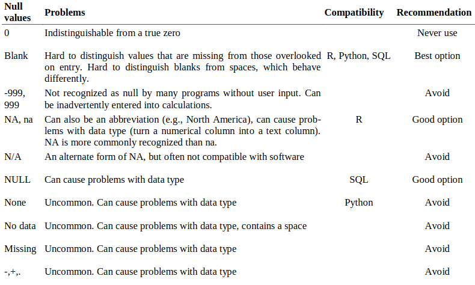

### Good practice: missing values

Nell'informatica, un valore mancante o sconosciuto viene chiamato valore nullo. È diverso da 0 o da false!

Meglio stabilire _una regola coerente_ che causi meno errori possibili. In informatica, vengono usati svariati valori nulli.

Per il vostro progetto, 'not available' (`NA`, `na`, o `N/A`) o 'unknown' possono avere senso. Uno per dati mancanti, l'altro per dati sconosciuti.

⚠️ **Documentate la vostra scelta**!

---

<!-- _footer: Wickham, H. (2014). Tidy data. *Journal of Statistical Software*, *59*(10), 1–23. https://doi.org/10.18637/jss.v059.i10 -->

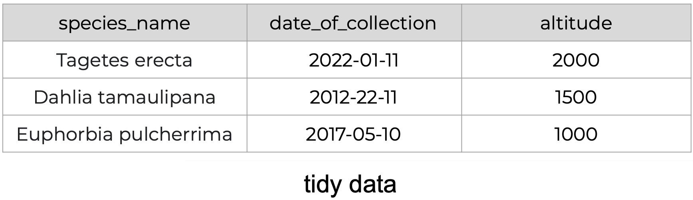

### Tidy data principles

Come abbiamo visto nella <a href="https://laurentfintoni.github.io/dh-ravenna-26-27/lessons/06/20261123-modelling.html" target="_blank">lezione 06</a>, il modo in cui modelliamo i dati può facilitarne la pulizia.

Nel vostro caso, in cui c'è una sola tabella, i principi del tidy data costituiscono una linea guida utile:

* Ogni valore appartiene a una variabile e a un’osservazione;
* Ogni variabile/attributo forma una colonna;
* Ogni osservazione forma una riga;

---

### Multiple values in one cell

E se avete bisogno o desiderate inserire più valori in una singola cella?

Abbiamo già visto alcuni esempi (lezione 06 pratica) in cui a volte ci sono molti valori per un unico attributo/variabile. Il soggetto di _Venere_ può essere “conchiglie, mare, vento, Venere” ecc.

Siete voi a **decidere come gestire** questa situazione! Potete scegliere di avere alcune celle con più valori (**utilizzando un delimitatore specifico**) oppure potete decidere di **suddividerli** in colonne separate.

Non esiste una risposta perfetta, dipenderà dalle vostre esigenze: l’importante è essere coerenti e documentare le vostre scelte!

---

<!-- _class: impact -->

###### Part 3
# cleaning is **interpretation**
## (or who decides what counts as messy?)

---

<!-- _class: steps -->
<!-- _footer: Rawson, K., & Muñoz, T. (2019). Against Cleaning. In M. K. Gold & L. F. Klein (Eds.), *Debates in the Digital Humanities 2019*. TODO publisher. https://dhdebates.gc.cuny.edu/read/untitled-f2acf72c-a469-49d8-be35-67f9ac1e3a60/section/07154de9-4903-428e-9c61-7a92a6f22e51 Image: Unsplash. <a href="https://unsplash.com/photos/a-black-and-white-photo-of-people-sitting-in-the-desert-GtgkkyFXR9I" target="_blank">Source</a>. -->

### Against cleaning

* La pulizia dei dati è, come molte delle pratiche DH che abbiamo visto, un modo per “vedere il mondo”. La pulizia implica disordine, e quindi ordine. Ma di chi?

* > "Data cleaning is a **consequential step** in the research process that we often make **opaque** by the way we talk about it." — _Rawson & Muñoz_ (2019)

---

<!-- _footer: Rawson, K., & Muñoz, T. (2019). Against Cleaning. In M. K. Gold & L. F. Klein (Eds.), *Debates in the Digital Humanities 2019*. University of Minnesota Press. https://dhdebates.gc.cuny.edu/read/untitled-f2acf72c-a469-49d8-be35-67f9ac1e3a60/section/07154de9-4903-428e-9c61-7a92a6f22e51 Image: Unsplash. <a href="https://unsplash.com/photos/a-black-and-white-photo-of-a-cliff-cmBzIkm73ss" target="_blank">Source</a>. -->

### What the mess can be

Diversi modi di scrivere un nome possono riflettere periodi storici diversi, o addirittura storie diverse legate al nome.

Quando si lavora con i dati, non bisogna mai perdere di vista il modo in cui questi possono essere generalizzati e, così facendo, cancellare ciò che rende unica la realtà da cui provengono.

Gli elementi dei dati che non sono generalizzabili (o che non possono essere catturati) vengono spesso eliminati.

---

<!-- _footer: Rawson, K., & Muñoz, T. (2019). Against Cleaning. In M. K. Gold & L. F. Klein (Eds.), *Debates in the Digital Humanities 2019*. University of Minnesota Press. https://dhdebates.gc.cuny.edu/read/untitled-f2acf72c-a469-49d8-be35-67f9ac1e3a60/section/07154de9-4903-428e-9c61-7a92a6f22e51 Image: Unsplash. <a href="https://unsplash.com/photos/a-couple-of-people-sitting-on-top-of-a-stone-wall-qowY_nbhwOU" target="_blank">Source</a>. -->

### Another approach

Se si lavora con varianti di un nome, invece di normalizzarle si potrebbe creare un elenco che colleghi ciascuna variante a un concetto comune.

Tale concetto comune potrebbe derivare da un controllo di autorità (<a href="https://laurentfintoni.github.io/dh-ravenna-26-27/lessons/07/20261126-lod.html" target="_blank">lesson 07</a>), oppure potrebbe essere qualcosa stabilito da una comunità coinvolta.

Il punto è che spesso esiste sempre una soluzione creativa a un problema tecnico, come la pulizia dei dati, che può aprire nuove modalità di pensiero e di lavoro.

---

<!-- _footer: Drucker, J., & Albrezzi, F. (2025). *The Digital Humanities Coursebook* (2nd ed.). Routledge. Image: Unsplash. <a href="https://unsplash.com/photos/a-black-and-white-photo-of-an-old-building-gkQgmUzYGHQ" target="_blank">Source</a>. -->

### Be mindful

Quando parliamo di pulizia, intendiamo l’eliminazione, che può riguardare aspetti specifici e/o l’identità culturale, cose difficile da tradurre in dati. Siate sempre consapevoli delle vostre decisioni.

- Conservate il file/i dati originali.
- Quando interpretate i dati, aggiungete invece di sostituire (nuova colonna, nuovi valori).
- Documentate le decisioni e le scelte.
- Se avete dei dubbi, verificate il motivo per cui qualcosa è com’è (ortografia, formato).

---

<!-- _class: impact -->

###### Part 4
# Open**Refine**
## (or an easy introduction to data cleaning)

---

<!-- _footer: van Hooland, S., Verborgh, R., & De Wilde, M. (2013). Cleaning Data with OpenRefine. *Programming Historian*, *2*. https://programminghistorian.org/en/lessons/cleaning-data-with-openrefine -->

### What it is

<a href="https://openrefine.org/docs" target="_blank">OpenRefine</a> è oggi uno degli strumenti più diffusi per la pulizia dei dati ed è molto apprezzato nelle discipline umanistiche per la sua interfaccia semplice e intuitiva.

🥳  È gratuito e open source (e gestito da un'organizzazione senza scopo di lucro).

Funziona sul computer e utilizza il browser per l'interfaccia, che è simile a quella di molti programmi di foglio elettronico. Dispone di connessioni integrate a Wikidata e RDF per facilitare la creazione di dati aperti.

---

<!-- _footer: van Hooland, S., Verborgh, R., & De Wilde, M. (2013). Cleaning Data with OpenRefine. *Programming Historian*, *2*. https://programminghistorian.org/en/lessons/cleaning-data-with-openrefine -->

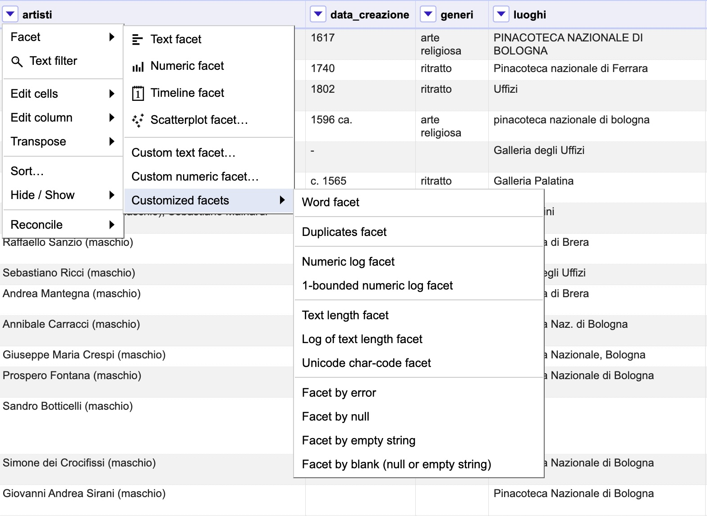
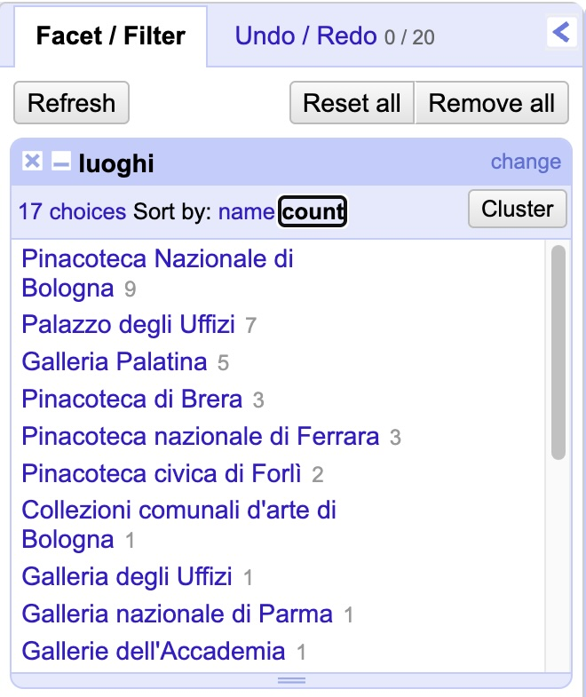

### Facets

Facets consentono di visualizzare un sottoinsieme specifico dei dati, per individuare tendenze e varianza. Un facet elenca tutti i valori distinti presenti in una colonna, indicandone il numero.

- **Text facet:** in quanti modi è scritto questo valore?
- **Numeric facet:** qual è l’intervallo e cosa non è un numero?
- **Facet by blank:** quali celle sono vuote?

---

<!-- _footer: van Hooland, S., Verborgh, R., & De Wilde, M. (2013). Cleaning Data with OpenRefine. *Programming Historian*, *2*. https://programminghistorian.org/en/lessons/cleaning-data-with-openrefine -->

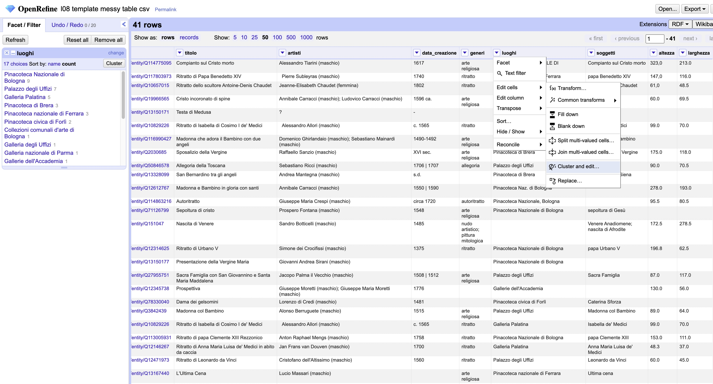
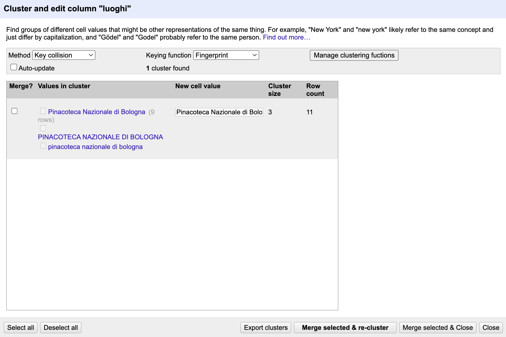

### Clustering

OpenRefine può aiutarvi a individuare valori che **probabilmente corrispondono alla stessa cosa, ma scritti in modo diverso**, e suggerirvi un modo per unirli.

In questo modo, le diverse varianti ortografiche dei nomi possono essere raggruppate in un unico valore. Siete voi a decidere quali valori unire e quale sarà il nuovo valore.

Il raggruppamento è un modo semplice per individuare, e magari correggere, le incongruenze presenti nei dati.

---

<!-- _footer: van Hooland, S., Verborgh, R., & De Wilde, M. (2013). Cleaning Data with OpenRefine. *Programming Historian*, *2*. https://programminghistorian.org/en/lessons/cleaning-data-with-openrefine -->

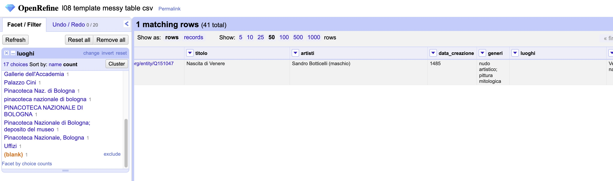

### Missing, hidden or empty values

A volte una cella vuota può contenere un singolo spazio. Per noi è vuota, ma un computer 'vede' un valore (uno spazio).

Lo stesso vale per uno spazio prima o dopo un valore!

Con OpenRefine si può vedere come appaiono i valori a una macchina.

Questo è importante quando si inizia a lavorare con i dati in modo più tecnico, perché i valori nascosti come gli spazi possono alterare l’analisi.

---

<!-- _footer: van Hooland, S., Verborgh, R., & De Wilde, M. (2013). Cleaning Data with OpenRefine. *Programming Historian*, *2*. https://programminghistorian.org/en/lessons/cleaning-data-with-openrefine -->

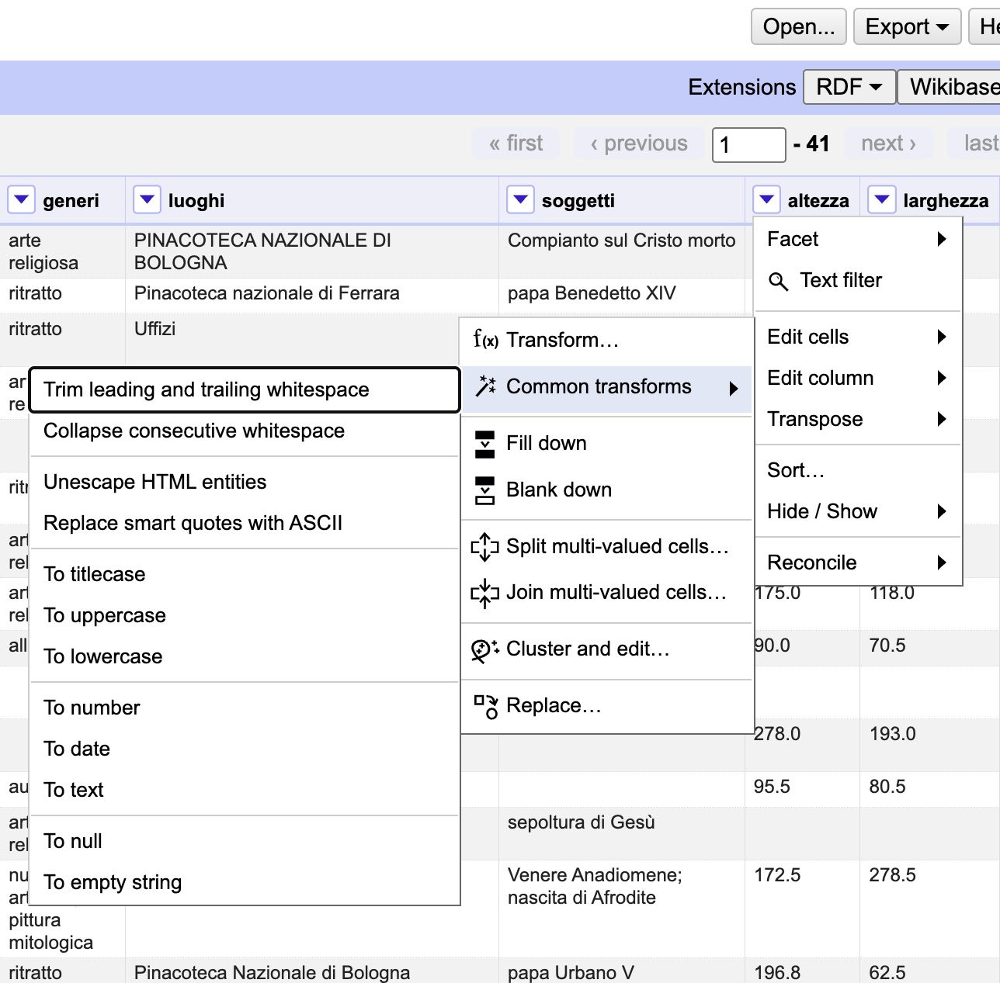

### Transformations

Con OpenRefine è possibile applicare una correzione o una modifica specifica a un'intera colonna o anche a determinati valori corrispondenti in una sola volta.

- Rimuovere gli spazi all'inizio e alla fine di ogni valore.
- Convertire il testo in numeri.
- Sostituire ogni virgola decimale con un punto.

In questo modo è più facile garantire la coerenza!

---

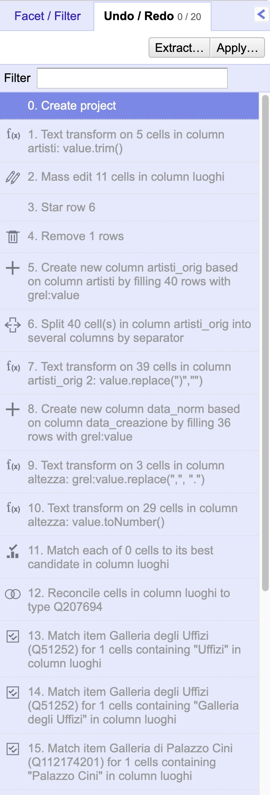

### A history of every step

OpenRefine è in grado di salvare tutte le operazioni effettuate all’interno di un progetto e permettere di annullare o ripetere ogni singolo passaggio.

- Ogni operazione viene **registrata**.
- Ogni operazione può essere **annullata** o **ripetuta**.
- L'elenco completo delle azioni può essere **copiato** e applicato a un'altra tabella o a un altro progetto.

Si tratta di una forma automatizzata di documentazione, a cui potete fare riferimento nella vostra, così più facile ricordare tutto quello che avete fatto 😉

---

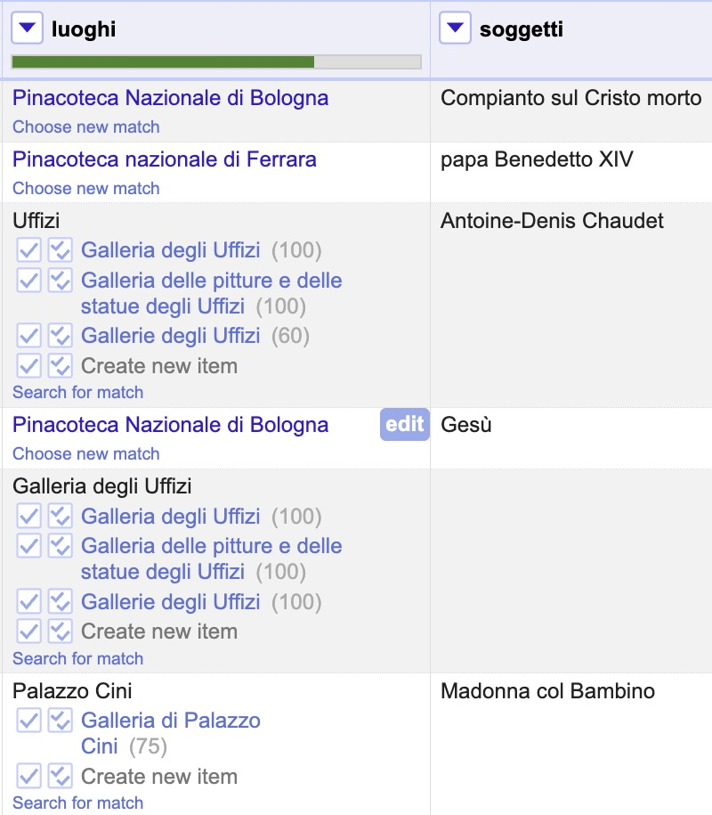

### Reconciliation

OpenRefine può collegarsi a database esterni, come Wikidata, per consentirvi di **allineare** i vostri dati con i loro.

Può essere utilizzato per allineare i dati a uno specifico controllo di autorità o per creare collegamenti con altri database. Una volta stabilito il collegamento, si può importare ulteriori dati nella tabella, come identificatori o determinati attributi.

Il sistema propone delle corrispondenze, ma potete sempre accettarle o sceglierne di diverse (è una questione di giudizio!). Questo è un modo per automatizzare il collegamento ai controlli di autorità su un'intera colonna.

---

<!-- _class: impact -->

###### Part 5
# cleaning for your **prototype**
## (what to do with all this for the exam)

---

<!-- _footer: Image: Unsplash. <a href="https://unsplash.com/photos/a-couple-of-people-that-are-walking-in-the-snow-vPELwOokLJE" target="_blank">Source</a>. -->

### It's actually not that complicated!

Come abbiamo visto a partire dalla Lezione 05, parte di ciò che dovrete fare per l’esame consiste nel creare dati e metadati seguendo un modello.

I dati che creerete verranno poi combinati con i templates relativi al percorso che sceglierete per creare una 'versione finale' (verranno unite due tabelle).

Questa tabella finale verrà utilizzata per alimentare i siti web relativi al percorso scelto e per la vostra analisi personale, basata sulle vostre domande di ricerca.

---

### Recap Lessons 05-08

La tabella dei metadati (<a href="https://laurentfintoni.github.io/dh-ravenna-26-27/lessons/05/20261119-metadata.html" target="_blank">lezione 05</a>) serve a spiegare come 'funziona' la tabella dei dati (secondo il modello). Quindi è in essenza il vostro schema. Non ha bisogno di essere pulita! La tabella dei dati, invece, ha (forse, probabilmente) bisogno di essere pulita e dovrebbe contenere quanto segue:
- Ogni riga deve avere un **identificatore**, quindi una chiave primaria (<a href="https://laurentfintoni.github.io/dh-ravenna-26-27/lessons/06/20261123-modelling.html" target="_blank">lezione 06</a>).
- Gli attributi dei vostri dati (nomi delle colonne) dovrebbero essere mappati secondo gli standard esistenti (nella tabella dei metadati), ove applicabile (lezione 05).
- Ogni valore segue **una regola** indicata nella tabella dei metadati (lezione 06). Ciò include i valori vuoti, come abbiamo visto oggi (regola documentata separatamente).
- Almeno **una colonna** contiene identificatori di autorità per un'entità nel proprio modello (<a href="https://laurentfintoni.github.io/dh-ravenna-26-27/lessons/07/20261126-lod.html" target="_blank">lezione 07</a>).

Il processo di pulizia può avvenire in diverse fasi, ma il momento più logico è quando si dispone di un modello funzionante e di una tabella dati in cui inserire i dati e iniziare la pulizia/valutazione.

---

### Keep track (document!)

Nel repository GitHub che mi inviate per l'esame dovrebbero essere presenti i seguenti elementi (ne riparleremo più nel dettaglio alla fine del corso):
- diagramma E/R (immagine);
- tabella dei metadati (csv);
- tabella dei dati vostra, versione originale (final_final_v3 😉) + versione pulita (csv);
- tabella dei dati utilizzata dal prototipo (una sola versione) per la quale potrebbe essere necessario un altro processo di pulizia seconda delle esigenze del progetto (csv);
- documentazione delle varie fasi e delle scelte che effettuate lungo il percorso (file Markdown).

Alla fine del corso esamineremo le convenzioni di nomenclatura per questi file; potete utilizzare qualsiasi sistema, l’importante è essere coerente!

**campi** (lezione 05) → **modello** (lezione 06) → **vocabolari** (lezione 07) → **CSV pulito** (oggi)

---

<!-- _paginate: false -->

# DH & Data Management per i Beni Culturali (2026/2027)

## 08. Data Cleaning ✅

### Thank you 🙏🏻
